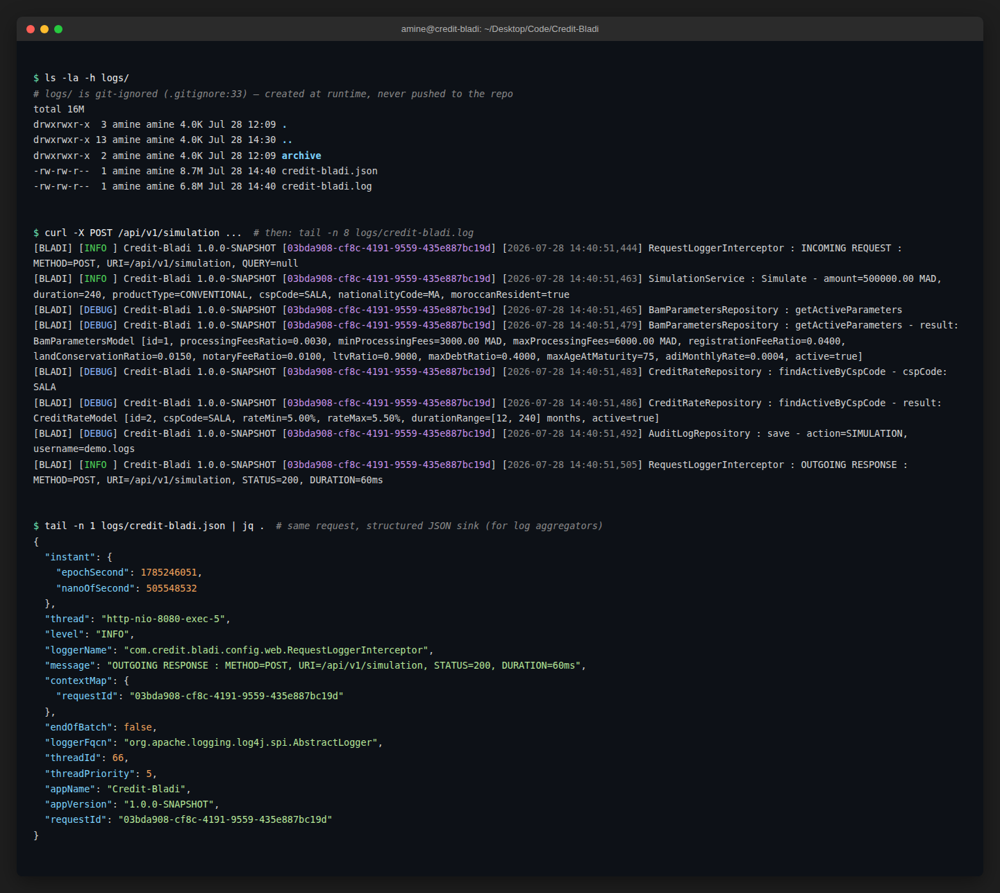
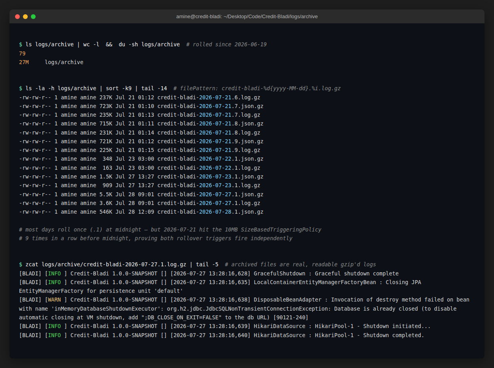

# Credit Bladi


Moroccan mortgage credit simulator built with Spring Boot 4, compliant with Bank Al-Maghrib (BAM) regulatory rules.

## Table of Contents

- [Overview](#overview)
- [Simulation Workflow & Business Domain](docs/business-workflow.md)
- [Tech Stack](#tech-stack)
- [Documentation](#documentation)
- [Getting Started](#getting-started)
  - [Prerequisites](#prerequisites)
  - [Environment variables](#environment-variables)
  - [Run locally (dev profile: H2 in-memory)](#run-locally-dev-profile-h2-in-memory)
  - [Quick launcher script](#quick-launcher-script)
  - [Swagger UI](#swagger-ui)
  - [H2 Console (dev only)](#h2-console-dev-only)
  - [Logging](#logging)
- [Configuration Profiles](#configuration-profiles)
  - [Required environment variables](#required-environment-variables)
- [Security Model](#security-model)
  - [Token expiration defaults](#token-expiration-defaults)
- [Contributing](#contributing)
- [License](#license)
- [Contact](#contact)

## Overview

Credit Bladi computes mortgage loan simulations for two financing products: a **Conventional**
interest-based mortgage and a **Mourabaha** (Sharia-compliant, participative) financing. Pricing
depends on the applicant's professional status. Each professional category (employee, civil
servant, freelancer, professional, retired) has its own BAM-regulated rate calculation strategy for
Conventional loans; Mourabaha financing applies a single bank-wide profit margin and VAT rate
regardless of profile. BAM parameters, credit rates, and Mourabaha parameters are stored in the
database and cached in-process.

For the full business explanation (the 4 eligibility checks, CSP profiles, who can do what), see
[Simulation Workflow & Business Domain](docs/business-workflow.md).

## Tech Stack

| Layer | Technology |
|---|---|
| Runtime | Java 25, Spring Boot 4.0.6 |
| Security | Spring Security, JJWT 0.12.6 (JWT in HttpOnly cookies) |
| Persistence | Spring Data JPA, Liquibase, H2 (dev) |
| Cache | Caffeine (30-min TTL) |
| API Docs | SpringDoc OpenAPI 3.0.2 |
| Tests | JUnit 5, Mockito, Karate BDD, Gatling |
| Code Style | Checkstyle (Google Java Style) |

## Documentation

Detailed docs live in [`docs/`](docs/):

| Doc | Covers |
|---|---|
| [Simulation Workflow & Business Domain](docs/business-workflow.md) | What a simulation is, the two financing products, the 4 eligibility checks, CSP profiles, who can do what |
| [Architecture & Design Patterns](docs/architecture.md) | Layered architecture, real package tree, Domain-Driven Design, the 12 GoF/PoEAA patterns used |
| [API Reference](docs/api.md) | Endpoint table, access levels, error handling / exception hierarchy |
| [Testing & Quality Reports](docs/testing.md) | How to run each test suite, reference results, and annotated screenshots of the JaCoCo, Karate, Gatling, Dependency-Check, ZAP and Swagger reports |

## Getting Started

### Prerequisites

- Java 25
- Maven 3.9+

### Environment variables

Copy `.env.template` to `.env.local` (gitignored, never committed) and fill in real values:

```bash
cp .env.template .env.local
```

Spring loads `.env` then `.env.local` automatically at startup (`spring.config.import` in
`application.properties`); no extra dependency, no need to `export` anything manually.
`.env.local` overrides `.env` if both exist.

### Run locally (dev profile: H2 in-memory)

```bash
./mvnw spring-boot:run -Dspring-boot.run.profiles=dev
```

The application starts on `http://localhost:8080`.

### Quick launcher script

`./run-tests.sh` is an interactive menu that wraps all of the above: the fastest way to get
started without memorizing Maven flags:

```bash
./run-tests.sh
```

| Option | Does |
|---|---|
| 1 | Unit tests (JUnit/Mockito), no app needed |
| 2 | Karate integration tests, starts the app automatically |
| 3 | Gatling performance tests, asks to auto-start the app if it's not already running |
| 4 | Karate then Gatling, back to back |
| 5 | Checkstyle (Google Java Style) |
| 6 | Start the app in **dev** mode (H2, Swagger, DEBUG logs) |
| 7 | Start the app in dev mode with remote debug open on port 5005 |
| 8 | OWASP Dependency-Check (SCA scan) |
| 9 | OWASP ZAP (DAST scan, requires Docker + the app running) |

Option **6** is the one-command equivalent of the `./mvnw spring-boot:run` command above. Reference
results and annotated screenshots for every option above are in [Testing & Quality
Reports](docs/testing.md).

### Swagger UI

```
http://localhost:8080/swagger/credit-bladi/v3/swagger-ui.html
```

### H2 Console (dev only)

```
http://localhost:8080/h2-console
JDBC URL : jdbc:h2:mem:bladidb
Username : sa
Password : (empty)
```

### Logging

Configured in `src/main/resources/log4j2-spring.xml`. Every request is logged to **three**
sinks at once:

| Sink | Location | Format |
|---|---|---|
| Console | stdout | human-readable, same pattern as the file sink |
| File | `logs/credit-bladi.log` | human-readable text, one line per event |
| JSON file | `logs/credit-bladi.json` | structured JSON, one line per event, for log aggregators (ELK, Loki, etc.) |

`logs/` is created at runtime and is git-ignored (`.gitignore:33`), so it never gets pushed and
nothing under it shows up in the repo for a new developer. Both files roll over daily or at 10 MB,
whichever comes first, and are gzip-archived to `logs/archive/` (kept up to 90 rotations).

Every log line belonging to the same HTTP request carries the same `requestId` (propagated via
MDC by `RequestContextInterceptor`), so `grep <requestId> logs/credit-bladi.log` reconstructs the
full request lifecycle (request in, internal repository/service calls, audit trail, response out)
across `INFO` and `DEBUG` lines alike. The root logger defaults to `INFO`; `com.credit.bladi` to
`DEBUG` (both overridable via `logging.level.root` / `logging.level.com.credit.bladi`).

Demonstration below: `ls -la logs/`, then a real `POST /api/v1/simulation` call traced end-to-end
through both the plain-text and JSON sinks via its `requestId`:



Archived rotations, one gzip pair (`.log.gz` + `.json.gz`) per day at midnight, or more often if a
day's traffic hits the 10 MB size trigger first: 79 files / 27 MB accumulated since 2026-06-19 in
this environment:



## Configuration Profiles

| Profile | Database | JWT Secret | Swagger |
|---|---|---|---|
| `dev` | H2 in-memory | `JWT_SECRET` (from `.env`/`.env.local`) | Public |
| `staging` | Env vars required | `JWT_SECRET` env var | Public (`swagger.public=true`, test environment only) |
| `prod` | Env vars required | `JWT_SECRET` env var | Restricted |

No profile ships a hardcoded secret: the app refuses to start if `JWT_SECRET` is missing.

### Required environment variables

```
JWT_SECRET             # all profiles, see .env.template, generate with: openssl rand -base64 32
DB_URL                 # staging/prod
DB_USERNAME            # staging/prod
DB_PASSWORD            # staging/prod
CORS_ALLOWED_ORIGIN    # prod
```

## Security Model

- JWT access token stored in an **HttpOnly cookie** (not localStorage, XSS safe)
- Refresh token rotated on every use
- Revoked tokens persisted in database (blacklist on logout)
- Stateless Spring Security session (`SessionCreationPolicy.STATELESS`)
- CORS restricted to `security.cors.allowed-origin`
- Rate limiting filter applied globally

### Token expiration defaults

| Token | Default | Prod override |
|---|---|---|
| Access token | 24 hours | Set shorter via `security.jwt.expiration-ms` |
| Refresh token | 7 days | Set via `security.jwt.refresh-expiration-ms` |

## Contributing

Contributions are welcome. See [CONTRIBUTING.md](CONTRIBUTING.md) for the branching workflow, the
tests to run before opening a pull request, and the code style enforced by Checkstyle. This
project follows the [Contributor Covenant](CODE_OF_CONDUCT.md).

## License

Licensed under the [Apache License, Version 2.0](LICENSE).

## Contact

**Amine Louzi** (louzi.amine.pro.pro@gmail.com)
