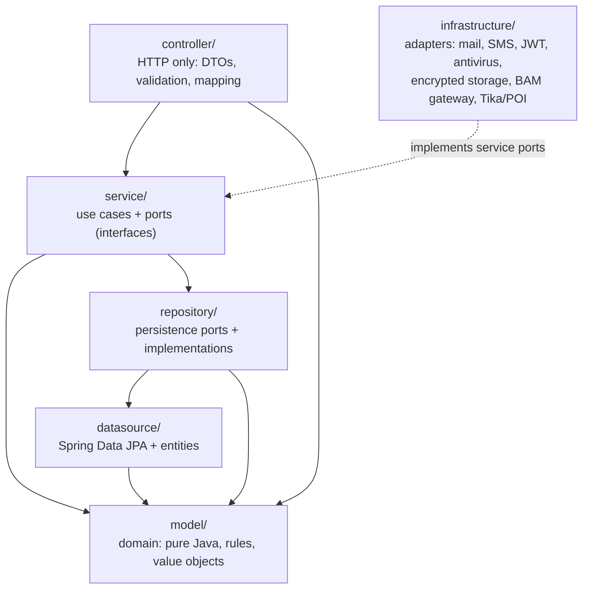

[Back to README](../README.md) · [Glossary](glossary.md) · [Architecture at a Glance](c4-architecture.md)

# Architecture

## Layers and dependency rule

- **`model/` depends on nothing** (no Spring, no JPA): business rules live there.
- **`service/` never imports `infrastructure/`, `datasource/` or `controller/`**, nor HTTP, mail, JWT,
  Tika/POI or Spring DAO types. It talks to the outside world through ports it owns (`DocumentStorage`,
  `AntivirusScanner`, `ISmsGateway`, `IInvitationMailer`, `ITokenService`, `FileContentInspector`,
  `IBamVerificationGateway`, `NotificationChannel`…), implemented in `infrastructure/`.
- **`controller/` never touches `repository/` or `datasource/`.** Uploaded files are converted to a
  domain `UploadedFile` before reaching a service.
- Repositories translate persistence errors (a unique-key violation becomes `DuplicateEntryException`).
- **These rules are executable.** `unittest/architecture/ArchitectureTest` (ArchUnit) fails the build when
  a class breaks them: model → only `model`/`exception`/JDK; services never see controllers, datasources,
  infrastructure, Spring Batch, JPA or the servlet API; repositories never reach up into services;
  controllers never reach persistence; no field injection. Spring Batch is reached through the
  `IDemandImportJobLauncher` port (adapter: `batch/demand/SpringBatchDemandImportJobLauncher`).

## Transaction boundaries

One rule: **the transaction is the use case**. `@Transactional` sits on public service methods only, 
never on controllers or datasources. In `repository/` it appears for two reasons only: a write that must
deliberately escape its caller's transaction (`REQUIRES_NEW`, table below), or a guard. Every write on the
dossier pipeline (`WorkflowRepository`) and on money (`InstallmentRepository`, `CreditFileRepository`,
`PaymentRepository`, `EarlyRepaymentRepository`) is `@Transactional(propagation = MANDATORY)`: it never
opens a transaction, it fails fast with `IllegalTransactionStateException` if a caller forgot one.

Slow I/O stays outside transactions: a document upload is **inspected** first with no transaction open
(size, real content type, SHA-256, ClamAV scan over the network: `IDocumentService#inspect`), then
**recorded** in a short transaction (`TransactionTemplate`: encrypted file, row, supersede, audit, and for a
client upload the fulfilled document request: `IDocumentService#record` is `MANDATORY`).

| Where | Annotation | Why |
|---|---|---|
| Service command (advance, classify, patch a grid, validate a payment...) | `@Transactional` | All writes of the use case commit or roll back together (e.g. a grid above the TMIC is refused and nothing is saved) |
| Service query | `@Transactional(readOnly = true)` | One consistent snapshot across several queries, no Hibernate dirty checking / flush |
| `AuditLogWriter#writeWithOperation` (mandatory actions: credit decisions, payments, parameters, roles, grade/team changes, assignments, RIBs, early repayments) | `@Transactional` (joins the caller) | **Atomic with the operation**: the entry commits only if the decision commits, and a failed audit write rolls the decision back: the trail never shows something that did not happen |
| `AuditLogWriter#writeIndependently` (every other action) | `REQUIRES_NEW` | The trail of a refused or failed attempt (simulation rejected, login, infected file) survives the rollback, and a failed audit write never breaks the operation |
| `NotificationRepository#save` | `REQUIRES_NEW` | Called after commit, when there is no live transaction left to join |
| `RefreshTokenRepository#revokeAllForUser` | `REQUIRES_NEW` | On refresh-token reuse every session is revoked, and that must stick even though the request then fails with `401` |
| `DemandImportRepository#recordRowError` | `REQUIRES_NEW` | A rejected Excel row is recorded even if the batch chunk rolls back |
| `ClientInvitationService#createInvitation` | `REQUIRES_NEW` | On PostgreSQL a unique-constraint hit poisons the whole transaction; isolating it keeps the classification that triggered it (a duplicate marks only this transaction rollback-only and returns quietly) |
| `CreditFileService#openCreditFile` | `@Transactional`, called from `@TransactionalEventListener(BEFORE_COMMIT)` | Completing a demand and opening its credit file are one atomic unit: if the schedule can't be created the completion rolls back, so a "completed" dossier always has its credit file |
| `OverdueInstallmentProcessor#process` | `REQUIRES_NEW` | The daily reminder job commits installment by installment: one failure never undoes the others, and the reminder is sent only after its "reminded at" is committed |

Exceptions and rollback: every business exception extends `ApiException` (unchecked), so Spring rolls the
use case back without any `rollbackFor`. Checked exceptions from libraries are converted at the adapter
boundary (`UncheckedIOException`, `IllegalStateException`) when the operation must fail (document storage,
encryption, import file, BAM gateway), or deliberately absorbed when they only concern a best-effort side
effect that already runs outside the transaction (SMS, SSE push, file cleanup). A `catch` never swallows an
exception thrown by a transactional bean inside the same transaction (that would end in
`UnexpectedRollbackException`): isolated work is its own `REQUIRES_NEW` bean and is caught outside it, or it
marks its own transaction rollback-only explicitly.

Isolation: every money movement on a credit file (declare, validate or reject a payment, early repayment)
first locks the credit file row (`ICreditFileRepository#findByDemandIdForUpdate`, `PESSIMISTIC_WRITE`), and every
workflow decision locks the demand (`IWorkflowRepository#lockDemand`), so concurrent requests on the same file run
one after the other on fresh data; single-row state changes are conditional `UPDATE … WHERE status = …` and
entities carry `@Version`.

Proxy rules this relies on: annotated methods are `public`, never `final`, and never called through
`this` when their propagation differs from the caller's (that is why the reminder step is its own bean).
Scheduled jobs run on the business zone (`zone = "Africa/Casablanca"`) with overridable crons
(`scheduler.payment-reminder.cron`, `scheduler.token-cleanup.cron`).

## Package map

**11 top-level packages** (count the sources with `find src/main/java/com/credit/bladi -name "*.java" | wc -l`):

| Package | Holds |
|---|---|
| `controller/` | REST controllers (`I*Controller` = Swagger contract), `dto/` records, `mapper/` per feature. `mortgage/` and `investment/` are the two public simulations; `client/` is the Enterprise record and the client portal (`/api/v1/me/...`); `enterprise/` is the client↔Enterprise access link (see [Package boundary notes](#package-boundary-notes)) |
| `service/workflow/` | The instruction pipeline, split by subject: see [Package boundary notes](#package-boundary-notes) |
| `service/servicing/` | After the decision: `CreditFileService` (schedule, payments, late interest, closure), `EarlyRepaymentService` + `EarlyRepaymentCalculator`; `CreditFileEventListener` reacts to a completed demand (the main coupling point to `workflow`; a few read-side dependencies on workflow models remain) |
| `service/mortgage/`, `service/investment/` | Each product's pricing, eligibility and strategies (`FinancingCalculationStrategy`: Conventional vs Mourabaha) |
| `service/calculation/` | Shared financial engines: `RateCalculationEngine` (monthly payment, amortization), `TaegCalculationEngine` |
| `service/importdemand/` | Bulk Excel import job control |
| `service/notification/` | `NotificationService` fan-out, channels (`InAppNotificationChannel`, `SmsNotificationChannel` here; `EmailNotificationChannel`, `SseNotificationChannel` in `infrastructure/notification`), `DemandContactNotifier`, `AfterCommitNotifications`, `NotificationTexts` |
| `service/enterprise/`, `service/invitation/`, `service/client/` | Client portal access links, email invitations, Enterprise records |
| `service/bamparameters/`, `mourabahaparameters/`, `creditrate/`, `parameters/` | Versioned, audited regulatory parameters (`AbstractVersionedParametersService`) |
| `service/audit/`, `security/`, `file/`, `verification/`, `auth/`, `user/`, `reference/`, `sector/`, `documentsuggestion/` | Audit trail, client access guard, file-inspection port, BAM verification port, authentication, staff accounts, reference data |
| `infrastructure/` | Adapters: `mail/`, `sms/`, `notification/` (email, SSE), `security/` (JWT), `antivirus/` (ClamAV), `storage/` (AES-256-GCM documents), `bam/` (mock/real BAM gateways), `file/` (Tika/POI) |
| `batch/` | Generic Spring Batch Excel importer (`excel/`, `config/`) + the demand import job (`demand/`) |
| `repository/`, `datasource/` | Persistence ports/implementations; Spring Data interfaces, JPA entities and entity mappers |
| `model/` | Domain models, `vo/` value objects (`Money`, `Rate`, `Ratio`, `Rib`, `DurationRange`, `AmortizationRow`), enums, events |
| `config/` | Security, cache, scheduler, web, i18n, `time/` (business clock), `servicing/` and `regulatory/` (payment beneficiary, servicing and regulatory policies) |
| `exception/`, `validator/`, `common/` | Exception hierarchy + `@RestControllerAdvice`; Bean Validation rules; small shared helpers (`CreditPage`, `EnumParsers`, `MergeSupport`, `PiiMasker`) |

## Package boundary notes

A few package names look interchangeable but aren't. The plain-language version (for non-developers)
is in the [Glossary: naming traps](glossary.md#naming-traps); the
developer-only details are below.

**"Enterprise" means three things.** The **investment credit** product is `controller.investment` /
`InvestmentCreditService` / `/api/v1/investment-credit`, but its demand type and detail table are
`DemandType.ENTERPRISE` / `EnterpriseDemandDetail` / `enterprise_demand_detail`. The **company record**
(`EnterpriseModel`) lives under `client`. The **portal access link** (`EnterpriseUserLinkController`)
lives under `enterprise`. Frontend: `pages/investment-credit`, `pages/admin/investment-credit-parameters`.
Renaming `DemandType.ENTERPRISE` → `INVESTMENT` and swapping the `client`/`enterprise` packages would
resolve it, but it is a cross-cutting rename (entity, table, every layer) tracked as a follow-up.

**`controller.mortgage`** backs `POST /api/v1/mortgage-credit`; calculation internals live in
`service.mortgage.conventional`, `.mourabaha`, `.strategy`. Types it uses but doesn't own:
`AmortizationRow` (`model/vo`, shared by every product), `CreditRateModel` (`model/creditrate`, owned by
the rate-grid feature), `RateCalculationEngine`/`TaegCalculationEngine` (`service/calculation`, shared).

**`service.workflow`: the credit instruction pipeline, up to the decision.** It drives a demand from
creation through classification, the configured steps (instruction, risk analysis…), the committee
decision (approved / refused / deferred) and completion. The steps themselves are **data**
(`workflow`/`process`/`step` tables), not code: the engine only knows "next step" and the flags a step
carries (required grade/team, classification, insurance confirmation, four-eyes, contact notification).
It is split by subject:

| Sub-package | Holds |
|---|---|
| `service.workflow.engine` | `WorkflowEngineService`/`IWorkflowEngineService` (the commands: open from simulation, classify, advance/return/refuse, assign), `DemandTimelineService`/`IDemandTimelineService` (the dossier's timeline: step history, pipeline view, assignment history, comments) and `WorkflowNotifications` (every pipeline message, sent after commit). Persistence is split the same way: `IWorkflowRepository` (demand + steps), `IDemandDocumentRepository`, `IDemandCommentRepository` |
| `service.workflow.access` | `StepAssignmentPolicy`: who may act on a step (grade/team, assignee), hand-off rules, four-eyes, legal rate ceiling |
| `service.workflow.product` | Per-`DemandType` strategies behind the generic `DemandTypeRegistry` (startup fails if a type has no strategy): `WorkflowCodeResolver` (which pipeline), `DemandEligibilityValidator` (regulatory ratios when terms change: the same rules as the simulation), `DemandAmortizationProvider` (schedule) |
| `service.workflow.document` | Demand documents: upload/download (`DocumentService`), document requests to the client (`DocumentRequestService`), and the `DocumentStorage`/`AntivirusScanner` ports (adapters in `infrastructure`) |

What is deliberately **not** in `service.workflow`:
- **After the decision**: credit file, installments, payments, late interest, early repayment:
  `service.servicing`.
- **Bulk Excel import** of demands: `service.importdemand`.
- **Financial calculations** (monthly payment, amortization, TAEG): `service.calculation`.

**Smaller traps:**
- `service.bamparameters` / `service.mourabahaparameters` are the only layer that suffixes those two
  contexts with "parameters"; every other layer says `bam` / `mourabaha`.
- `DemandDetailStore` (`EnterpriseDemandDetailStore`, `MortgageDemandDetailStore`) is a third
  persistence naming pattern beside `*Datasource`/`*Repository`: the product-specific demand detail is a
  polymorphic strategy dispatched by `DemandType`, not a plain CRUD table. Extend it for a new demand
  type, not `I<Feature>Repository`.
- `KeepOrManualOption` is named after the form widget; the business concept is the committee keeping or
  overriding the computed terms.
- The mock BAM/SCIP gateway is exposed at `/api/v1/mock/verification-bam`; rename or hide it once a real
  integration replaces `MockBamVerificationGateway`.

## Design notes

Code in `src/main` carries no comments; the reasons behind non-obvious choices are kept here.

- **`IsoCountryCodeValidator` only judges well-formed codes.** A wrong shape is left to the field's
  `@Pattern`, so one precise violation is reported (format error *or* unknown country), never two.
- **Steps without a required profile** (the `MORTGAGE_RETAIL` steps have no grade or team): any staff member
  can be proposed as assignee (`StepAssignmentPolicy.eligibleAssignees`), but once a step is assigned only its
  assignee may act on it or hand it over, and a four-eyes step cannot be handed to someone who closed an earlier
  step.
- **Enterprise-link notifications go off the request thread** (`EnterpriseLinkStatusChangedListener`): a
  client claim notifies every staff member, and the client must not wait for one e-mail/SMS per recipient.
  Workflow notifications do the same through `AfterCommitNotifications` and `notificationTaskExecutor`.
- **Import "read" count adds read-skips back** (`SpringBatchDemandImportJobLauncher`): Spring Batch keeps
  rows rejected while reading out of `getReadCount()`, so "read" = created + skipped = every row of the file.

## Domain-Driven Design

The `model/` package is a **rich domain model**: business rules live inside the objects they protect,
not re-implemented in services against getters/setters.

| DDD Concept | Where | What it means here |
|---|---|---|
| Rich Domain Model | `BamParametersModel`, `InvestmentCreditParametersModel` | Regulatory checks (`assertWithinLtv`, `assertWithinDebtRatio`, `assertEligibleAge`, `assertWithinFinancingRatio`…) are methods on the model, used by both the simulation and the workflow re-check |
| Aggregate root | `model/workflow/Demand` | The demand and its open step form one aggregate. `IWorkflowRepository.findForUpdate` loads it under a row lock, the engine calls intention-revealing methods (`advance`, `refuse`, `classifyAsReal`, `classifyAsNotReal`, `reassign`, `refreshFromSimulation`) that check the invariants (open demand, classification first, deferral only backwards, one closure per step) and record `DemandChange` events; `IWorkflowRepository.save` applies them in one transaction. The workflow *definition* (steps, order) is a separate aggregate referenced by id, so step navigation stays in the engine |
| Aggregate with guarded transitions | `InstallmentModel` (`declare`, `validate`, `reject`), `DemandModel` (`status`, `assertOpen`), `CreditFileModel` (`isActive`) | An illegal transition (validating an undeclared installment, advancing a closed demand) is refused by the model itself; persistence then applies it atomically |
| Entity vs value equality | Entities (`User`, `BamParametersModel`, `CreditRateModel`, `MourabahaParametersModel`, `InvestmentCreditParametersModel`, `AuditLogModel`) are immutable final classes (final fields, no setters, built by a `Builder`) that compare **by id**; value objects are records that compare **by value** | A record would silently turn an entity into a value; that is why these stay classes |
| Decision rules on the domain | `StepClosureDetails` (`rateDecision`, `amountDecision`, `durationDecision`, `isRefusal`, `isDeferralMovingForward`, `overridesTerms`) | What a step closure means is decided in the model, not in the engine |
| Value Object | `model/vo/Money`, `Rate`, `Ratio`, `Rib`, `DurationRange` | Immutable, self-validating records (`Money` rejects negatives; `Rib` checks the Moroccan mod-97 key and never echoes the value in errors) |
| Polymorphic Value Object (sealed interface) | `DemandDetail` (`permits EnterpriseDemandDetail, MortgageDemandDetail`), `DemandSnapshotDetail` | Exhaustive `switch` everywhere: a third demand type that isn't handled fails to compile |
| Domain policies as values | `LateInterestPolicy`, `EarlyRepaymentPolicy`, `RegulatoryLimits`, `PaymentBeneficiary` | Contractual/legal parameters built once from configuration and validated at startup |
| Domain Event | `DemandCompletedEvent`, `EnterpriseLinkStatusChangedEvent` | Contexts react to each other through events instead of direct calls. `DemandCompletedEvent` is handled `BEFORE_COMMIT` so the credit file opens in the same transaction; notifications react `AFTER_COMMIT` |

## Design Patterns

| Pattern | Location | Purpose |
|---|---|---|
| Strategy + generic Registry | `service/workflow/product/DemandTypeRegistry` (`WorkflowCodeResolver`, `DemandEligibilityValidator`, `DemandAmortizationProvider` per `DemandType`); `FinancingStrategyFactory` (Conventional vs Mourabaha) | One implementation per product, picked at runtime; the registry fails at startup if a demand type has none or two. Adding a product = adding `@Component`s |
| Ports & Adapters | Ports in `service/` (`DocumentStorage`, `AntivirusScanner`, `ISmsGateway`, `IInvitationMailer`, `ITokenService`, `FileContentInspector`, `IBamVerificationGateway`), adapters in `infrastructure/` | Use cases don't know which library, provider or storage is behind them; swapping a provider is a config change or one new class |
| Data-Driven Formula | `RateFormula` (`MIN`/`MAX`/`AVERAGE`) on `credit_rate` and `enterprise_credit_parameters` | A new CSP profile or enterprise type reusing a formula is a data change, not a class |
| Data-Driven Step Behavior | `step.requires_classification`, `requires_insurance_confirmation`, `requires_four_eyes`, `notify_contact_on_enter_type` (read via `WorkflowStepInfo`) | Any step of any workflow opts into a gate or a client notification by data only; `WorkflowNotifications#stepEntered` maps a `NotificationType` to its text |
| Template Method | `AbstractVersionedParametersService` (BAM, Mourabaha, investment parameters, credit rates); `batch/config/GenericChunkStepFactory` | Shared algorithm (versioned patch + audited diff; fault-tolerant chunk step), product-specific hooks |
| Registry | `batch/config/ImportJobRegistry` (by Spring Batch job name), used only by the `SpringBatchDemandImportJobLauncher` adapter | Resolves a `Job` and its running status instead of wiring one service to one job |
| Factory Method | `exception/*Exception.of(type)` | Maps an enum discriminator to the right `ApiStatus` and i18n key |
| Repository | `repository/` + `datasource/` | Decouples use cases from the ORM |
| Builder | Parameter models, `AuditLogModel`, `User`, credit requests | Safe construction of multi-field immutable domain objects; validation and defaults run once, in the constructor |
| Observer | `NotificationService#notify` → every `NotificationChannel` bean | Adding a channel (Slack, WhatsApp…) is one new `@Component` |
| After-commit side effects | `AfterCommitNotifications`, `@TransactionalEventListener(AFTER_COMMIT)` listeners | No notification for an operation that was rolled back; a failing channel never undoes the operation |
| Adapter | `UserDetailsServiceAdapter`, `SecurityExceptionHandler`, `IsoCountryCodeValidator` | Plugs domain types into Spring Security / Bean Validation SPIs |
| Decorator | `config/web/CachedBodyHttpServletRequest` | Replays a buffered request body |
| Change diff | `VersionedPatchResult`, `*Model#describeChangesFrom`, `AuditChanges` | Field-level before → after captured so the audit trail shows exactly what changed (a diff, not a restorable snapshot) |
| Data Mapper | `controller/*/mapper/`, `datasource/*/mapper/` | Static mappers at every DTO ↔ model ↔ entity boundary |

## Banking / Domain-Critical Patterns

### Implemented

| Pattern | Where | Notes |
|---|---|---|
| Optimistic locking + conditional updates | `@Version` on demand, credit file, installment and parameter entities; installment/link/request transitions as `UPDATE … WHERE status = …` | Two concurrent writers fail loudly (`409`) instead of overwriting each other |
| Pessimistic lock on the dossier | `IWorkflowRepository#lockDemand` in `advance`, `classify`, `assign`; `ICreditFileRepository#findByDemandIdForUpdate` in payment declare/validate/reject and early repayment | Serializes concurrent decisions and money movements on the same file |
| Soft delete | `@SQLDelete` + `@SQLRestriction` on demand and credit file | Rows are flagged, never removed |
| Maker-checker | Payment declare (client) → validate/reject (manager); link claim → approve/reject | A maker action leaves a state only a checker can resolve |
| Four-eyes / segregation of duties | `StepAssignmentPolicy#assertFourEyes`, `step.requires_four_eyes` (decision steps), `workflow.four-eyes.enabled` | Whoever handled an earlier step cannot take the credit decision alone |
| Committee decision enforcement | `StepClosureDetails#isRefusal` / `#isDeferralMovingForward` | A refused credit never reaches contract or disbursement; an ajourné one can only go back |
| Same rules at simulation and instruction | `FinancingCalculationStrategy#assertEligible`, `InvestmentDemandEligibilityValidator` | Terms changed during instruction are re-checked with the simulation's own rules |
| Legal rate ceiling | `RegulatoryLimits` (`MAX_ANNUAL_RATE`, TMIC; `MAX_RATE_SIMULATION_BASIS` = `NOMINAL` or `TEG`) | Edited rate grids, every decided rate (kept or manual) and every simulation (nominal rate or TEG, as configured) above it are refused; a refused simulation is audited |
| One dossier per person and product | `WorkflowEngineService#openDemandFromSimulation` | A new eligible simulation by the same person (same email + name, same product and workflow) refreshes their dossier while it is still unclassified, same reference, audited `DEMAND_REFRESHED_BY_SIMULATION` with before → after, instead of opening a duplicate. Once classified, a new simulation opens a new dossier |
| Client language | `Language` (fr/en/ar), `app_user.preferred_language`, `demand.contact_language`, `NotificationTexts#render` | Taken from `Accept-Language` at registration, invitation acceptance and simulation; every notification (in-app, email, SMS, invitation emails) is rendered in the recipient's language, falling back to `notification.locale` (French) |
| Agreed terms are frozen | Rate/margin stored on the demand; `AgreedPricing` (table `demand_agreed_pricing`) captured by `AgreedPricingCapture` on `CommitteeDecisionEvent`; `TERMS_FROZEN_AFTER_DECISION` | When the committee approves, the fees, borrower insurance, Mourabaha VAT and takaful in force are frozen and used for the schedule; after the decision step, amount, rate and duration can no longer be changed without returning the dossier to the committee |
| Audit trail | `AuditService` (mandatory entries join the operation's transaction, the others use `REQUIRES_NEW`, see [Transaction boundaries](#transaction-boundaries)), `AuditAction`, `AuditTarget` (`entityType`/`entityPublicId`), `AuditChanges` | Who, what, when, IP, **which dossier/enterprise/user**, and **field-level before → after** (values compared by amount, so `5.50` = `5.500`; a parameter edit or simulation refresh that changes nothing writes no entry). Mandatory for credit decisions, payments, parameters, roles, grade/team changes, step assignments, RIBs and early repayments: if the entry can't be written, the operation rolls back. `GET /audit-log?entityType=DEMAND&entityId=` returns a dossier's full trail |
| Immutable step history | `DemandHistoryEntryModel` | One append-only entry per step with previous/applied terms, outcome, closer |
| Money value objects | `Money`, `Rate`, `Ratio` (`BigDecimal`, `HALF_UP`, `DECIMAL128`); last installment absorbs rounding | No floating point anywhere in money math |
| Moroccan RIB validation | `model/vo/Rib` | 24 digits, mod-97 key; normalized in storage, masked in audit and logs; beneficiary RIB checked at startup |
| Business calendar | `config/time/ClockConfig` (`Africa/Casablanca`), one injected `Clock` everywhere: no `Instant.now()` / `System.currentTimeMillis()` left in `src/main` | Due dates, lateness, audit and record timestamps, token expiry and API error timestamps all follow Moroccan time; testable with `Clock.fixed` |
| Late interest & early repayment | `LateInterestPolicy`, `EarlyRepaymentPolicy` (loi 31-08 cap), `EarlyRepaymentCalculator` | None charged on Mourabaha (participative finance) |
| Encryption at rest | `infrastructure/storage/EncryptedFileDocumentStorage` (AES-256-GCM, filename as AAD) | Key required in staging/prod; legacy clear files still readable |
| CSRF | `CookieTokenHelper` (`HttpOnly`, `SameSite=Strict`, `Secure` outside dev), CORS limited to one origin (`security.cors.allowed-origin`) | Spring's CSRF token is off on purpose: the auth cookies are never sent on a cross-site request, which is the attack CSRF tokens exist to stop |
| PII-safe logging | `common/PiiMasker`, `Rib#masked` | Emails, phones and RIBs are masked in application logs. **Known gap:** some audit entries still record an e-mail address in clear |
| RBAC + ownership (ABAC) | `@PreAuthorize` (CLIENT / MANAGER); grade + team per step; `ClientDemandAccessGuard` on every `/me/**` endpoint | A client can never reach another client's dossier by guessing an id |
| Transaction boundaries | `@Transactional` services; `REQUIRES_NEW` only for non-mandatory audit entries, notifications written after commit, token revocation and batch row errors (credit file opening and mandatory audit join the caller) | Writes that must survive, or run after, the parent transaction |

### Deliberately not implemented

| Pattern | Why not now | Revisit when |
|---|---|---|
| Outbox | Events stay in-process; no broker or outbound webhook needs delivery atomic with the commit | A message broker or third-party webhook is introduced |
| Inbox | No external event consumer | The app consumes external events |
| Saga | Single deployable, no distributed transaction | The system is split into services |
| Circuit breaker / retry / bulkhead | BAM/SCIP and SMS integrations are still mocked | Before wiring real BAM/SCIP or SMS/email providers |
| CQRS / Event sourcing | Read/write load isn't divergent; step history already gives point-in-time business history | Only if read and write scaling genuinely diverge |

## Known limitations

This is an MVP. The points below are known and tracked; they are listed here so the documentation never
claims more than the code does.

| Area | Limitation | Planned direction |
|---|---|---|
| Contract terms | Pricing is frozen at the committee decision, but there is no versioned contract document (offer, signed terms) attached to the dossier | Generate and store the credit offer / contract with its terms |
| Mortgage workflow profiles | The mortgage steps have no required grade/team in the seed data, so any staff member can claim an **unassigned** mortgage step (an assigned one now belongs to its assignee only) | Seed grade/team for the mortgage steps and check the invariant at startup |
| Legal rate ceiling | Simulations are compared on the nominal rate by default; comparing on the TEG (`MAX_RATE_SIMULATION_BASIS=TEG`) awaits the compliance decision on the legal basis | Switch the default once the legal basis is confirmed |
| Anonymous re-simulation | A new simulation with the same name and e-mail refreshes a still-unclassified dossier | Always open a new dossier and flag duplicates at classification |
| Mourabaha | Modelled as a financing with a fixed margin; the purchase/resale sequence (promise, purchase by the bank, sale deed) is not modelled | Model the contractual milestones with a Sharia board |
| Single instance | Cache, SSE connections, rate limiting and scheduled jobs assume one backend instance | Shared cache/rate limiter and job locking before scaling out |
| Personal data (loi 09-08) | The public simulator does not yet show a data-processing notice nor collect consent | Add the notice and an explicit consent checkbox, recorded with the dossier |
| Early repayment | A full early repayment is recorded by a single manager (no second validation) | Maker/checker: a second manager validates before the credit file is closed |
| Load testing | Gatling passes on the `dev` stack (99.7 % success, 95th percentile 216 ms, see [Testing](testing.md)), not yet on a production-sized instance | Re-run Gatling against the prod connection-pool size |
| Layer exceptions | `ApiExceptionHandler` (exception) reads `IRequestContext` (service); `NotificationController` and the dev-only `FakeSmsGatewayController` use `infrastructure` classes directly (see the [dependency graph](dependency-graph.md)) | Move the request context to `common` and put the SSE registry and the fake SMS inbox behind service ports |
