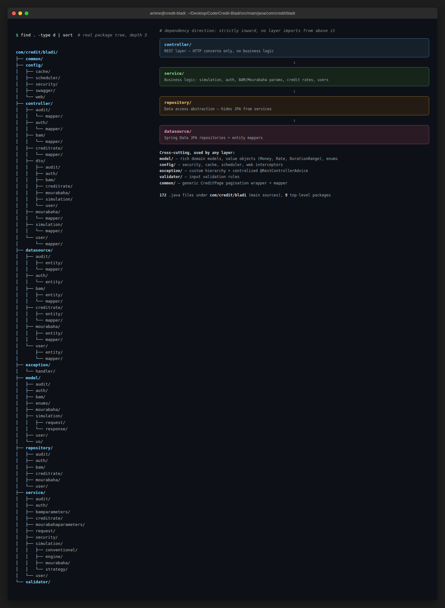

[← Back to README](../README.md)

# Architecture

```
controller/        REST layer, HTTP concerns only, no business logic
service/           Business logic: simulation, auth, BAM/Mourabaha parameters, credit rates, users
  simulation/
    strategy/         Product-level Strategy: FinancingCalculationStrategy (Conventional vs Mourabaha)
    conventional/      Conventional pricing: RateCalculationStrategy + RateStrategyFactory + csp/ (5 profile strategies)
    mourabaha/         Mourabaha pricing: margin/VAT calculation engine
    engine/            Shared rate/TAEG calculation engines
repository/         Data access abstraction, hides JPA from services
datasource/         Spring Data JPA repositories + entity mappers
model/              Domain models, value objects (Money, Rate, DurationRange), enums
config/             Security, cache, scheduler, web interceptors
exception/          Custom exception hierarchy + centralized @RestControllerAdvice
validator/          Input validation rules
common/             Shared cross-cutting types (generic CreditPage pagination wrapper + mapper)
```

Dependency direction is strictly inward: `controller → service → repository → datasource`. No layer imports from a layer above it.

Real package tree (`find src/main/java/com/credit/bladi -type d`, depth 3) next to the layer
dependency flow, so the table above can be checked against the actual code:



## Domain-Driven Design

The `model/` package is a **rich domain model**, not a set of plain DTOs. Business rules live inside the entities and value objects they protect, instead of being re-implemented in services against raw getters/setters.

| DDD Concept | Where | What it means here |
|---|---|---|
| Rich Domain Model | `model/bam/BamParametersModel` | Regulatory checks (`assertWithinLtv`, `assertWithinDebtRatio`, `assertEligibleAge`) are methods on the model itself, not logic duplicated inside a service |
| Business Encapsulation | `model/bam/BamParametersModel`, `model/vo/*` | Fields are private; mutation only happens through a validating `Builder` or compact constructor, so an invalid `BamParametersModel` or `Money` can never exist |
| Value Object | `model/vo/Money`, `Rate`, `Ratio`, `DurationRange` | Immutable, self-validating records (e.g. `Money` rejects negative amounts) exposing domain-meaningful operations (`Money#add`, `#multiply`, `#isGreaterThan`) instead of raw `BigDecimal` values passed around |

This is deliberate: Credit-Bladi owns the mortgage-simulation business rules, so its domain layer should be rich. A pure orchestration/BFF layer with no business rules of its own would correctly keep an anemic `model/` (plain serialization DTOs): different architectural role, both correct for their context.

## Design Patterns

| Pattern | Location | Purpose |
|---|---|---|
| Strategy (two-tier) | `service/simulation/strategy/FinancingCalculationStrategy` (Conventional vs Mourabaha); `service/simulation/conventional/csp/` (5 CSP profile strategies, used only by the Conventional strategy) | Outer strategy picks the pricing engine for the chosen `productType`; the Conventional strategy in turn delegates to a CSP-specific rate strategy; Mourabaha has no inner strategy, since it prices every profile identically |
| Registry / Service Locator | `service/simulation/strategy/FinancingStrategyFactory` (by `ProductType`), `service/simulation/conventional/RateStrategyFactory` (by CSP code) | Indexes the Spring-managed strategy beans for lookup, not a GoF Factory since nothing is constructed on demand |
| Factory Method | `exception/AuthException`, `SimulationException`, `BAMException`, `BamParametersException`, `CreditRateException`, `MourabahaParametersException`, `ValidationException` | Each exception hides its own constructor behind a static `of(type)` that maps an enum discriminator to the right `ApiStatus`/message |
| Repository | `repository/` + `datasource/` | Decouples business logic from ORM |
| Builder | All domain models | Safe construction of complex objects |
| Value Object | `model/vo/`: Money, Rate, DurationRange | Immutable domain primitives with built-in validation |
| Facade | `SimulationService`, `AuthService`, `BamParametersService`, `CreditRateService`, `MourabahaParametersService` | One simple entry point per use case, orchestrating repositories, strategies, calculators and audit logging internally |
| Adapter | `config/security/UserDetailsServiceAdapter`, `SecurityExceptionHandler`, `validator/IsoCountryCodeValidator` | Adapts this app's domain types to third-party SPIs it must plug into (Spring Security's `UserDetailsService`, `AccessDeniedHandler`, Bean Validation's `ConstraintValidator`) |
| Decorator | `config/web/CachedBodyHttpServletRequest` | Wraps `HttpServletRequest` to replay a buffered body, transparent to downstream code |
| Chain of Responsibility | `config/security/JwtAuthFilter`, `RateLimitFilter`, `config/web/CachedBodyRequestFilter`, `RequestContextInterceptor`, `RequestLoggerInterceptor` | Each filter/interceptor independently short-circuits or forwards along an ordered pipeline |
| Template Method | `service/simulation/conventional/RateCalculationStrategy#validateBamConstraints` | Default eligibility step shared by all CSP profiles, overridable per profile, inside a fixed orchestration order in `ConventionalFinancingStrategy` |
| Proxy | `@Cacheable`/`@CacheEvict` on `SimulationRepository`, `BamParametersRepository`; `@Transactional` services | Spring AOP proxies add caching and transaction demarcation transparently around the real bean methods |
| Memento | `model/bam/BamParametersPatchResult`, `BamParametersModel#describeChangesFrom`, `MourabahaParametersModel#describeChangesFrom` | Captures before/after state of a regulatory parameter change so the audit trail can reconstruct exactly what changed |
| Data Mapper (PoEAA, non-GoF) | `controller/*/mapper/`, `datasource/*/mapper/` | Consistent static `toDomain`/`toDTO`/`mapFromEntity`/`mapToEntity` boundary between DTOs, domain models and JPA entities |