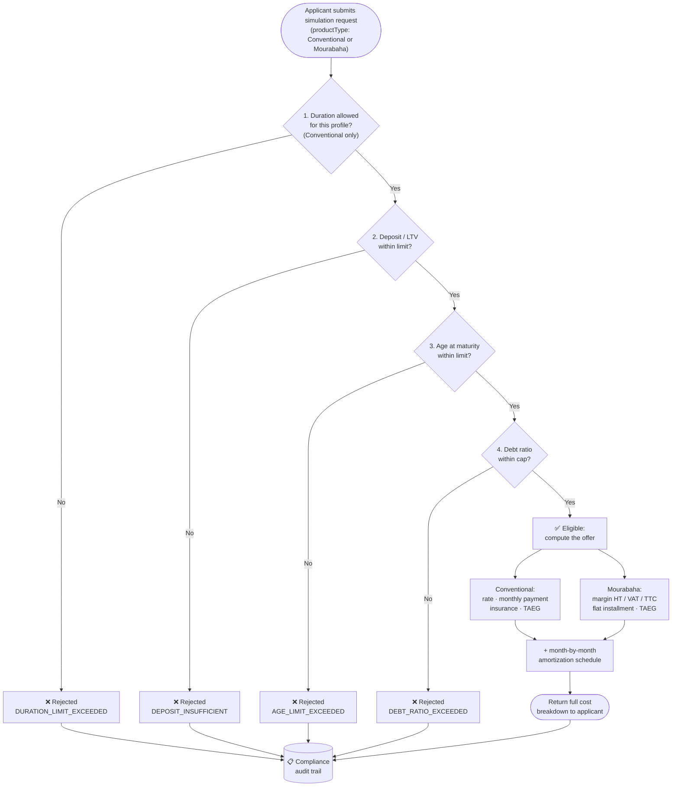
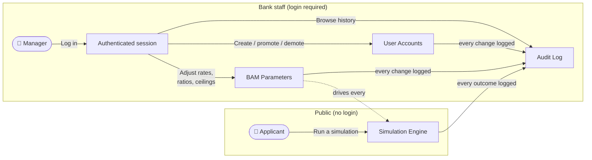

[← Back to README](../README.md)

# Simulation Workflow (Business Process)

This is the core business of Credit Bladi, explained without technical jargon, for Product
Owners, Scrum Masters, and managers who need to understand *what the system does*, not how it's
coded.

## What a "simulation" is

A simulation answers one question for a mortgage applicant: **"If I borrow this amount, under
these conditions, am I eligible, and what will it cost me every month?"**

It happens in a single request/response exchange: the applicant fills in their information once
and immediately gets either a full cost breakdown or a clear rejection reason. No account, no
paperwork, no waiting for a human to review it.

## The two financing products

The applicant picks a product with the `productType` field (defaults to **Conventional** if
omitted); every other field on the request stays the same either way.

| | Conventional | Mourabaha |
|---|---|---|
| What it is | A standard interest-bearing mortgage | A Sharia-compliant financing with no interest (*riba*): the bank finances the purchase and is repaid via a fixed markup instead |
| What the applicant pays | Principal + **interest** | Principal + a fixed **profit margin (Marge HT)** + **VAT on that margin (TVA sur Marge)** |
| Rate depends on applicant profile? | Yes, each professional category (CSP) has its own rate, see [Applicant Profiles](#applicant-profiles-csp) | No, one bank-wide profit rate and VAT rate applies to every applicant, regardless of profile |
| Duration limited by profile? | Yes, each profile has its own min/max duration | No, only the general BAM deposit and age-at-maturity rules apply (see checks 2 and 3 below) |
| Cost breakdown returned | Interest, monthly payment, TAEG | Margin HT, VAT on margin, Margin TTC, flat monthly installment (TTC), TAEG |

Both products go through the same BAM compliance checks and the same audit trail. Only the
pricing math, and the profile-specific duration limit for Conventional, differ.

## Visual workflow: the 4 scenarios

Every simulation follows the same decision path. The first check that fails stops the process
immediately with a specific reason. If all four pass (three for Mourabaha, which skips the
duration check; see the note under the eligibility checks table further down), the applicant gets
a full cost breakdown. Either way, the outcome is always recorded for compliance.

## Step by step

**1. The applicant provides their situation**
- How much they want to borrow (loan amount)
- The value of the property they want to buy
- How long they want to repay (duration, in months)
- Which product they want: Conventional or Mourabaha (see [The two financing
  products](#the-two-financing-products) above; defaults to Conventional)
- Their professional category, see [Applicant Profiles](#applicant-profiles-csp) below
- Their age
- Their nationality and whether they live in Morocco
- Their monthly income (and, if applicable, a co-borrower's income)

**2. The system checks eligibility against Bank Al-Maghrib (BAM) regulation**

Four checks run automatically, in this order. If any one fails, the simulation stops immediately
and returns the specific reason. The applicant is never left guessing:

| # | Check | Plain-language meaning |
|---|---|---|
| 1 | Duration limit | Does this applicant's profile allow a loan this long? (Different professions have different maximum durations, see below.) |
| 2 | Deposit / down payment | Is the applicant borrowing too large a share of the property's value? The bank requires a minimum personal contribution. |
| 3 | Age at maturity | Will the applicant still be under the bank's maximum age at maturity when the loan is fully repaid? This ceiling is a single bank-configured value (age 75 by default) applied identically to every profile, not just retirees: a borrower's income capacity isn't guaranteed past the same age regardless of current employment status. |
| 4 | Debt-to-income ratio | Would the monthly payment (including mandatory insurance, or the flat Mourabaha installment) take up too large a share of the applicant's income? Banks cap this to protect the borrower from over-indebtedness. |

> Check #1 only applies to **Conventional** financing, since only Conventional rates are tied to a
> profile-specific duration range. **Mourabaha** financing skips straight to checks #2–#4. Its
> profit rate and VAT rate are the same for every profile, so there is no per-profile duration
> limit to check.

**3. If eligible, the system computes the offer**

For a **Conventional** loan:
- The **interest rate** that applies to this applicant's profile
- The **monthly payment** (principal + interest)
- The **mandatory insurance premium** (death/disability cover, required by law on every mortgage,
  doubled if there's a co-borrower)
- The **all-in monthly payment** (what actually leaves the applicant's account each month)
- The **total cost** of the loan over its full duration, and the **total interest** paid

For a **Mourabaha** financing:
- The **profit margin excluding VAT (Marge HT)**, the **VAT on that margin (TVA sur Marge)**, and
  the **margin including VAT (Marge TTC)**, which replaces interest entirely
- The **flat monthly installment including VAT** the applicant actually pays each month

Either way:
- The **effective annual rate (TAEG)**: the single number Moroccan regulation requires banks to
  disclose, bundling in all fees so different offers are comparable, whichever product was chosen
- The **one-time fees** due at signing: registration, land conservation, notary, and the bank's
  own processing fee
- A full **month-by-month amortization schedule** (tableau d'amortissement), showing, for every
  installment, how much goes to principal versus interest (Conventional) or margin/VAT
  (Mourabaha), and the remaining balance

**4. Every simulation is recorded**

Whether it succeeds or gets rejected, the event is logged with the reason. This is not optional:
it is the audit trail BAM inspectors and internal compliance review against. A rejected
simulation is just as important to have on record as a successful one, because it proves the
bank's automated system is actually enforcing the regulation, not just approving everything.

## Applicant Profiles (CSP)

The interest rate and eligibility rules depend on the applicant's professional category. This is
the single biggest lever in the whole simulation: the same loan amount can be eligible for one
profile and rejected for another purely because of this field.

| Profile | Who it covers | What's different about it |
|---|---|---|
| Private-sector employee | Salaried employee, private company | Standard terms |
| Civil servant | Government employee | Preferential (lower) interest rate, considered lower risk (stable income) |
| Freelancer / self-employed | Independent professionals, auto-entrepreneurs | Standard terms |
| Liberal profession | Doctors, lawyers, architects, etc. | Standard terms |
| Retired | Pensioners | Fixed rate; subject to the same bank-wide maximum age at maturity as every other profile (see check #3 above) |

This table, and the notion of "profile" driving the rate, only applies to **Conventional**
financing. Mourabaha financing uses one bank-wide profit rate and VAT rate for every applicant,
regardless of professional category (see [The two financing
products](#the-two-financing-products)).

Adding a new profile in the future (e.g. a special rate for a partner program) is a
configuration-level change on the engineering side, not a rebuild of the simulation logic. This
was a deliberate design choice so business can request a new profile without a lengthy dev cycle.

## Who can do what

| Role | Can do |
|---|---|
| **Applicant / public visitor** | Run simulations. No login required: this is the product's front door, it must have zero friction. |
| **Manager (bank staff)** | Everything above, plus: adjust the regulatory parameters (rates, ratios, ceilings) that every simulation uses, create/manage staff accounts, and review the full compliance audit log. |

## Why the regulatory parameters are adjustable, not hardcoded

BAM's rules (maximum debt ratio, minimum deposit, fee ceilings, insurance rate, etc.) are not
fixed in the code. They live in a single configuration a Manager can update through the app.
This matters for the business because:
- BAM can change these thresholds, and the bank must be able to comply the same day, without
  waiting for a new software release
- Every change is tracked (who changed what, from what value to what value, and when); the same
  compliance audit trail mentioned above covers configuration changes, not just simulations

## Professional Categories (CSP Codes)

Applies to **Conventional** financing only. Mourabaha prices every profile identically (see [The
two financing products](#the-two-financing-products)).

| Category | Strategy | Package |
|---|---|---|
| Employee | `EmployeeStrategy` | `service/simulation/conventional/csp/` |
| Civil Servant | `CivilServantStrategy` | `service/simulation/conventional/csp/` |
| Freelancer | `FreelancerStrategy` | `service/simulation/conventional/csp/` |
| Professional | `ProfessionalStrategy` | `service/simulation/conventional/csp/` |
| Retired | `RetiredStrategy` | `service/simulation/conventional/csp/` |

Each strategy applies its own BAM-regulated rate formula. Adding a new category requires implementing `RateCalculationStrategy` and registering it in `RateStrategyFactory`; no existing code changes needed. Adding an entirely new financing product (beyond Conventional/Mourabaha) means implementing `FinancingCalculationStrategy` and registering it in `FinancingStrategyFactory`.