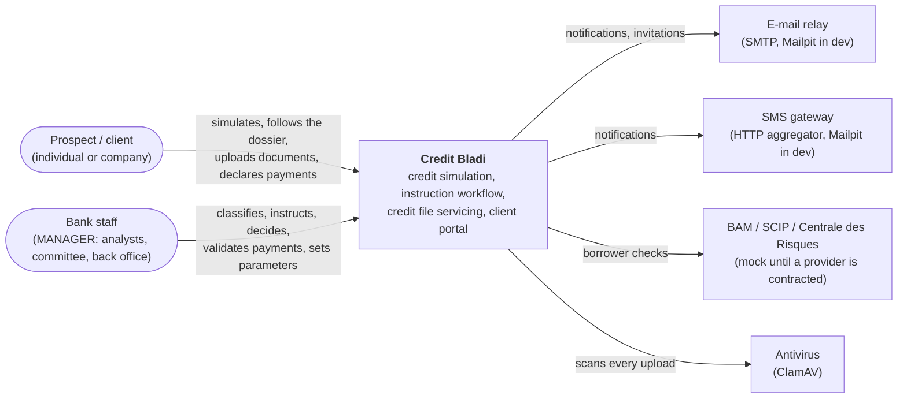
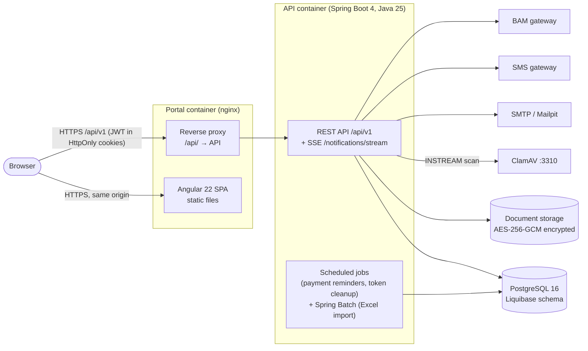
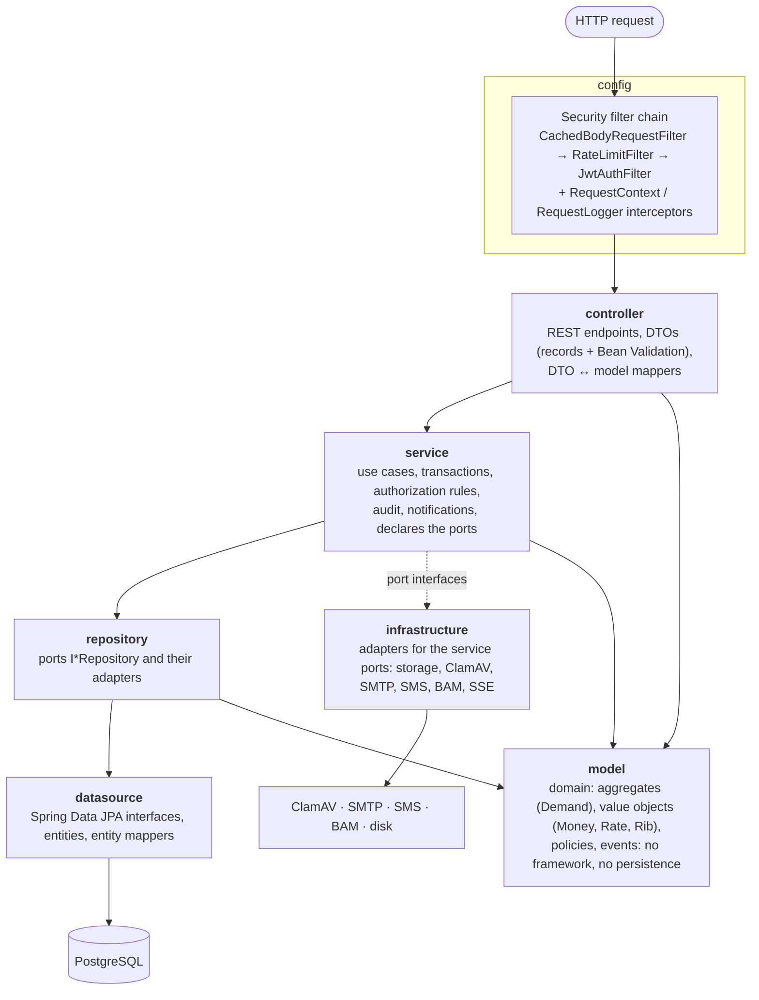
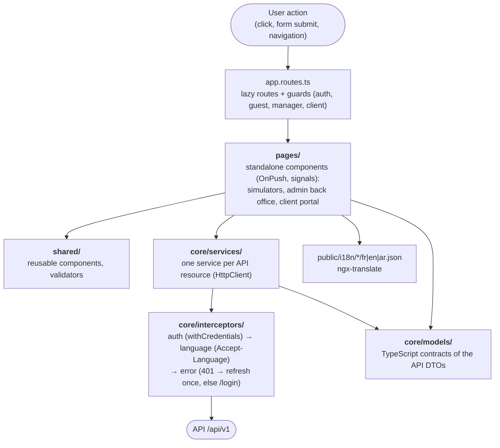

# Architecture at a Glance (C4)

Three zoom levels, from "who uses what" to "which layer calls which". For the step-by-step path of each feature
(click → Angular → API → database → response), see [Feature Flows](flows/README.md).

- Backend code: this repository.
- Frontend code: [---Bladi-Credit-Portal---](https://github.com/LouziAmine/---Bladi-Credit-Portal---).

## Level 1: System context

Who uses Credit Bladi, and which outside systems it talks to.

## Level 2: Containers

What runs, and how the pieces talk to each other.

| Container | Code | Runs as |
|---|---|---|
| Portal | frontend repo, `deploy/nginx/default.conf.template` | `ghcr.io/<owner>/credit-bladi-portal` (nginx, unprivileged) |
| API | this repo | `ghcr.io/<owner>/credit-bladi-api` (JRE 25, unprivileged) |
| PostgreSQL, ClamAV, Mailpit | `docker-compose.yml` | Official images |

In development the SPA runs on `ng serve` (`:4200`) and calls the API directly on `:8080` (CORS allows
`http://localhost:4200`). In production the browser only sees the portal's origin.

## Level 3: Components

### Backend layers

The dependency rule is enforced by [`ArchitectureTest`](../src/test/java/com/credit/bladi/unittest/architecture/ArchitectureTest.java):
an arrow means "may depend on"; nothing points back up.

### Frontend layers

### Generated dependency graph

The package-level dependency graph is generated from the source code, so it never goes stale:
[dependency-graph.md](dependency-graph.md) (regenerate with `python3 scripts/docs/dependency_graph.py`).
