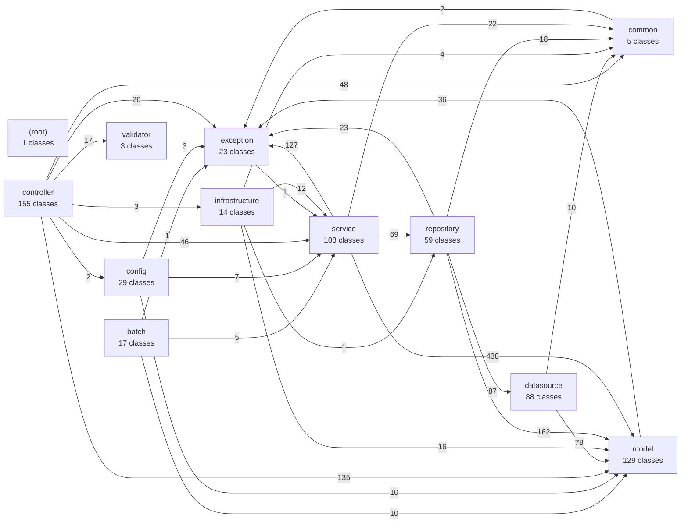
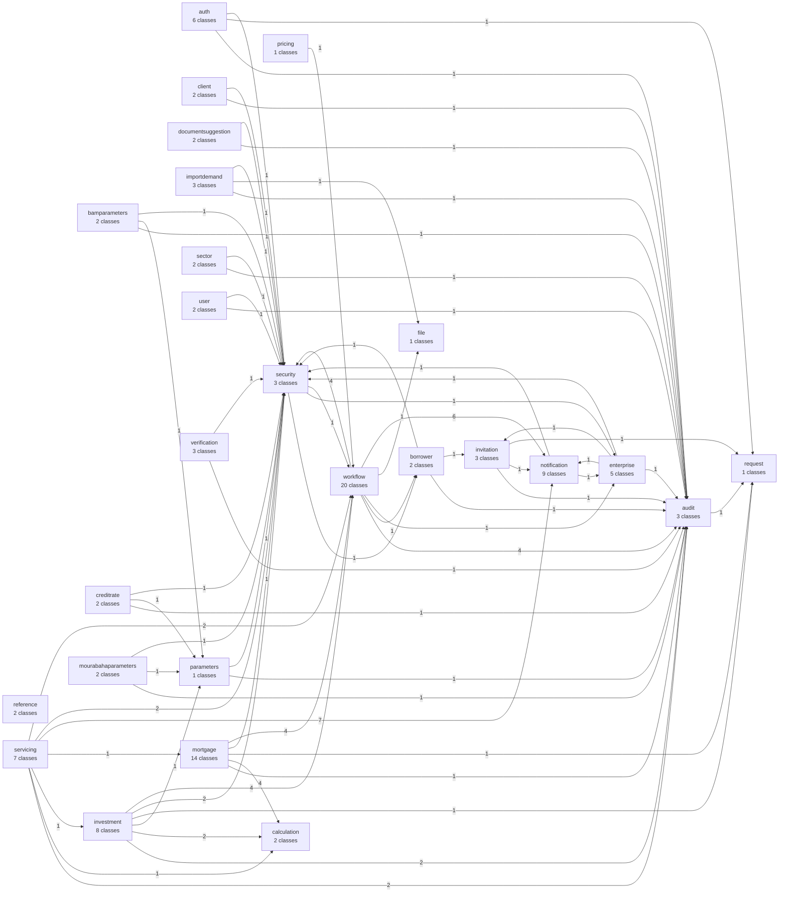

# Dependency Graph (generated)

Generated by `python3 scripts/docs/dependency_graph.py` from the imports of `src/main/java/com/credit/bladi`. Do not edit
by hand: rerun the script after a refactoring. An arrow `A -->|n| B` means that `n` import statements in
package `A` point to package `B`. The allowed directions are explained in
[Architecture at a Glance](c4-architecture.md#backend-layers) and enforced by `ArchitectureTest`.

## Top-level packages

## Inside `service`

