[Back to README](../README.md) · [Glossary](glossary.md)

# End-to-End Journeys

Every API endpoint placed in a complete journey, from the public simulation to the last repayment, with each
success, refusal and error and its HTTP status. This is the business view; the path of each call through the
classes is in [Feature Flows](flows/README.md). The rules are detailed in [Mortgage Credit](mortgage-credit-workflow.md)
and [Enterprise Credit](enterprise-credit-workflow.md), the endpoint list in [API](api.md).

## Contents

1. [Overview](#1-overview)
2. [Mortgage simulation → dossier](#2-mortgage-simulation--dossier)
3. [Investment credit simulation → dossier](#3-investment-credit-simulation--dossier)
4. [Workflows and their steps](#4-workflows-and-their-steps)
5. [Classifying a dossier](#5-classifying-a-dossier)
6. [Advancing a dossier (`/advance`)](#6-advancing-a-dossier-advance)
7. [Assignment and reassignment](#7-assignment-and-reassignment)
8. [Dossier documents and document requests](#8-dossier-documents-and-document-requests)
9. [After the decision: credit file, payments, late interest](#9-after-the-decision-credit-file-payments-late-interest)
10. [Early repayment](#10-early-repayment)
11. [Client portal: account, invitation, enterprise access](#11-client-portal-account-invitation-enterprise-access)
12. [Regulatory parameters (managers)](#12-regulatory-parameters-managers)
13. [Bulk Excel import](#13-bulk-excel-import)
14. [Cross-cutting: audit, notifications, scheduled jobs](#14-cross-cutting-audit-notifications-scheduled-jobs)
15. [Scenario catalogue (live end-to-end run)](#15-scenario-catalogue-live-end-to-end-run)

---

## 1. Overview

The two public simulations are the **entry points**: an eligible simulation creates a dossier (`Demand`) in
the **same workflow engine**. The dossier follows its workflow up to the committee decision; if granted and
carried through to the last step, a **credit file** (repayment schedule) opens automatically.

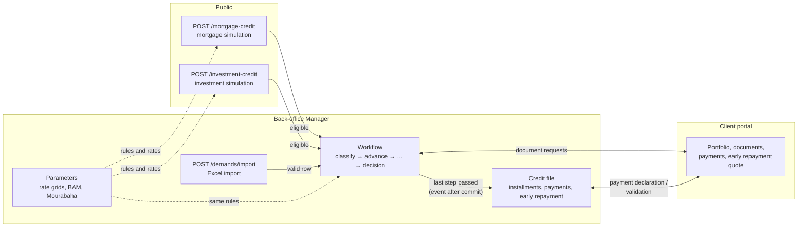

**Key consistency rule**: the simulation and the workflow apply **exactly the same business rules** (same
code). A manager who changes the amount, rate or duration during instruction can never obtain a dossier a
simulation would have refused.

---

## 2. Mortgage simulation → dossier

`POST /api/v1/mortgage-credit`: public, rate-limited (429 over quota).

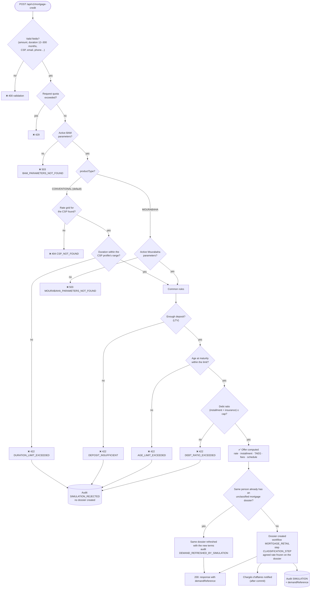

| Case | Result |
|---|---|
| Conventional, SALA profile, 240 months, enough deposit and income | 200 + dossier created |
| Conventional, SALA, 300 months (SALA range: 12–240) | 422 `DURATION_LIMIT_EXCEEDED`, no dossier |
| Deposit too low | 422 `DEPOSIT_INSUFFICIENT` |
| Too old at the end of the loan | 422 `AGE_LIMIT_EXCEEDED` |
| Installment too heavy for the income (co-borrower included) | 422 `DEBT_RATIO_EXCEEDED` |
| Eligible Mourabaha | 200 + dossier; the **agreed margin** is frozen on the dossier |
| Same person (same email + name) simulates again before anyone classified their dossier | 200 + **same** `demandReference`; the dossier's terms are replaced by the new simulation (audited) |
| Same person simulates again after classification | 200 + a new dossier |
| Missing grid on the bank side | 503 (configuration error, not the client's) |

> **Mourabaha**: no per-CSP duration range (the product doesn't have one in simulation either), TTC installment
> (margin + VAT); the agreed margin stays the one used by the final schedule even if the bank later changes its
> margin.

---

## 3. Investment credit simulation → dossier

`POST /api/v1/investment-credit`: public, rate-limited.

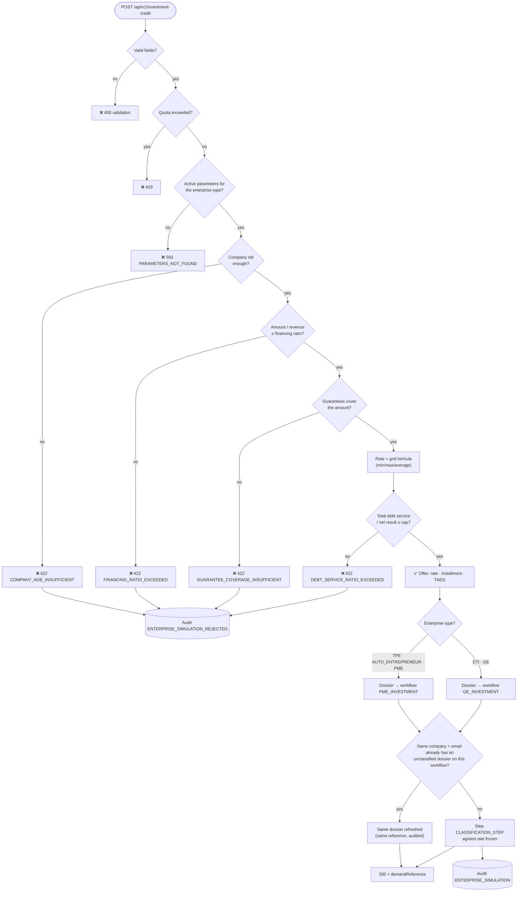

---

## 4. Workflows and their steps

Steps are **data** (`workflow`, `process`, `step` tables), not code. Each step carries flags: required
grade/team, mandatory classification, insurance confirmation, **four-eyes**, client notification on entry.

### PME_INVESTMENT and GE_INVESTMENT (same workflow, different PPIF teams)

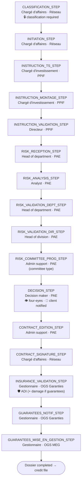

### MORTGAGE_RETAIL (individual mortgage)

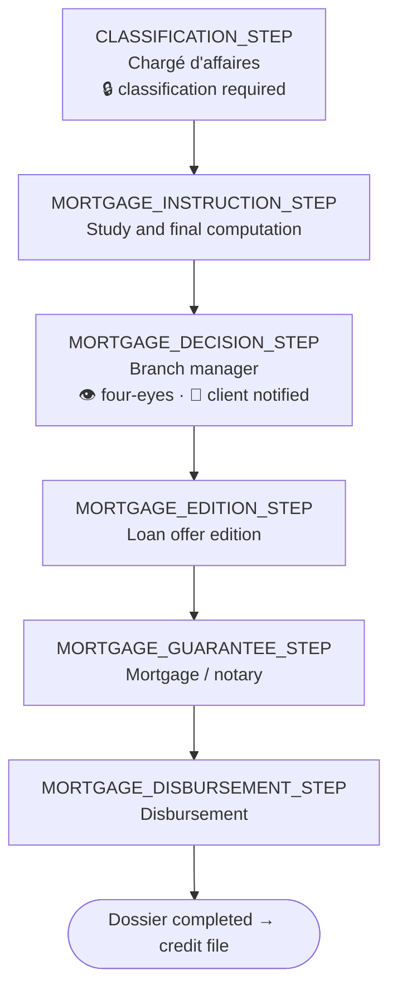

Dossier lifecycle (`DemandStatus`, derived):

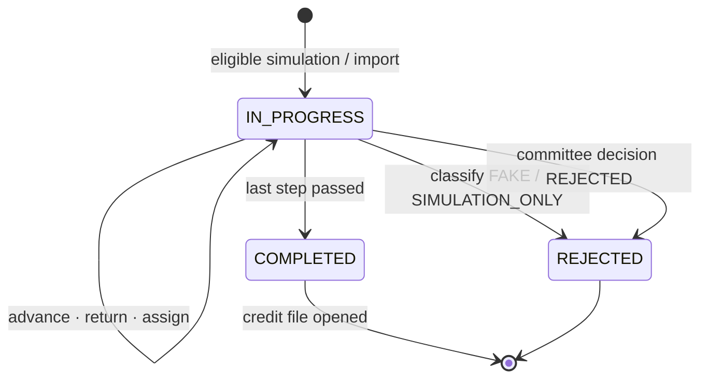

---

## 5. Classifying a dossier

`POST /api/v1/demands/{id}/classify`: manager. The only way out of `CLASSIFICATION_STEP`.

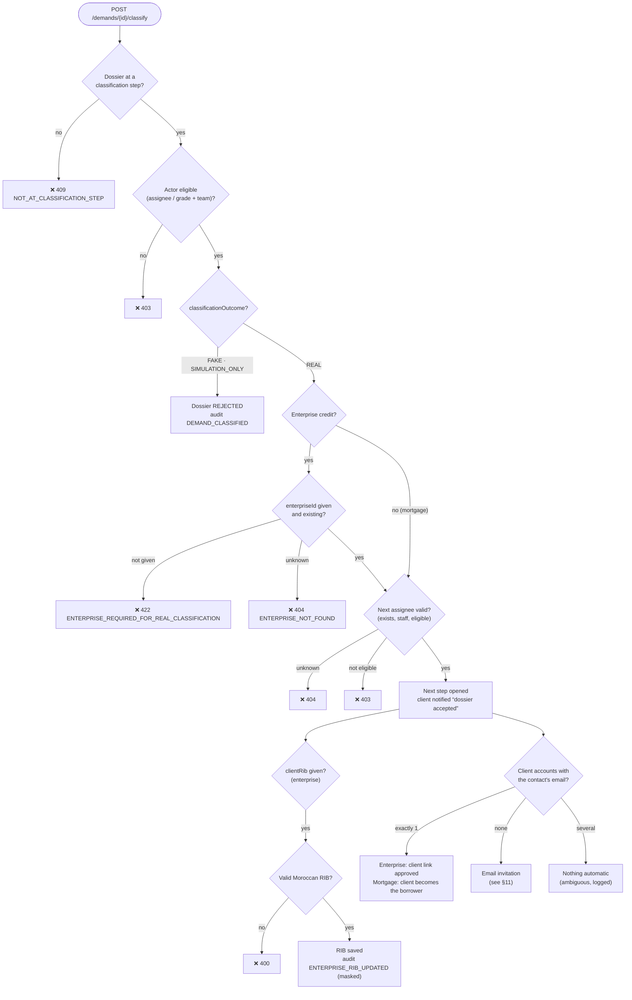

The same three-way resolution runs for both products. For an investment dossier it grants access to the
**enterprise** (and so to all its dossiers); for a mortgage, which has no enterprise, it grants access to **that
dossier only** by recording its borrower (`mortgage_borrower`, audit `MORTGAGE_BORROWER_LINKED`).

---

## 6. Advancing a dossier (`/advance`)

`POST /api/v1/demands/{id}/advance`: manager. Closes the current step with a rate/amount/duration decision
(`KEEP` or `MANUAL`) and opens the next one (or the previous one when returning for completion).

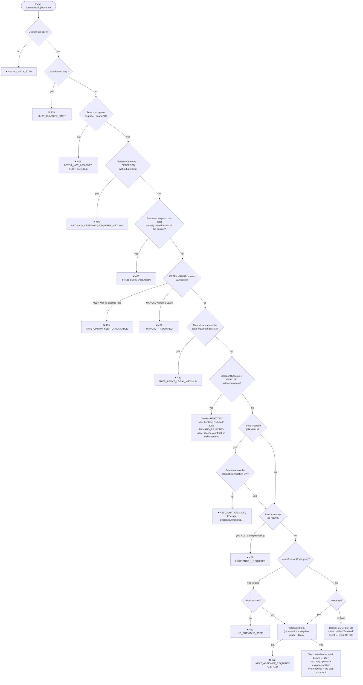

Every advance is audited with the exact changes, e.g. `changes={rate: 5.25 -> 5.75; duration: 240 -> 180}`,
targeted at the dossier (see §14).

---

## 7. Assignment and reassignment

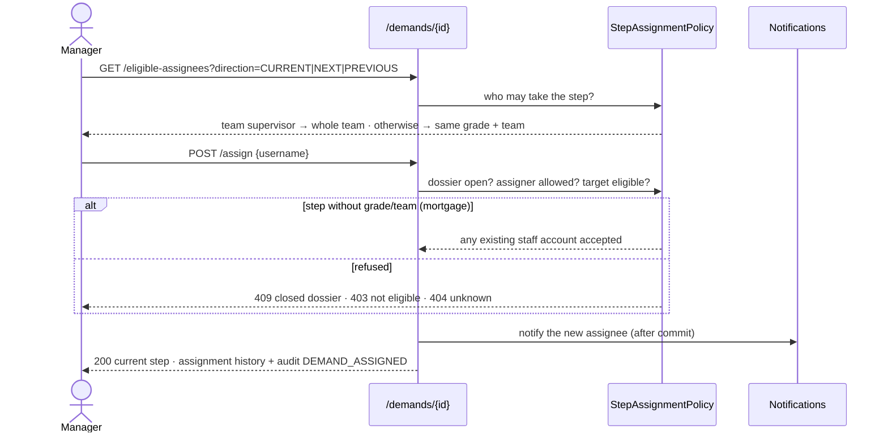

---

## 8. Dossier documents and document requests

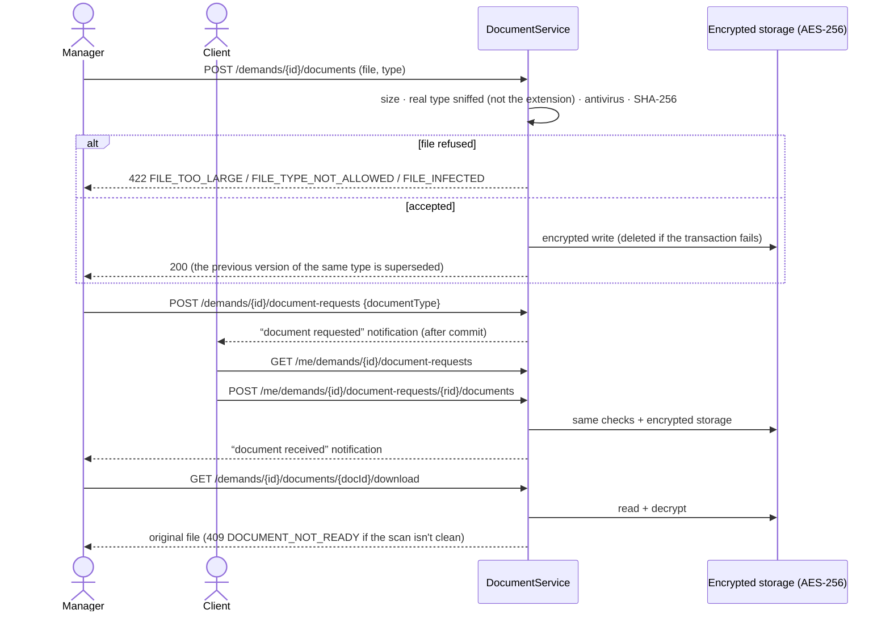

---

## 9. After the decision: credit file, payments, late interest

Once the last step is passed, an event opens the credit file **after commit**: schedule computed at the
**rate / margin agreed** on the dossier, first installment at disbursement + 30 days (`Africa/Casablanca`
calendar).

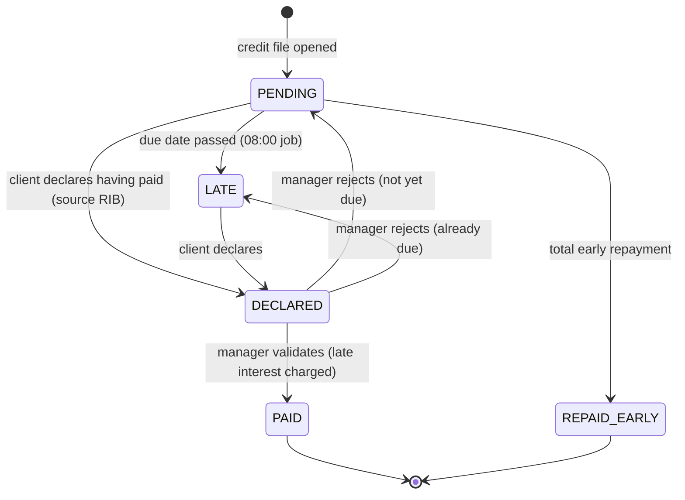

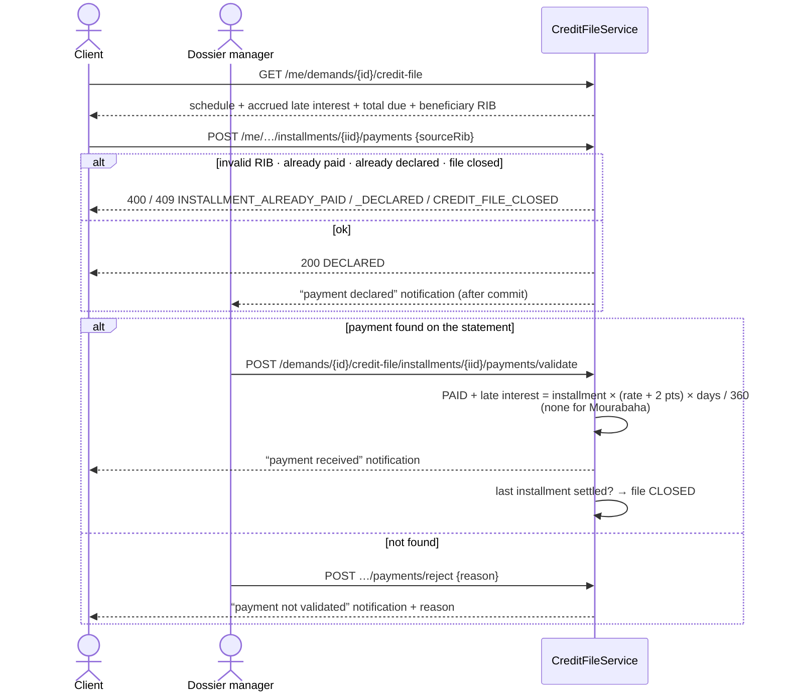

---

## 10. Early repayment

Endpoints: manager `GET …/credit-file/early-repayments/quote?amount=`, `POST …/early-repayments`,
`GET …/early-repayments`; client `GET /me/…/credit-file/early-repayments/quote`.

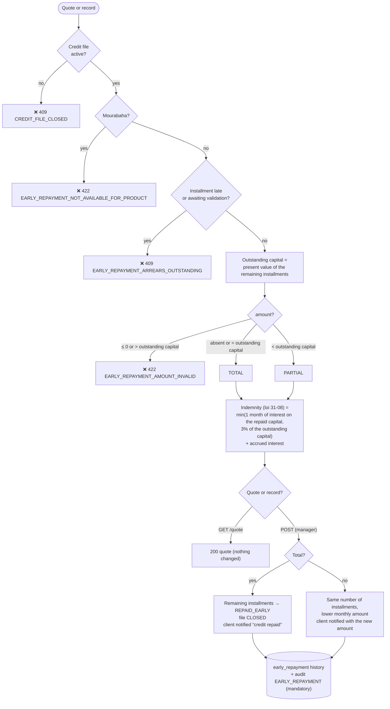

---

## 11. Client portal: account, invitation, enterprise access

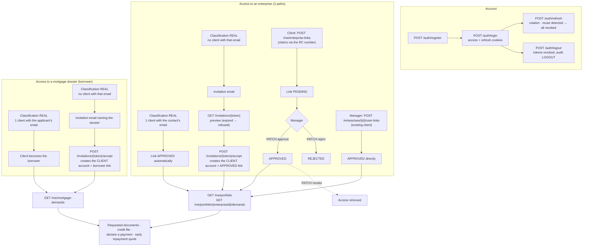

Every `/me/**` endpoint checks the caller's right to **that** dossier: an **APPROVED** link to its enterprise
for an investment dossier, being its **borrower** for a mortgage (`ClientDemandAccessGuard`). An id guessed in
the URL never gives access to another client's dossier. A mortgage invitation preview carries the dossier
reference (`demandReference`) instead of an enterprise name.

---

## 12. Regulatory parameters (managers)

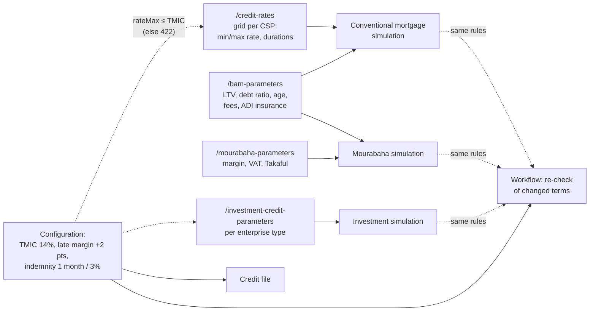

Each `PATCH` creates a new active version (a `/credit-rates` or `/investment-credit-parameters` grid whose `rateMax` would exceed the TMIC is refused with `422 RATE_ABOVE_LEGAL_MAXIMUM` and nothing is saved); the previous one stays for history. The change is audited field by
field (**mandatory** audit: if the audit write fails, the change is rolled back). An existing dossier keeps
**its** agreed rate or margin: changing a grid only affects new simulations.

---

## 13. Bulk Excel import

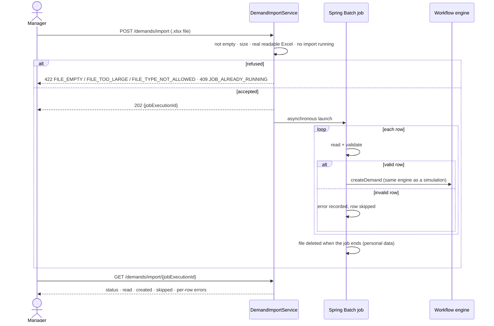

---

## 14. Cross-cutting: audit, notifications, scheduled jobs

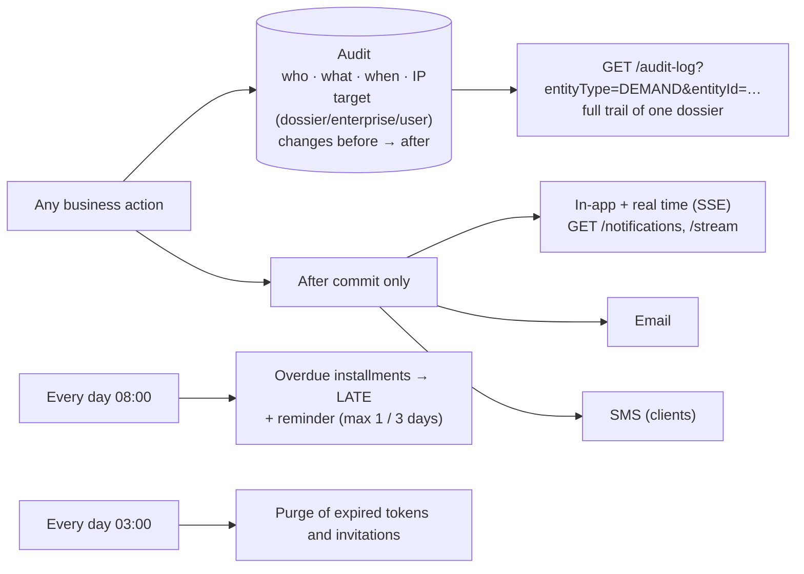

- **Mandatory audit** (credit decisions, payments, parameters, roles, RIBs, early repayments): if the audit
  write fails, the operation is rolled back.
- **Notifications**: never sent for an operation that was finally rolled back; a delivery failure never undoes
  the operation; emails/phones are masked in logs; each one is written in the recipient's language (fr/en/ar,
  from `Accept-Language` at simulation, registration or invitation acceptance), French when unknown.

---

## 15. Scenario catalogue (live end-to-end run)

Every journey above, played end to end against the real application (dev profile: PostgreSQL, ClamAV,
Mailpit, encrypted storage) by `scripts/e2e/run_e2e.py`: see [Testing → Live end-to-end scenario run](testing.md#live-end-to-end-scenarios).
Last run: **2026-10-21, 60 of 60 passed**. The same journeys are also played in the browser by the portal's
Playwright suite (130 tests, all passing), whose screenshots illustrate the portal's
[User Guide](https://github.com/LouziAmine/---Bladi-Credit-Portal---/blob/release/2.1.0/docs/user-guide/README.md).
Each scenario uses its own accounts and data, so the run can be repeated on the same database.

### Setup

| # | Scenario | Result |
|---|---|---|
| S-01 | Admin logs in and creates staff for every grade/team of the three workflows (x2 for four-eyes) | ✅ |

### A. Mortgage simulation

| # | Scenario | Result |
|---|---|---|
| A-01 | Conventional mortgage, eligible -> 200, dossier created at CLASSIFICATION_STEP | ✅ |
| A-02 | Same person simulates again before classification -> same dossier refreshed | ✅ |
| A-03 | Duration outside the CSP range (SALA 300 months) -> 422 DURATION_LIMIT_EXCEEDED, no dossier | ✅ |
| A-04 | Deposit insufficient (loan > LTV) -> 422 | ✅ |
| A-05 | Too old at maturity -> 422 | ✅ |
| A-06 | Debt ratio exceeded -> 422 | ✅ |
| A-07 | Mourabaha eligible -> 200 with TTC schedule | ✅ |
| A-08 | Validation: missing fields / bad nationality shape / unknown ISO country -> 400 with precise message | ✅ |
| A-09 | Error messages follow Accept-Language (fr/ar) | ✅ |

### B. Investment simulation

| # | Scenario | Result |
|---|---|---|
| B-01 | PME eligible -> 200, dossier on PME_INVESTMENT workflow | ✅ |
| B-02 | GE eligible -> dossier on GE_INVESTMENT workflow (PPIF_GE teams) | ✅ |
| B-03 | Company too young -> 422 | ✅ |
| B-04 | Amount / revenue above financing ratio -> 422 | ✅ |
| B-05 | Guarantees below required coverage -> 422 | ✅ |
| B-06 | Debt service ratio exceeded -> 422 | ✅ |
| B-07 | Same company + email simulates again before classification -> same reference | ✅ |

### C. Accounts & security

| # | Scenario | Result |
|---|---|---|
| C-01 | Client registers, logs in, /me, refresh rotation, logout revokes access | ✅ |
| C-02 | Duplicate username -> 409; weak password -> 400; wrong password -> 401 generic | ✅ |
| C-03 | Role separation: anonymous -> 401 on back-office, client -> 403 on back-office | ✅ |

### D. Classification

| # | Scenario | Result |
|---|---|---|
| D-01 | Advance while at CLASSIFICATION_STEP -> 409 MUST_CLASSIFY_FIRST | ✅ |
| D-02 | Classify REAL enterprise dossier without enterpriseId -> 422; unknown enterprise -> 404 | ✅ |
| D-03 | Actor without the step's grade/team cannot classify -> 403 | ✅ |
| D-04 | Classify FAKE -> dossier REJECTED, further advance -> 409 | ✅ |
| D-05 | Classify REAL with an invalid RIB -> 400, nothing changed | ✅ |
| D-06 | Classify REAL with enterprise + RIB + next assignee -> INITIATION_STEP, invitation mailed to the contact (no client account with that email) | ✅ |

### G. Client access

| # | Scenario | Result |
|---|---|---|
| G-01 | Invitation preview (public) then accept -> CLIENT account + APPROVED link, portfolio visible | ✅ |
| G-02 | Invitation token cannot be reused -> 4xx | ✅ |
| G-03 | Client claims an enterprise by RC number -> PENDING; manager rejects; claims again; approves; revokes -> access removed | ✅ |
| G-04 | IDOR: a client with no link cannot read another enterprise's dossier, documents or credit file | ✅ |

### F. Documents

| # | Scenario | Result |
|---|---|---|
| F-01 | Upload a real PDF (sniffed, scanned CLEAN by ClamAV, encrypted) and download the same bytes | ✅ |
| F-02 | Upload a text file renamed .pdf -> 422 FILE_TYPE_NOT_ALLOWED (real type is sniffed) | ✅ |
| F-03 | Upload a .docx carrying the EICAR test virus -> 422 FILE_INFECTED | ✅ |
| F-04 | Re-upload the same document type -> previous version SUPERSEDED | ✅ |
| F-05 | Document request -> client sees it, uploads, manager downloads the fulfilled document | ✅ |

### E. Instruction pipeline (PME)

| # | Scenario | Result |
|---|---|---|
| E-01 | Comments, history, assignment history and pipeline statuses are consistent | ✅ |
| E-02 | Only the assignee (or same grade+team) may advance -> 403 otherwise | ✅ |
| E-03 | Next assignee not eligible for the next step -> 403; missing -> 422 | ✅ |
| E-04 | Reassign: eligible-assignees CURRENT, assign to ineligible -> 403, eligible -> 200 | ✅ |
| E-05 | Walk the PME pipeline to DECISION_STEP (a return for completion on the way) | ✅ |
| E-06 | Decision rules: DEFERRED without return -> 409, MANUAL rate above TMIC -> 422, MANUAL amount breaking the financing ratio -> 422 | ✅ |
| E-07 | Committee APPROVED with a MANUAL rate within limits -> CONTRACT_EDITION_STEP, change audited | ✅ |
| E-08 | Insurance step without ADI confirmation -> 422, with ADI -> next step | ✅ |
| E-09 | Last step passed -> dossier COMPLETED, credit file opened with the full schedule at the agreed rate | ✅ |

### H. Payments

| # | Scenario | Result |
|---|---|---|
| H-01 | Client sees the credit file; declares a payment with a bad RIB -> 400; valid -> DECLARED; twice -> 409 | ✅ |
| H-02 | Manager rejects the declaration (not yet due -> PENDING), client declares again, manager validates -> PAID | ✅ |
| H-03 | Validate an installment the client never declared -> 409 | ✅ |
| H-04 | Client is notified by email of the payment received / rejected (bell is back-office only) | ✅ |

### I. Early repayment

| # | Scenario | Result |
|---|---|---|
| I-01 | Early repayment quote (client) then PARTIAL by the manager -> lower installments | ✅ |
| I-02 | TOTAL early repayment -> remaining installments REPAID_EARLY, credit file CLOSED, declaring afterwards -> 409 | ✅ |

### J. Mortgage pipeline

| # | Scenario | Result |
|---|---|---|
| J-01 | Mortgage: classify REAL (no enterprise needed) then four-eyes blocks the instructor from deciding | ✅ |
| J-02 | Mortgage: second pair of eyes decides, dossier goes to disbursement, credit file opens | ✅ |
| J-03 | Mortgage borrower (no enterprise): invited by e-mail at classification, creates an account, sees only their dossier | ✅ |
| J-06 | Mortgage borrower declares an installment payment, the manager validates it -> PAID | ✅ |
| J-04 | Mortgage committee REJECTED -> dossier REJECTED, client notified by email, no credit file | ✅ |
| J-05 | Mourabaha: early repayment is refused (422) once its credit file exists | ✅ |

### K. Parameters & reference data

| # | Scenario | Result |
|---|---|---|
| K-01 | Credit-rate grid with rateMax above the TMIC (14%) -> 422, nothing saved | ✅ |
| K-02 | BAM parameters update -> new active version, audited field by field | ✅ |
| K-03 | Document suggestions: create (CSP scope), duplicate -> 409, delete | ✅ |
| K-04 | BAM verification mock answers for an enterprise identifier | ✅ |

### Good to know

- **In-app notifications are back-office only**: `/api/v1/notifications/**` is `MANAGER`-only and the bell is
  hidden for clients; clients are notified by e-mail and SMS. Their in-app rows are stored but never shown.
- **Four-eyes is off in the `dev` profile** (`workflow.four-eyes.enabled=false`); it is on everywhere else.
- **`GET /demands/{id}` leaves `currentProcessName` / `currentStepName` empty**: only the list fills them;
  the detail screen reads `GET /demands/{id}/current-step`.
- **`/advance` requires `rateOption`, `amountOption` and `durationOption`** (`KEEP` or `MANUAL`) on every call,
  including steps that do not change terms.
