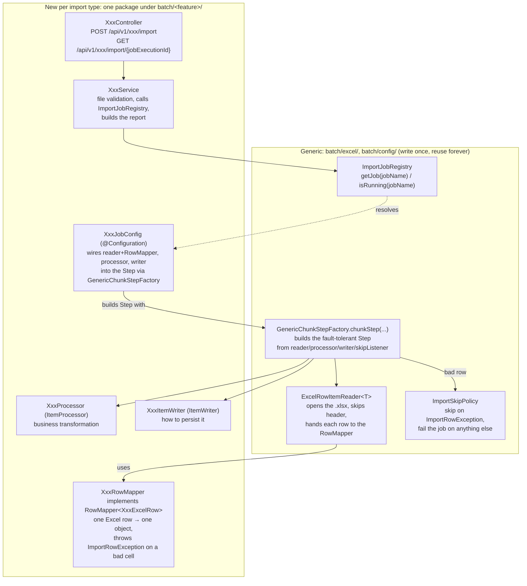
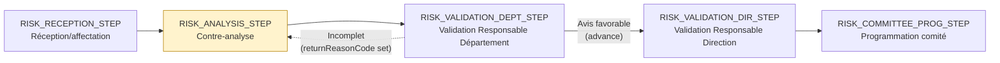

[Back to README](../README.md) · [Mortgage Credit Workflow →](mortgage-credit-workflow.md) · [Glossary](glossary.md)

# Enterprise Credit Simulation Workflow (Business Process)

This page covers the business/investment credit side of Credit Bladi: the products aimed at
companies rather than individuals. It's written without technical jargon, for Product Owners,
Scrum Masters, and managers who need to understand *what the system does*, not how it's coded.
Looking for individual mortgage credit instead? See the [Mortgage Credit
Workflow](mortgage-credit-workflow.md).

## Enterprise Credit: TPE, Auto-Entrepreneur, PME, ETI and GE

Alongside the individual mortgage simulation, Credit Bladi also simulates **business investment
credit** for companies. It's split into five size categories, smallest to largest: **TPE** (Très
Petite Entreprise), **Auto-Entrepreneur**, **PME** (Petite/Moyenne Entreprise), **ETI** (Entreprise
de Taille Intermédiaire), and **GE** (Grande Entreprise). This isn't just a new CSP profile bolted
onto the mortgage flow: it's a genuinely separate product line. A company has no property value
and no personal monthly income, so its eligibility rules look nothing like the individual mortgage
rules.

### What's different from the individual mortgage simulation

| | Individual mortgage | Enterprise credit |
|---|---|---|
| Who it's for | A private individual buying a home | A company financing an investment |
| Sizing driven by | Property value (LTV) and personal monthly income | Annual revenue, company age, net annual result, and guarantees offered |
| Eligibility checks | Duration limit, deposit/LTV, age at maturity, debt ratio | Minimum company age, financing-to-revenue ratio, guarantee coverage ratio, debt-service ratio |
| Rate | Depends on CSP profile (5 profiles) | Depends on enterprise type (5 types), one bank-wide rate range per type |
| After an eligible simulation | Cost breakdown **and** a tracked `Demand` entering its own `MORTGAGE_RETAIL` pipeline (see [Mortgage Credit Workflow](mortgage-credit-workflow.md#from-simulation-to-tracked-dossier)) | Cost breakdown **and** a tracked `Demand` entering the bank's processing pipeline (see below) |
| Classification → client portfolio | No Enterprise-linking step (individuals have no company record); no self-service client portal yet | `REAL` attaches the demand to an `Enterprise` and (best-effort) the client's own account |

### The five enterprise types, risk-tiered

Each type has its own admin-configurable rate range and eligibility thresholds
(`enterprise_credit_parameters` table, one active row per type). Generally speaking, the smaller
and younger the applicant tier, the stricter and pricier the terms, which mirrors how a real bank
prices risk. The applicable rate itself gets derived from that row's `rateMin`/`rateMax` through a
`rate_formula` column (`MIN`, `MAX` or `AVERAGE`): this is the same generic mechanism individual
mortgage credit uses for its CSP profiles (see [Mortgage Credit Workflow → Applicant Profiles
(CSP)](mortgage-credit-workflow.md#applicant-profiles-csp)). Right now, all five
enterprise types use `AVERAGE`:

| Type | Min company age | Max financing/revenue | Min guarantee coverage | Rate range (seed) |
|---|---|---|---|---|
| **Auto-Entrepreneur** | 0 years | 30% | 90% | 7.50–9.00% |
| **TPE** | 1 year | 40% | 85% | 6.50–8.00% |
| **PME** | 2 years | 50% | 80% | 6.00–7.50% |
| **ETI** | 3 years | 60% | 65% | 5.50–6.75% |
| **GE** | 3 years | 70% | 60% | 5.00–6.50% |

### Enterprise eligibility checks

These run in order. The first check that fails stops the simulation right there, same as the
individual mortgage flow:

| # | Check | Plain-language meaning |
|---|---|---|
| 1 | Minimum company age | Has the company existed long enough for its type (see table above)? |
| 2 | Financing-to-revenue ratio | Is the requested amount a reasonable share of the company's annual revenue (chiffre d'affaires)? |
| 3 | Guarantee coverage ratio | Do the guarantees offered cover a large enough share of the requested amount? |
| 4 | Debt-service ratio | Would the company's total annual debt service (existing debt plus this new financing) take up too large a share of its net annual result? |

Like the individual mortgage's BAM parameters, these ratios and rate ranges are admin-configurable
rather than hardcoded. A Manager can retune them without waiting on a new release, and every change
gets audit-logged.

### The Workflow/Process/Step pipeline

An **eligible** enterprise credit simulation creates a **Demand**: a tracked record that moves step
by step through the bank's loan-processing pipeline until a decision is made. A rejected simulation
never creates one. Mortgage credit follows this exact same principle, just on its own shorter
pipeline (see [Mortgage Credit Workflow → From simulation to tracked
dossier](mortgage-credit-workflow.md#from-simulation-to-tracked-dossier)): the two products
actually share this generic engine, described below, instead of each maintaining its own tracking
mechanism.

This models the reference workflow the bank uses for its broader integrated loan process (the
"PPIF" instruction path for investment credit; a distinct BKGR path exists for GE working-capital
credit, but that one isn't modeled here):

- **Workflow**: the category a `Demand` belongs to, `PME_INVESTMENT` or
  `GE_INVESTMENT` for enterprise credit. Both currently share the same 7-process, 16-step pipeline
  below. Rather than giving each of the five enterprise types its own dedicated pipeline, they're
  tiered onto these two workflows: TPE, Auto-Entrepreneur and PME demands go through
  `PME_INVESTMENT`, while ETI and GE demands go through `GE_INVESTMENT` (see
  `EnterpriseWorkflowCodeResolver`). That keeps the seed data small while still routing by
  size tier. Splitting a tier into its own dedicated pipeline later would just be a
  configuration/seed-data change, not a rebuild of the tracking engine: mortgage credit already
  proved this out with its own `MORTGAGE_RETAIL` workflow (see [Mortgage Credit Workflow → From
  simulation to tracked dossier](mortgage-credit-workflow.md#from-simulation-to-tracked-dossier)),
  a third, much shorter workflow bolted onto this exact same engine without touching it. A
  `Demand`'s `demandType` (`ENTERPRISE` or `MORTGAGE`) determines which product-specific detail it
  carries (`EnterpriseDemandDetail` vs. `MortgageDemandDetail`), but the tracking engine itself
  (Workflow/Process/Step/assignment/history/notifications/documents/comments, everything else in
  this section) never looks inside that detail.
- **Process**: a phase of that pipeline (Classification, Initiation, Instruction, Risk
  Analysis or contre-analyse, Decision, Contract Edition, Guarantees).
- **Step**: the detailed stage(s) inside a process. Splitting a process into more steps, or adding
  new ones, is a configuration/seed-data change, nothing that touches the tracking engine itself.
- **Demand**: the actual record being tracked, sitting at exactly one step at a time. Every step it
  passes through gets kept as history: who handled it, when it was entered and left, plus (see
  below) any note, structured return reason, decision outcome, committee type, recommendations and
  reserves. It's the same audit-trail principle the simulation compliance log follows, and it
  mirrors the "Circulation du dossier" panel (Etape / Date Début / Date Fin / Délai / Utilisateur /
  Action / Commentaire) you'd see on the real IDCE dossier screen.
- **Who may act on a step**: each step carries a required **grade** and, per workflow, a required
  **team** (e.g. Analyste · PAE). Only the step's assignee (or, if it is unassigned, a user with that grade
  and team) may advance it (`403` otherwise); see [Business continuity: the Superviseur
  override](#business-continuity-the-superviseur-override) for hand-offs. The decision step is also
  **four-eyes**: whoever closed an earlier step of the dossier cannot decide it alone
  (`403 FOUR_EYES_VIOLATION`, data flag `step.requires_four_eyes`; enforced in staging/prod, off in
  the `dev` profile). The step's *typical role* label ("Analyste PAE"…) is informational only.

### The 16 steps

| Process | # | Step | Typical role |
|---|---|---|---|
| **Classification** | 1 | Validation initiale du dossier avec le client | Chargé d'affaires |
| **Initiation** | 1 | Création du dossier et ouverture des lignes | Chargé d'affaires |
| **Instruction** | 1 | Préparation et validation de la TS indicative (term sheet) | Chargé d'investissement / Responsables PPIF |
| | 2 | Montage du dossier | Chargé d'investissement |
| | 3 | Validation du dossier (PPIF et Réseau) | Responsables PPIF et Réseau |
| **Risk Analysis** | 1 | Réception du dossier et affectation | Responsable Département/Direction PAE |
| | 2 | Contre-analyse du dossier de crédit | Analyste PAE |
| | 3 | Validation de la contre-analyse (Responsable Département) | Responsable Département PAE |
| | 4 | Validation de la contre-analyse (Responsable Direction) | Responsable Direction PAE |
| | 5 | Programmation du comité | Support Administratif |
| **Decision** | 1 | Décision comité (Tournant ou Séance Tenante) | Décideurs désignés / PAE |
| **Contract Edition** | 1 | Edition des contrats | Support Administratif |
| | 2 | Signature des contrats | Chargé d'affaires |
| **Assurances et gestion des garanties** | 1 | Souscription et validation des assurances | Gestionnaire OGS Garanties |
| | 2 | Notification des garanties | Gestionnaire OGS Garanties |
| | 3 | Mise en gestion du dossier | Gestionnaire OGS Mise en gestion |

The insurance step sits after Contract Signature and before Notification des garanties, following
Moroccan regulatory practice. ACAPS (Code des
assurances, loi 17-99) supervises the insurance side, loi 110-14 gives the client the right to a
"délégation d'assurance" (an external insurer's equivalent policy) instead of the bank's group
contract, and BAM's client-protection framework treats borrower/collateral insurance as a de facto
condition before funds get released. That means it can't happen before the contract is signed, and
has to be cleared before the guarantee is notified or put into management. It reuses the same
profile (Gestionnaire · OGS Garanties) already assigned to that process. It checks ADI on the
caution/dirigeant, plus dommages/multirisque whenever the dossier has real guarantees.

#### Insurance: pricing and the workflow step are two different things

`INSURANCE_VALIDATION_STEP` is a **compliance gate**. It doesn't compute anything: no pricing
calculation happens here. Under the hood it's a generic data flag
(`step.requires_insurance_confirmation`, read via
`WorkflowStepInfo#requiresInsuranceConfirmation()`) rather than a step-code check hardcoded to this
one step (see [Architecture → Design Patterns](architecture.md#design-patterns), Data-Driven Step
Behavior row), so any future step, on any workflow, can require the same ADI/dommages confirmation
before advancing just by setting that column. The actual cost of insurance is priced separately and
automatically, starting from the very first simulation, by `InvestmentCreditCalculator`:

- Every `enterprise_credit_parameters` row (one per `EnterpriseType`) carries an
  `insurance_premium_ratio`: monthly, flat, shaped just like `processing_fees_ratio`, and editable
  via the "Paramètres crédit entreprise" screen. Seed values: TPE 0.12%, Auto-Entrepreneur 0.14%,
  PME 0.10%, ETI 0.08%, GE 0.06% of the financed amount, per month.
- `insurancePremium = amount × insurancePremiumRatio`, flat over the whole duration rather than
  degressive on the declining balance. Same design the mortgage path's
  `RateCalculationEngine#calculateAdiMonthlyPremium` already uses.
- `allInMonthlyPayment = monthlyPayment + insurancePremium` feeds into the TAEG calculation
  (`TaegCalculationEngine`) and shows up per-installment in the amortization table and PDF export
  (`DemandAmortizationResponseDTO.insurancePremium` / `.allInMonthlyPayment` /
  `.totalInsuranceCost`).
- This estimate gets computed at simulation time and **never recalculated later**, not even by
  `INSURANCE_VALIDATION_STEP`. Whatever the Gestionnaire records there (ADI subscribed, coverage
  type `BANK_GROUP_POLICY` vs. `EXTERNAL_DELEGATION`, dommages subscribed) is purely an audit/
  compliance record that gates advancement past the step. It never feeds back into
  `InvestmentCreditCalculator`. Product decision: the priced offer shown to
  the client stays fixed from simulation onward, even if the client ends up choosing an external
  délégation d'assurance with a different real premium than the bank's own ratio. Think of it like
  a bank that doesn't re-quote a signed offer letter after the fact. Turning this into a true
  recalculation someday (say, discounting the premium when `EXTERNAL_DELEGATION` comes with a
  cheaper negotiated rate) would need a new field for that rate, wired back into the pricing engine.

The Instruction and Risk Analysis breakdowns, the Contract Edition/Signature split, and the roles
above all mirror the real IDCE dossier navigation and "Suivi des dossiers" / "Mes tâches" screens.
This was confirmed against actual application screenshots, not just the process description, 
Etape values "Edition des contrats" and "Signature contrats" genuinely appear as two distinct rows
there. A **TS indicative** (indicative term sheet) gets prepared and validated with the client
*before* the full dossier is built ("montage"). The contre-analyse risque is a 5-stage review
(reception/affectation → analyse → validation département → validation direction → programmation
comité) with return-for-completion loops at each validation stage. And contracts get edited, then
separately signed, in their own phase *between* the committee decision and the guarantees/mise en
gestion phases.

### Bulk demand creation: importing existing dossiers

A Manager can also create demands in bulk from an Excel spreadsheet of already-existing dossiers,
say a bank migrating its back-book onto Credit Bladi, or a batch of applications collected outside
the portal, rather than walking each one through the public simulator by hand. `POST
/api/v1/demands/import` (multipart `.xlsx` file) kicks off an asynchronous **Spring Batch** job and
returns right away with a `jobExecutionId`. `GET /api/v1/demands/import/{jobExecutionId}` polls its
progress.

The pipeline itself is a generic, reusable chunk-oriented Excel importer (`batch/excel/`,
`batch/config/GenericChunkStepFactory`, `batch/config/ImportJobRegistry`), wired here to one
concrete job (`batch/demand/`, `DemandImportJobConfig`). A second Excel import feature elsewhere in
the app would reuse everything except `DemandImportJobConfig` and the row mapper/processor/writer
below it:

| Stage | Class | Does |
|---|---|---|
| Read | `DemandRowMapper` | Parses one Excel row into a `DemandExcelRow`: fixed column order: companyName, enterpriseType, amount, duration, applicableRate, contactEmail, contactPhone, annualRevenue, existingAnnualDebtService, netAnnualResult, guaranteesValue, sector, companyAgeYears. A malformed cell (missing required field, invalid email, unknown `enterpriseType`) raises an `ImportRowException` right here. |
| Process | `DemandSnapshotProcessor` | Builds the exact same `DemandSnapshot` a user-submitted demand produces, so a bad row fails through the domain's own `Money`/`Rate` validation instead of a parallel, looser set of rules. |
| Write | `DemandImportItemWriter` | Calls `IWorkflowEngineService#createDemand`: the same call path an API-created demand goes through. The imported demand opens at `CLASSIFICATION_STEP`, unassigned, and fires the exact same "new dossier waiting" notification to the team as an organically-created one: there is no separate "imported" code path past this point. |

Each row is processed independently, in a fault-tolerant chunk step. A bad row gets skipped and
recorded rather than triggering a whole-file rollback. `DemandImportSkipListener` writes one
`demand_import_row_error` row per skip (row number, company name when known, and the reason), so
`GET /{jobExecutionId}` tells you exactly which lines to fix and re-import, without re-submitting
rows that already went through fine. `readCount`/`writeCount`/`skipCount` on the report come
straight from Spring Batch's own job execution rather than a separate counter someone maintains by
hand.

Only one import can run at a time (`POST /api/v1/demands/import` while one is already
`STARTING`/`STARTED` raises `JOB_ALREADY_RUNNING`, 409). This is a bulk back-office tool, not a
high-throughput ingestion pipeline, so serializing imports just avoids two files racing each other
against the same PostgreSQL rows. `DemandImportService` doesn't actually check this itself: it
asks `ImportJobRegistry#isRunning(jobName)`, and resolves the `Job` to launch via
`ImportJobRegistry#getJob(jobName)`, a `Map<String, Job>` Spring auto-populates with every `Job`
bean in the context, keyed by bean name, rather than wiring one service to one `Job` via
`@Qualifier`. Ported from ms-dataload's `JobRetryStrategyRegistry` pattern.

#### Adding a second Excel import type

Everything in the top box below already exists and is generic: you'd never touch it again. The
bottom box is the new, business-specific slice a second import type would write from scratch:

**Concrete example: a "bulk client import" feature.** Same shape as demand import, living in a new
package `batch/client/`:

| Layer | Demand import (exists today) | Client import (new: what you'd write) |
|---|---|---|
| Reused, unchanged | `batch/excel/ExcelRowItemReader`, `RowMapper`, `ImportSkipPolicy`, `ImportRowException`, `batch/config/GenericChunkStepFactory`, `ImportJobRegistry` | *(same classes, no copy, no edit)* |
| Row → object | `batch/demand/DemandExcelRow` + `DemandRowMapper` | `batch/client/ClientExcelRow` + `ClientRowMapper` |
| `ItemProcessor` | `batch/demand/DemandSnapshotProcessor` | `batch/client/ClientImportProcessor` |
| `ItemWriter` | `batch/demand/DemandImportItemWriter` | `batch/client/ClientImportItemWriter` |
| Skip listener | `batch/demand/DemandImportSkipListener` | `batch/client/ClientImportSkipListener` (only if a per-row error report is needed: see below) |
| Job wiring | `batch/demand/DemandImportJobConfig` | `batch/client/ClientImportJobConfig` |
| Service | `service/importdemand/DemandImportService` | `service/client/ClientImportService` (injects `ImportJobRegistry`, same as today: no new "is a job running" logic) |
| Controller + DTOs | `controller/workflow/DemandImportController` + `DemandImport*DTO` | `controller/client/ClientImportController` + `ClientImport*DTO`, own route `POST /api/v1/clients/import` |

Each import type keeps its own endpoint rather than sharing a `/api/v1/imports/{type}` dispatcher,
mirroring ms-dataload's per-domain read routes (`/catalogBatch`, `/customerBatch`, ...).

This isn't generalized on purpose. A per-row error table like `demand_import_row_error` is specific
to this one job. If a second import type ever needs the same "list exactly which rows failed and
why" report, that's the moment to decide whether to duplicate a similar table or generalize it
(discriminator column plus a Liquibase migration). Doing that speculatively now, before a second
consumer even exists, just isn't worth the schema risk.

### Classification: the gate before the pipeline

A demand doesn't land in the Initiation process the moment it's created. It opens at
`CLASSIFICATION_STEP` first (inserted ahead of Initiation in both workflows, `globalOrder` 1): the
chargé d'affaires' initial check that a freshly-submitted demand is genuine before it goes any
further. Think of it as mirroring a real bank that won't commit staff time to a dossier before
confirming the client actually exists and actually intends to borrow. The gate itself works through
a generic data flag (`step.requires_classification`) rather than a hardcoded check for this one
step's code: `POST /advance` refuses to move a demand past this step, only `POST /classify` can,
and any future step could reuse the same "must be explicitly classified first" gate without
touching code. See [Architecture → Design Patterns](architecture.md#design-patterns) (Data-Driven
Step Behavior row).

`POST /demands/{id}/classify` closes this step with one of three outcomes:

| Outcome | What happens |
|---|---|
| `REAL` | The demand is a genuine request. It's attached to an `Enterprise` (`enterpriseId`, required) and `INITIATION_STEP` opens next: assigned to `assigneeUsername`, required whenever that step has a required grade/team. |
| `FAKE` | The demand was never a real request (e.g. a prankster, a competitor testing the form). Rejected here: it never enters the pipeline, never joins a portfolio, and is never "completed" in the usual sense. |
| `SIMULATION_ONLY` | The applicant was only checking numbers, not actually applying. Same rejection path as `FAKE`, kept as a separate enum value purely so the *reason* for stopping here is distinguishable in reporting. |

Classifying `REAL` requires an `enterpriseId`, the `Enterprise` record for the client company the
demand belongs to. Since the company name typed into the public simulator is free text ("AFD
Technology", "afd technology", "AFD-TECHNOLOGY SARL" could all be the same company), `GET
/enterprises/match?name=` looks one up through a normalized comparison instead of a brittle exact
match (`EnterpriseNameNormalizer`: uppercased, accents and punctuation stripped, common legal-form
suffixes like SARL/SA/SAS dropped). That way the chargé d'affaires can reuse an already-onboarded
Enterprise instead of accidentally creating a duplicate portfolio for a client who already has one.
On the classify form, the portal surfaces this as a "use this existing enterprise" banner when a
match turns up, or a one-click "create and attach" action when it doesn't.

Diagram with every case (RIB capture, client auto-link or invitation): [End-to-End Flows →
§5](end-to-end-flows.md#5-classifying-a-dossier).

### BAM verification: a mock SCIP / Centrale des Risques check

In the real bank process, a chargé d'affaires would check the applicant against Bank Al-Maghrib's
SCIP (incidents de paiement chèques) and Centrale des Risques (existing credit exposure at other
banks) registries before classifying a demand `REAL`. No such integration exists yet. `POST
/api/v1/mock/verification-bam` (Manager-only) is a **simulated** stand-in rather than a real
regulatory check, and every response says so explicitly: `source=MOCK_SIMULATION`, plus a
disclaimer added at the controller boundary.

`IBamVerificationGateway` follows the same one-interface/one-active-implementation shape as
`ISmsGateway` (see [Notifications](#notifications-keeping-the-right-people-in-the-loop)), and gets
selected by `bam.verification.provider`:

| Provider | Class | Behavior |
|---|---|---|
| `mock` (default) | `MockBamVerificationGateway` | Draws a weighted-random outcome from a per-`EnterpriseType` distribution (e.g. GE gets `CLEAR`: nothing found, "RAS", 85% of the time, TPE only 70%, mirroring smaller/younger companies carrying more real-world risk). The `BamScenario` outcomes are `CLEAR`, `MINOR_INCIDENT` / `ACTIVE_INCIDENT` (a cheque incident, regularized or not), `PERSONAL_EXPOSURE_DETECTED` / `MULTIPLE_EXPOSURES` / `CONSOLIDATED_GROUP_EXPOSURE` (existing credit lines, "encours", at fictional banks) and `REQUIRES_MANUAL_REVIEW`, each with a `SimulatedRecommendation` (`FAVORABLE`, `TO_REVIEW`, `UNFAVORABLE`). Pass `scenario` on the request to force a specific outcome instead, for a repeatable manager demo. Simulates 500–1500ms of network latency by default (`bam.verification.mock.latency.*`) so the UI's loading state has something real to show. |
| `real` | `RealBamVerificationGateway` | A generic JSON-over-HTTPS POST-with-bearer-token adapter (`bam.verification.gateway.url`/`.api-key`), the same shape as `HttpSmsGateway`. No aggregator has been chosen yet: `parseResponse` is a deliberate `UnsupportedOperationException` placeholder: only `buildRequestBody`/`parseResponse` need to change once a real SCIP/Centrale-des-Risques provider (BAM itself, CREDITINFO, QUANTIK, ...) is contracted. |

This is deliberately **not** wired into `POST /classify` itself. It's a standalone lookup tool the
chargé d'affaires can call from the classify screen before deciding `REAL`/`FAKE`, not a gate the
API enforces. Going live with a real registry just means a config change
(`bam.verification.provider=real` plus the URL/key) once `RealBamVerificationGateway#parseResponse`
is implemented. Nothing in the classification workflow itself has to change: it's the same "swap
the gateway, not the caller" pattern the SMS channel uses.

### Structured fields captured when a step is closed

Beyond the free-text note, advancing a demand can also record four additional fields: these show
up as distinct, structured inputs on the real screens rather than getting folded into the free-text
note:

| Field | Meaning | Seen on |
|---|---|---|
| `returnReasonCode` | The **"Motif de retour"**: a structured reason selected from a dropdown (e.g. "Pièce justificative manquante"), separate from the free-text comment. Setting it sends the dossier **back to the previous step** instead of advancing (mirrors the reference process's separate "Retourner le dossier" button, distinct from "Transmettre/Valider") | The "Demande Infos Complémentaires" popup, used whenever a dossier is returned for completion (the real screens further categorize these by context, Motifs de retour Plateforme / PAE / OGS, not modeled as separate referentials here) |
| `committeeType` | The **"Type Comité"**: `ROTATING` (comité tournant) or `STANDING_SESSION` (séance tenante), chosen *before* the decision itself | The "Programmation du comité" screen, when scheduling the ordre du jour |
| `recommendations` | The committee's **"Recos"** | The "Décision Comité" screen |
| `reserves` | The committee's **"Réserves"** | The "Décision Comité" screen |

None of these get validated against a referential table in this first version: that belongs to
the "Administrateur fonctionnel" paramétrage screens, which are out of scope here. They're free
text/enum, kept generic on every step rather than special-cased to a particular one, so the engine
stays branch-free. In practice, though: `committeeType` only really matters on
`RISK_COMMITTEE_PROG_STEP`, `recommendations`/`reserves` matter on the Decision step, and
`returnReasonCode` can apply to any step where a dossier gets sent back for completion.

The API itself will accept these fields on any step, branch-free as noted above, but the portal's
advance form only enables them on their relevant step and greys them out elsewhere with an
explanatory hint. That's presentation-layer guidance to stop someone mis-filling an unrelated
step's form, not a rule the server enforces.

> The real screens also show each validation stage recording its own small set of structured
> "avis" values, different at every stage (e.g. Avis favorable / Ajourné / Avis défavorable at the
> contre-analyse validation step, vs. Avis favorable / Avis favorable avec réserves / Avis
> défavorable at the Avis Plateforme step). These are distinct from the Decision step's own
> Accordé/Ajourné/Refusé. This first version only models one such enum (`decisionOutcome`, see
> below) rather than a full per-step outcome vocabulary: other stages' avis just get captured as
> free text in `decisionNote` for now.

### Two decision modes

The reference process describes two ways a credit committee reaches a decision:

- **Comité Tournant**: the dossier gets routed to two designated decision-makers in sequence, each
  recording their own position in the workflow.
- **Comité Séance Tenante**: the PAE enters the committee's final decision directly.

Which mode applies gets recorded via `committeeType` when the committee is programmed (Risk
Analysis step 5), ahead of the decision itself. Either way, advancing past the Decision step records
a **decision outcome**, and the outcome is **enforced**, not just recorded:

| Outcome on a forward `POST /advance` | Effect |
|---|---|
| `APPROVED` (Accordé) or none | Normal move to the next step (contract edition) |
| `REJECTED` (Refusé) | The dossier is rejected: terminal, client notified, audit `DEMAND_REJECTED`. It never reaches contract, guarantees or disbursement |
| `DEFERRED` (Ajourné) | Refused (`409 DECISION_DEFERRED_REQUIRES_RETURN`): an ajourné file can only be sent back for completion (same call with a `returnReasonCode`) |

Comité Tournant's two sequential decision-makers aren't modeled as two distinct steps; the single
Decision step captures the outcome either way.

The full pipeline and the complete `/advance` decision tree (every check, in order, with its HTTP
status) are drawn in [End-to-End Flows → §4 and §6](end-to-end-flows.md#4-workflows-and-their-steps).

A Manager moves a demand forward one step at a time. Each move closes the current step (with an
optional decision note and, where relevant, a decision outcome) and opens the next one, or marks
the demand completed once it passes the last step. If the step gets closed with a
`returnReasonCode` set instead, the dossier is **not** advanced: it goes back to the previous step
for completion, the same "Retourner le dossier" behavior seen throughout the reference decks at
every validation stage (Focus PAE slides 8-11, EDB slide 8). `POST /advance` is a single endpoint
either way; whether `returnReasonCode` is present is what decides the direction. Returning from the
very first step raises `NO_PREVIOUS_STEP`, since there's nowhere to send it back to.

Whichever direction the demand moves, the step being opened has to be assigned in the same call.
`assigneeUsername` is a required field on `POST /advance` whenever there's a step left to open, 
only advancing past the last step (which completes the demand instead) skips it, since there's
nothing left to assign at that point. This closes off a gap where a step could otherwise land
unassigned in a team's pool with nobody explicitly holding it. The eligibility rules here are the
same ones `POST /assign` uses (grade+team match, or any team member if the caller is that team's
Superviseur, see below), just checked against the step being opened rather than the one being
closed. `GET /eligible-assignees?direction=NEXT` (or `PREVIOUS`) tells you who's eligible for that
step ahead of submitting the form, mirroring `direction=CURRENT` (the default) used for `POST
/assign` itself. Missing the field when it's required raises `NEXT_ASSIGNEE_REQUIRED` (422); an
ineligible choice raises `ASSIGNEE_NOT_ELIGIBLE_FOR_STEP` (403), same as a bad `POST /assign` call.

Here's a worked example on the 5-step contre-analyse (Focus PAE): the analyst finalizes their
review at `RISK_ANALYSIS_STEP`, but the Responsable Département finds it incomplete and closes
`RISK_VALIDATION_DEPT_STEP` with a `returnReasonCode`. The dossier goes back to
`RISK_ANALYSIS_STEP` for the analyst to redo it, not forward to `RISK_VALIDATION_DIR_STEP`:

This is still a first version of the model. Committee branching (Tournant's two sequential
decision-makers aren't modeled as two distinct steps), SLA-based automatic alert *timers* (e.g.
"nag someone if a step sits untouched for 48h"), and organizational scoping (agency/region) from
the fuller reference design aren't implemented yet. Event-driven notifications, on the other hand, 
someone gets notified the moment they're actually assigned something: already are; see
[Notifications](#notifications-keeping-the-right-people-in-the-loop) below.

### Rate, amount and duration: a decision on every advance

Beyond the note and the structured fields above, every `POST /advance` call also has to decide what
happens to the demand's three headline numbers: its applicable interest rate, financing amount, and
duration. That's done via three independent, mandatory `KEEP`/`MANUAL` choices:

| Field pair | `KEEP` | `MANUAL` |
|---|---|---|
| `rateOption` / `manualRate` | Reuses the demand's current `applicable_rate` unchanged (`RATE_OPTION_KEEP_UNAVAILABLE` if the demand has no rate yet). | Applies `manualRate` (%) typed by the acting user. |
| `amountOption` / `manualAmount` | Reuses the demand's current financing amount unchanged. | Applies `manualAmount` (MAD) directly. |
| `durationOption` / `manualDuration` | Reuses the demand's current duration (months) unchanged. | Applies `manualDuration` directly. |

All three are required on every call, forward or return: there's no "skip this decision" option.
Changed terms (`MANUAL`) are re-checked with **the same eligibility rules as the simulation**
(financing-to-revenue ratio, guarantee coverage, debt-service ratio: each rule applied as soon as its
input figures are on file). The applied rate, kept or manual, must stay under the legal maximum (TMIC,
`MAX_ANNUAL_RATE`, 14 % by default), otherwise `422 RATE_ABOVE_LEGAL_MAXIMUM`.

Once the committee decision (`DECISION_STEP`, a four-eyes step) is behind the dossier, the terms are the
committee's: a `MANUAL` change at the contract, guarantee or disbursement steps is refused
(`409 TERMS_FROZEN_AFTER_DECISION`) until the dossier is returned to the decision step. The pricing parameters
in force when the committee approves (processing fees, insurance premium) are frozen for the dossier
(`demand_agreed_pricing`) and used when its credit file opens.

A change of terms is always a deliberate, recorded act. Whichever way each gets decided, the previous and applied values are
recorded on the step being closed (with who closed it) and surfaced on `GET /{id}/history`
(`rateOption`/`previousRate`/`appliedRate`/`rateChangedBy`, plus the equivalent trio for amount and
duration); the audit entry carries the same diff (`changes={rate: 5.25 -> 5.75; …}`). So reviewing a
demand's history shows not just *where* it went, but *what changed and who changed it* at every
hop. `GET /{id}/amortization` recomputes the tableau d'amortissement from whichever amount/
duration/rate are currently applicable, or from an explicit override triplet, to replay a past
step's own applied values without mutating the demand.

### Assignment history: who affected what and when

The demand's own **current-step card only ever shows the latest assignee**. If a step gets
reassigned more than once before it's closed (someone hands it off, then hands it off again), the
earlier assignees simply disappear from view. `GET /demands/{id}/assignment-history` fixes that
with a separate, append-only audit trail: every `POST /assign` call writes one immutable row (the
step, the previous assignee, `null` on a step's very first assignment, the new assignee, who
performed the reassignment, and when), so "who gave this dossier to whom, and who decided that"
stays fully traceable no matter how many times a step changes hands, for as long as it stays open.
This is deliberately a second, purpose-built table (`demand_assignment_history`) rather than an
extra row shoehorned into the per-step `GET /{id}/history` trail above, since that one is keyed
one-row-per-step-visit and isn't shaped to hold an unbounded number of reassignment events per
visit. The initial assignment a step gets when `POST /advance`/`POST /classify` opens it (via
`assigneeUsername`) doesn't yet write a row here: only an explicit `POST /assign` call does.
Closing that gap is a natural follow-up that just hasn't happened yet.

### Notifications: keeping the right people in the loop

Two internal moments in this workflow need a Manager or chargé to actually notice: not just sit as
a database row nobody looks at:

1. **A demand is created.** It opens at `CLASSIFICATION_STEP` completely unassigned (the "pool
   d'équipe": nobody gets auto-assigned at creation). Every user whose grade and team match that
   step's requirement (Chargé d'affaires · Réseau) gets notified there's a new dossier waiting, so
   one of them can pick it up.
2. **A step is (re)assigned to someone**, either via `POST /assign`, or implicitly by `POST
   /advance`/`POST /classify` opening the next step with an `assigneeUsername`. The new assignee
   gets notified it's now theirs.

On the client side, four pipeline milestones are surfaced on their own, so the client doesn't have
to poll the portal for status: see `WorkflowNotifications` and `DemandContactNotifier`:

1. **Classified REAL** (`POST /classify`, `enterpriseId` set): "votre dossier a été validé".
2. **Entering a step with `notify_contact_on_enter_type` set** (`POST /advance`, forward only; a
   backward "return for correction" landing back on such a step doesn't re-fire this).
   `DECISION_STEP` and `MORTGAGE_DECISION_STEP` are seeded with `notify_contact_on_enter_type =
   DEMAND_IN_DECISION`, firing "en cours d'examen par le comité": see [Architecture → Design
   Patterns](architecture.md#design-patterns) (Data-Driven Step Behavior row).
3. **Refused** (committee `REJECTED`): "dossier refusé".
4. **Completed** (`POST /advance` past the last step): "votre dossier a été finalisé".

Every notification is sent **only after the transaction commits** (`AfterCommitNotifications`), so
nobody is ever told about a decision that was finally rolled back, and a failing channel never undoes
the business operation. Each one goes through the same generic dispatcher,
`NotificationService#notify(NotificationMessage)`, which fans the event out to every registered
`NotificationChannel`. The caller never has to know, or care, which channels actually exist:

| Channel | Delivery | Notes |
|---|---|---|
| **In-app** | Persisted to a `notification` table, read via `GET /notifications` | The portal's header bell and its unread badge; skipped silently if `recipientUsername` is null (see below) |
| **Real-time push** | `GET /notifications/stream` (Server-Sent Events) | The bell updates the instant a notification is created, without polling: see [Architecture](architecture.md) for `SseEmitterRegistry`; also skipped silently when `recipientUsername` is null |
| **Email** | `spring-boot-starter-mail`, gated by `notification.email.enabled` | Skipped silently (logged only) if the recipient has no email on file, or if `SMTP_HOST` isn't configured: never blocks or fails the triggering action |
| **SMS** | `SmsNotificationChannel`, gated by `notification.sms.enabled` | Delivery is delegated to the `ISmsGateway` port (implementations in `infrastructure/sms/`): the channel itself never talks to a provider. See below for the two implementations. |

`ISmsGateway` follows the same one-interface/one-active-implementation shape already used for
`AntivirusScanner`/`ClamAvAntivirusScanner` (ClamAV), and gets selected by `sms.gateway.provider`:

| Provider | Class | When active |
|---|---|---|
| `mailpit` (default) | `MailpitSmsGateway` | No real aggregator is configured: routes the SMS text through the same mail infrastructure as the Email channel, tagged `[SMS] to=<phone>` and addressed to `notification.sms.fakeCatcherAddress` (default `sms-catcher@bladi-credit.ma`), so it lands in the local Mailpit inbox. |
| `http` | `HttpSmsGateway` | `sms.gateway.provider=http` plus `sms.gateway.url`/`sms.gateway.api-key` set (typically via `.env`/`.env.local`): POSTs `{"to","from","message"}` as JSON with a bearer token to a real aggregator. No aggregator has been chosen yet, so the request shape is a reasonable generic default, not a specific provider's contract; if the eventual provider's API differs, only this one class needs to change. |

Going live with a real SMS provider comes down to: implement `ISmsGateway` (or adjust
`HttpSmsGateway` to match the chosen provider's actual API), set
`sms.gateway.provider`/`url`/`api-key` in `.env`/`.env.local`, and restart. Nothing in
`SmsNotificationChannel`, `NotificationService`, or any of the `notify()` call sites has to change
see [Observer pattern](architecture.md#design-patterns).

**Demo tool** (`dev` profile only: `FakeSmsGatewayController`, `@Profile("dev")`, doesn't exist
under any other profile). `application-dev.properties` points `sms.gateway.provider` at `http`
instead of the `mailpit` default, aimed at `POST /api/v1/fake-sms-gateway/sms`. That exercises the
real `HttpSmsGateway` HTTP client end to end against a local endpoint, instead of relying on
`MailpitSmsGateway`'s email-disguise trick. You can browse what it received at
`GET /api/v1/fake-sms-gateway/inbox` (auto-refreshing HTML page), and flip `sms.gateway.provider`
back to `mailpit` to compare the two.

The two internal notifications always carry a `recipientUsername` (the assignee already has an
account) and no `recipientPhone`, since staff phone numbers aren't tracked. The three client-facing
milestones work differently: they resolve their recipient through `DemandContactNotifier`. Every
`APPROVED` `EnterpriseUserLink` for the demand's Enterprise gets notified on their own account's
username/email plus the demand's `contactPhone` for SMS, with a deep link to the dossier in the portal
(`/portal/{enterpriseId}/demands/{demandId}`, public UUIDs). If nobody's linked yet, the message still
goes out on the demand's own `contactEmail`/`contactPhone` alone: no `recipientUsername`, so
in-app and SSE self-skip, but email and SMS still reach the person who actually applied. It's the
same "email/phone is the anchor, account linking is best-effort" posture
`resolveClientForClassification` follows below: the client should hear about progress on their file
whether or not they've created an account yet, and once linked, on every account that has one.

Adding a further channel (Slack, WhatsApp, ...) just means a new class implementing
`NotificationChannel`, picked up automatically by Spring. No change needed to
`WorkflowEngineService` or `NotificationService` itself: see [Observer
pattern](architecture.md#design-patterns) in the architecture doc.

### Document upload (manager side)

A Manager can attach files to a demand's current step (`POST /api/v1/demands/{id}/documents`,
multipart), list every document uploaded on a demand including superseded ones (`GET
/api/v1/demands/{id}/documents`), and download one (`GET
/api/v1/demands/{id}/documents/{documentId}/download`): see `docs/api.md`. Content type gets
detected from the file's actual bytes rather than trusted from the client-supplied header, checked
against a whitelist, antivirus-scanned via ClamAV (enabled in every profile, including dev via the
Docker ClamAV container), fingerprinted (SHA-256) and **stored encrypted** (AES-256-GCM, key
`DOCUMENT_ENCRYPTION_KEY`; a file written by a transaction that rolls back is deleted). Nothing ever
gets deleted from the dossier: re-uploading the same
`documentType` marks the previous document `SUPERSEDED` instead of removing it, so the full history
stays on record: same audit-trail principle as the rest of this workflow.

### Document requests: asking the client for a specific document

A Manager can tag a demand with the name of a document the client still needs to provide (`POST
/api/v1/demands/{id}/document-requests`, body `{documentType}`, free text: e.g. "Pièce
d'identité", "RIB") instead of leaving the client to guess what's needed from the upload form's
fixed content-type hint alone. This creates a `PENDING` `document_request` row and notifies the
demand's client side: email, SMS, and in-app if an account's already linked, otherwise still email
and SMS on the demand's own `contactEmail`/`contactPhone` (see `DemandContactNotifier`): that a
document is required.

The `CLIENT` self-service upload this enables is the client-facing counterpart of the Manager
upload above. `GET /api/v1/me/demands/{demandId}/document-requests` lists the tags on a demand in
the client's portfolio (403 unless they hold an `APPROVED` `EnterpriseUserLink` to that demand's
Enterprise: `IEnterpriseUserLinkService#assertCurrentUserApprovedForEnterprise`), and `POST
/api/v1/me/demands/{demandId}/document-requests/{requestId}/documents` fulfils one tag by
uploading through the exact same path as a Manager's own upload (`IDocumentService#upload`, 
content-sniffing, size cap, antivirus scan, `documentType`-based supersede-on-re-upload, all reused
as-is; only the access check differs). On success the request gets marked `FULFILLED` and the
Manager who asked for it is notified: **email + in-app only, deliberately no SMS**, since SMS is
reserved for reaching clients, not for pinging internal staff.

See `DocumentRequestService`/`ClientDocumentRequestController`/`DocumentRequestController` for the
implementation, and `DemandContactNotifier` (shared with the pipeline-milestone notifications
above) for the client-reach logic.

### Enterprise client portal access

This entire section is **enterprise-only**. Mortgage credit's individual applicants have no
`Enterprise` to link to, and no equivalent self-service portal exists for them yet (see [Mortgage
Credit Workflow → Why a dossier at
all](mortgage-credit-workflow.md#why-a-dossier-at-all-an-individual-isnt-a-company)).

A `CLIENT` account (`POST /auth/register`) and an `Enterprise`/its `Demand`s used to live in two
disconnected worlds. Portfolio access exposes a company's full credit history: amounts, rates,
guarantees, decisions: so linking a client login to an `Enterprise` is itself a KYC/access-control
decision, not just a UI convenience. It's never auto-granted, follows the same "adjustable, not
hardcoded", audit-everything, least-privilege posture as the rest of this workflow, and is modeled
as its own record, `EnterpriseUserLink` (table `enterprise_user_link`), rather than a bare FK on
the user. It needs to represent a request pending review, not just an established fact.

| Principle | Applied here |
|---|---|
| No auto-grant on unverified claim | Registering, or matching an existing `Enterprise` by free-text name (`GET /enterprises/match`, fuzzy, internal to Managers) never by itself grants portfolio access: a client's own claim (see below) is matched by an *exact* `registrationNumber` instead, and still lands `PENDING` |
| Human-verified linkage | A Manager explicitly approves/rejects a `PENDING` link (`PATCH /enterprise-user-links/{id}/approve|reject`), the same way `POST /demands/{id}/classify` already requires a human decision before a demand joins a portfolio: no code path attaches a `CLIENT` account to an `Enterprise` without a Manager action somewhere on the path |
| Least privilege / scoped read | A linked client sees only their own `Enterprise`'s demands and portfolio: never another company's, and never the internal step/assignee/comment detail a Manager sees, just status and key figures (`ClientDemandSummaryResponseDTO`), mirroring the "Manager sees everything, Applicant sees only their own" boundary already in [Who can do what](#who-can-do-what-enterprise-credit) below |
| One Enterprise, several authorized users | A company's *responsable* can delegate (a second signatory, an accountant): modeled as a many-to-many `enterprise_user_link` with a `role` (`RESPONSABLE`/`DELEGUE`), not a single hardcoded owner, since real companies rarely have exactly one person who should see the portfolio |
| Full audit trail | Every invite/claim/approve/reject/revoke is both `AuditAction`-logged (who, when) and kept as its own row in `enterprise_user_link` (`requestedByUsername`, `decidedByUsername`, `decidedAt`): same audit-log principle as parameter changes and demand history elsewhere in this doc |
| Revocable | `PATCH /enterprise-user-links/{id}/revoke` (Manager-only) turns an `APPROVED` link `REVOKED` without touching the `Enterprise` or its demands: it's a link, not a merge. Self-revoke by the client is not yet implemented |
| At most one active link per pair | A `PENDING` or `APPROVED` link already existing for a given (Enterprise, user) blocks a second invite/claim (`LINK_ALREADY_ACTIVE`, 409): enforced at the database level (generated-column unique index), the same "at-most-one-active-row" idiom used elsewhere in this schema (e.g. one active `credit_rate` per CSP) |

Three ways a link starts, all converging on the same table:

1. **Invite (Manager-initiated).** `POST /enterprises/{enterpriseId}/user-links`: a Manager grants
   an already-registered `CLIENT` (looked up by `username`) access directly. The link gets created
   `APPROVED` immediately, since the Manager's own action *is* the required human verification, the
   same trust level the app already gives Managers over dossiers and steps. There's no separate
   client-side acceptance step. The target has to already have a `CLIENT` account (see
   auto-resolution below for the case where they don't yet).
2. **Claim (client-initiated).** `POST /api/v1/me/enterprise-links`: a registered `CLIENT`
   requests a link by supplying the Enterprise's exact `registrationNumber` (RC/ICE-style,
   `enterprise.registration_number`). This is deliberately *not* the free-text/fuzzy name matching
   `EnterpriseNameNormalizer` uses internally, since a name match alone isn't proof of authority to
   see the company's credit history. The claim lands `PENDING`. Every Manager gets notified
   (`ENTERPRISE_LINK_CLAIM_PENDING`) and has to explicitly approve or reject it
   (`PATCH /enterprise-user-links/{id}/approve|reject`) before any portfolio data becomes visible.
3. **Auto-resolution at classification.** `POST /demands/{id}/classify` (`REAL`) already
   auto-matches or creates the `Enterprise` side of a demand (see
   [Classification](#classification-the-gate-before-the-pipeline)). It now resolves the client side
   the same way, from the demand's own `contactEmail` (`@NotBlank @Email`-validated at simulation
   submission, so always present by classification time): see
   `EnterpriseUserLinkService#resolveClientForClassification`:
   - **Exactly one `CLIENT` account matches that email** → linked `APPROVED` immediately, origin
     `AUTO_MATCHED_ON_CLASSIFICATION`. The classifying chargé d'affaires' own action is the human
     verification here too, no different in trust level from a manual invite, just triggered
     automatically instead of needing a second trip to `/admin/enterprise-links`.
   - **No `CLIENT` account matches** → a `client_invitation` row gets created (one-time token,
     SHA-256 hashed at rest via the same `TokenHasher` refresh tokens use, 7-day expiry) and emailed
     to the applicant. The system never invents or guesses a password: `GET /invitations/{token}`
     (public) previews the target Enterprise, and `POST /invitations/{token}/accept` (public) lets
     the real person choose their own username/password, which creates the `CLIENT` account and an
     `APPROVED` link (origin `EMAIL_INVITATION`) in the same call. Expired or already-used tokens
     get purged by the existing nightly `TokenCleanupScheduler` job alongside refresh/revoked
     tokens.
   - **Two or more `CLIENT` accounts share that email** (`email` is nullable/non-unique on
     `app_user`) → this deliberately does nothing automatically. It's left for a Manager to resolve
     by hand via `/admin/enterprise-links`, since guessing which account is "the" one would
     undermine the whole KYC posture above.

Diagram of the three paths: [End-to-End Flows → §11](end-to-end-flows.md#11-client-portal-account-invitation-enterprise-access).

Once `APPROVED`, the client-facing read surface reuses existing building blocks rather than new
ones. `GET /me/portfolio` lists the Enterprises the caller has approved access to (name, sector,
their `role` on it), and `GET /me/portfolio/{enterpriseId}/demands` (403 without an approved link
to that Enterprise) delegates straight to the same paginated, filterable demand query the Manager
`GET /demands` endpoint already uses (`IWorkflowEngineService#getAllDemands`), just trimmed down to
a client-safe `ClientDemandSummaryResponseDTO` (reference, type, amount, duration, rate, status, 
no assignee/comment/step-history detail). The existing `NotificationService#notify` dispatcher
(see [Notifications](#notifications-keeping-the-right-people-in-the-loop)) gained the
`ENTERPRISE_LINK_*` message types above alongside the existing staff ones, purely additive, no
change to the dispatcher itself. Invitation emails bypass that dispatcher entirely: a dedicated
`InvitationMailer`, gated by the same `notification.email.enabled`/`SMTP_HOST` config as every other
outbound email: since there's no `username` yet to notify.

Not yet implemented: client self-revoke (a Manager revokes).

### Credit File Servicing: after the demand is accorded

Everything above ends the moment a demand passes its last pipeline step (`POST /advance` past
`GUARANTEES_MISE_EN_GESTION_STEP`, or `MORTGAGE_DISBURSEMENT_STEP` for a mortgage) and gets marked
completed. From there, a **Dossier de crédit**
(`CreditFileModel`, table `credit_file`) takes over: the disbursement that was made, and the repayment
schedule the client now owes against. This lives in a separate bounded context
(`service/servicing/`) from the workflow engine: servicing listens for a demand completing, but the
workflow engine never calls into servicing directly.

#### Opening the dossier

`WorkflowEngineService` publishes a `DemandCompletedEvent` the instant a demand completes.
`CreditFileEventListener` reacts to it `AFTER_COMMIT`, so the credit file only opens once the
demand's own completion has actually landed in the database, and calls
`CreditFileService#openCreditFile`:

- The disbursed amount is the demand's final financing amount, and the first due date is
  **"date de validation du crédit + 30 jours"** (a 30-day grace period), using the same
  rate/amount/duration that were last applied on `POST /advance` (see [Rate, amount and
  duration](#rate-amount-and-duration-a-decision-on-every-advance) above): for Mourabaha, the
  margin agreed on the dossier. Dates follow the bank's calendar (`Africa/Casablanca`).
- The full **tableau d'amortissement** (see `DemandAmortizationProvider`, the
  same engine `GET /{id}/amortization` already exposes) gets materialized as one `Installment` row
  per month, rather than recomputed on the fly on every read, each due one calendar month after the
  previous one, starting at the grace-period due date.
- The dossier's reference reuses the demand's own (`DEM-xxxxx` → `DOS-xxxxx`), so the two are
  recognizable as the same file at a glance.
- Every write here is audit-logged (`AuditAction.CREDIT_FILE_OPENED`), same principle as everywhere
  else in this workflow.

`openCreditFile` runs inside the transaction that completes the demand (a `BEFORE_COMMIT` listener on
`DemandCompletedEvent`): completing the last step and opening the credit file are one atomic unit. If
the schedule can't be created, the completion rolls back and the demand stays on its last step, so a
"completed" dossier always has its credit file. It is idempotent (a second event for the same demand
returns the existing dossier), and the client's "Dossier de crédit actif" notification is sent only
after the commit.

#### The repayment loop: declare → validate/reject

Every money movement on one credit file (declare, validate, reject, early repayment) first locks that
credit file row, so two requests on the same file are processed one after the other on fresh data.

Each `Installment` moves through `PENDING → DECLARED → PAID`, or back to `PENDING`/`LATE` if a
declared payment is rejected. There's no real payment gateway integrated here, so "paying" is a
two-sided, human-checked declaration rather than an automatic debit:

1. **Client declares** (`POST
   /api/v1/me/demands/{demandId}/credit-file/installments/{installmentId}/payments`, body
   `{sourceRib}`), "J'ai payé": the client states which RIB they paid from. This moves the
   installment to `DECLARED`, but it's **not** `PAID` yet. Rejected with `INSTALLMENT_ALREADY_PAID`
   or `INSTALLMENT_ALREADY_DECLARED` (409) if it's already settled or already awaiting validation, 
   a client can't declare the same installment twice.
2. **Manager validates or rejects** against the actual bank statement:
   - `POST /api/v1/demands/{demandId}/credit-file/installments/{installmentId}/payments/validate`
     records the `Payment` (installment + any late interest), marks the installment `PAID`, and
     notifies the client (`PAYMENT_RECEIVED`). When that was the last unsettled installment, the
     credit file moves from `ACTIVE` to `CLOSED`.
   - `POST /api/v1/demands/{demandId}/credit-file/installments/{installmentId}/payments/reject`
     (body `{reason}`) reverts the installment to `PENDING`/`LATE` and notifies the client
     (`PAYMENT_REJECTED`) with the reason. Both raise `INSTALLMENT_NOT_DECLARED` (409) if there's
     nothing awaiting validation.

The Manager who gets paged when a client declares a payment is specifically the **gestionnaire who
advanced the demand past its last step** (`creditFile.managedByUsername`, captured when the
dossier was opened). A client-declared payment doesn't really mean anything to anyone else until
it's checked against the real bank statement, so only the person accountable for that dossier gets
notified (`PAYMENT_DECLARED`, email + in-app only, internal staff never get SMS, same posture as
document request fulfillment). The notification body includes the client's declared source RIB
alongside the bank's own beneficiary RIB (`PAYMENT_BENEFICIARY_RIB`, validated at startup), so the
Manager has everything needed to check the statement without a second lookup. RIBs are validated as
Moroccan RIBs (24 digits, key = whole number ≡ 0 mod 97), stored normalized, and masked in the audit
trail.

#### Late interest (intérêts de retard)

A late installment accrues **installment × (credit rate + 2 points) × days late / 360**, from the day
after its due date until the client declares having paid (margin: `LATE_INTEREST_MARGIN_POINTS`).
It is shown live on the credit file (`latePenalty`, `totalDue`), charged when the payment is
validated, and stored on the installment. **No late interest on a Mourabaha** financing: participative
finance forbids charging interest.

#### Early repayment (remboursement anticipé)

`GET …/credit-file/early-repayments/quote?amount=` (manager or client) prices it, `POST
…/credit-file/early-repayments` (manager) records one the bank has received, `GET
…/early-repayments` lists them:

- outstanding capital = present value of the remaining installments at the credit rate;
- indemnity (loi 31-08) = **min(1 month of interest on the repaid capital, 3% of the outstanding
  capital)**, plus interest accrued on the repaid capital since the current period started;
- **total**: remaining installments become `REPAID_EARLY` and the credit file is `CLOSED`;
  **partial**: same number of installments, lower monthly amount;
- refused while an installment is late or awaiting validation (`409`), for an amount above the
  outstanding capital (`422`), and for Mourabaha (`422`, no interest to rebate).

Installment state diagram: [End-to-End Flows → §9](end-to-end-flows.md#9-after-the-decision-credit-file-payments-late-interest).

#### Overdue reminders

A daily scheduled job (`PaymentReminderScheduler`, 08:00 Moroccan time: `zone = Africa/Casablanca`,
overridable with `scheduler.payment-reminder.cron`) flags every `PENDING` installment past its due date
as `LATE` and re-notifies the client (`PAYMENT_REMINDER`), but no more often than once every 3 days per
installment (`lastReminderSentAt` tracked per row): nobody wants a client emailed daily about the same
unpaid échéance. Each installment is processed in its own transaction (`OverdueInstallmentProcessor`):
one failure never blocks the others, and the reminder is sent only after its "reminded at" is committed. This reuses the same
`DemandContactNotifier` fan-out (in-app + real-time + email + SMS, resolved through the demand's
linked `EnterpriseUserLink`s or its own contact details) as every other client-facing milestone in
this workflow: see [Notifications](#notifications-keeping-the-right-people-in-the-loop) above.

#### Who sees what

`GET /api/v1/demands/{demandId}/credit-file` (Manager) and `GET
/api/v1/me/demands/{demandId}/credit-file` (Client, 403 without an `APPROVED` link to the demand's
Enterprise, the exact same access check as the rest of the client portal) return the same shape:
the disbursement, the beneficiary RIB to pay into, the client's own RIB on file, and every
installment with its live status. A `DECLARED` installment also carries the RIB the client says
they paid from, so a Manager reviewing it has everything on one screen. Neither endpoint exists
before the demand actually completes (`CREDIT_FILE_NOT_FOUND`, 404): a dossier genuinely doesn't
exist until then, it's not just "empty".

### Who can do what (enterprise credit)

| Role | Can do |
|---|---|
| **Applicant / public visitor** | Run enterprise credit simulations, same zero-friction front door as the individual mortgage simulation. |
| **Manager (bank staff)** | Everything above, plus: adjust eligibility/pricing parameters for all 5 enterprise types, manage Enterprises and activity sectors, browse all demands, run a simulated BAM SCIP/Centrale des Risques check, bulk-import demands from Excel, classify a demand (`REAL`/`FAKE`/`SIMULATION_ONLY`), (re)assign a step, advance/return a demand (with the mandatory rate/amount/duration decision, an optional note, and, on the relevant steps, a decision outcome/committee type/recommendations/reserves), leave remarks, upload/list/download documents, review a demand's full step history and its separate assignment history, review/validate/reject a client's declared payment on a completed demand's credit file, and receive in-app/real-time/email notifications when a dossier or a payment needs their attention. |
| **Client (registered applicant)** | Once linked to an Enterprise: browse that Enterprise's own demands (trimmed, read-only), upload documents to fulfil a Manager's document request, view the credit file (disbursement, repayment schedule, late interest) opened once a demand is accorded, self-declare having paid an installment ("J'ai payé"), and quote an early repayment. |

Within MANAGER, who may act on a given step is decided by **grade + team** (see [The
Workflow/Process/Step pipeline](#the-workflowprocessstep-pipeline)). The reference process also
describes a dedicated **Administrateur fonctionnel** role for parametrage; it isn't modeled as its own
role.

#### Business continuity: the Superviseur override

Normally, `POST /assign` only lets a step be handed to a user whose grade *and* team exactly match
the step's requirement (e.g. only an `Analyste` of the `PAE` team for `RISK_ANALYSIS_STEP`), and
only a member of that same team can perform the assignment. If the one person who happens to hold
that exact grade is on leave, or has left the company, this would otherwise deadlock the pipeline
entirely: nobody else could be assigned, and `GET /eligible-assignees` would come back empty.

A user with grade `SUPERVISEUR` in the step's required team is exempt from the grade restriction.
They can assign the step to **any** member of that team, regardless of that member's own grade,
and `GET /eligible-assignees` returns the team's full roster for them instead of the
grade-filtered list. The team restriction itself still applies, though: a Superviseur can only
dispatch work within their own team, never across teams. This mirrors the "chaque équipe a un
superviseur/responsable qui peut affecter le dossier" principle from the reference decks (EDB
slide 11), and it's meant here specifically as a fallback path for staff absence, not routine
day-to-day assignment.

The team restriction on the assigner is unconditional, including for an account with **no** team
of its own (e.g. a bootstrap `admin` account that was never profiled with a grade/team). Such an
account gets rejected the same way as one from the wrong team: it's not silently exempted.
There's no built-in "can assign anything, anywhere" superuser role: an account needs a grade+team,
or `SUPERVISEUR` in the target team, like everyone else. A step with no grade/team requirement (all
the mortgage steps) accepts any staff account as assignee, but once it is assigned only its current
assignee may act on it or hand it over; naming an unknown user returns `404`.

`GET /api/v1/grades` and `GET /api/v1/teams` (Manager, read-only) expose the grade and team lists used
throughout this section, and feed the portal's dropdowns when a user's profile is set
(`PATCH /users/{id}/profile`; nobody can change their own grade or team).

#### Remarks: a third action alongside assign and advance

`POST /demands/{id}/comments` lets a Manager leave a free-text remark on a demand without
advancing, returning, or reassigning its current step: e.g. "en attente de la pièce X de la part
du client". Each remark denormalizes the step code/name it was posted against (captured at write
time, same trade-off as `typical_role`), so the thread still reads correctly even after the demand
has moved on. `GET /demands/{id}/comments` returns the full thread, oldest first, and stays
available after the demand is completed, since comments are informational-only and never gated by
the demand's or step's state, unlike `advance`/`assign`. In the portal, this is the third option
in the same action toggle as "Affecter / réaffecter" and "Avancer / retourner le dossier".
