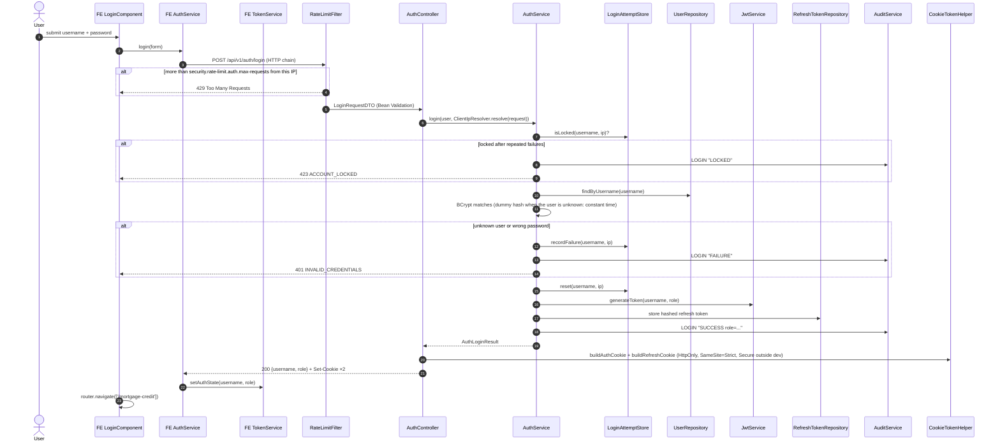
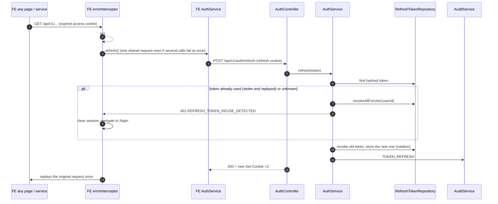

# 1. Login and session refresh

**Journey:** a user types a username and a password on `/login`; the API checks them, sets two HttpOnly
cookies (access token and refresh token) and the portal opens the simulator. Later, when the access token
expires, the portal renews it silently.

## Login

## Silent refresh (access token expired)

## Classes involved

| Layer | Class | Role |
|---|---|---|
| FE page | [`LoginComponent`](https://github.com/LouziAmine/---Bladi-Credit-Portal---/blob/release/2.1.0/src/app/pages/login/login.component.ts) | Form, error message, navigation |
| FE service | [`AuthService`](https://github.com/LouziAmine/---Bladi-Credit-Portal---/blob/release/2.1.0/src/app/core/services/auth-service/auth.service.ts) | `login`, `refresh` (single in-flight request), `logout`, `initAuthState` (`/auth/me` at startup) |
| FE service | [`TokenService`](https://github.com/LouziAmine/---Bladi-Credit-Portal---/blob/release/2.1.0/src/app/core/services/token-service/token.service.ts) | Keeps username and role in memory (the tokens themselves are never readable by JavaScript) |
| FE interceptor | [`errorInterceptor`](https://github.com/LouziAmine/---Bladi-Credit-Portal---/blob/release/2.1.0/src/app/core/interceptors/error.interceptor.ts) | 401 → refresh once → replay, otherwise `/login` |
| Filter | [`RateLimitFilter`](../../src/main/java/com/credit/bladi/config/security/RateLimitFilter.java) | Per-IP limits on login, refresh, logout and simulations |
| Filter | [`JwtAuthFilter`](../../src/main/java/com/credit/bladi/config/security/JwtAuthFilter.java) | Reads the access cookie, reloads the user's authorities from the database |
| Controller | [`AuthController`](../../src/main/java/com/credit/bladi/controller/auth/AuthController.java) | `/auth/login`, `/refresh`, `/logout`, `/me`, `/register` |
| Service | [`AuthService`](../../src/main/java/com/credit/bladi/service/auth/AuthService.java) | Credential check, lockout, token issue and rotation, audit |
| Config | [`LoginAttemptStore`](../../src/main/java/com/credit/bladi/config/security/LoginAttemptStore.java) | Failure counter per username + IP |
| Infrastructure | [`JwtService`](../../src/main/java/com/credit/bladi/infrastructure/security/JwtService.java) | Signs and verifies the access JWT (HMAC) |
| Config | [`CookieTokenHelper`](../../src/main/java/com/credit/bladi/config/security/CookieTokenHelper.java) | Cookie attributes |

## Error cases

Messages are the API's own (`src/main/resources/i18n/exception/`, shown in the user's language).

| Case | HTTP | `errorCode` | Message (en) |
|---|---|---|---|
| Empty or too short field | 400 | `CB-400` | Field error under the input (the form blocks it before the call) |
| Wrong username or password | 401 | `CB-401` | "Invalid username or password." |
| Too many failures for this username from this IP | 423 | `CB-423` | "Account temporarily locked due to too many failed login attempts. Please try again in 15 minutes." |
| Too many requests from this IP | 429 | `CB-429` | "Too many requests. Please try again in 1 minute." |
| Refresh token reused | 401 | `CB-401` | "Refresh token reuse detected. All sessions have been revoked for security reasons. Please log in again." |
