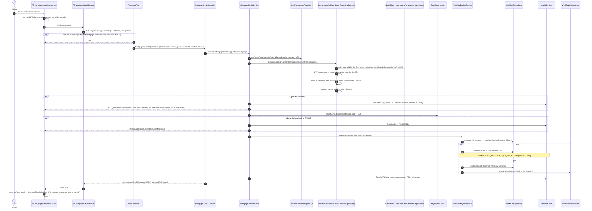

# 2. Mortgage simulation (opens a dossier)

**Journey:** a visitor fills in the mortgage simulator on `/mortgage-credit` and clicks **Simulate**. The API
checks the BAM rules, prices the loan (conventional) or the sale (Mourabaha), opens a dossier in the
`MORTGAGE_RETAIL` workflow and returns the monthly payment, the TEG, the fees, the schedule and the dossier
reference. No account is needed.

## Classes involved

| Layer | Class | Role |
|---|---|---|
| FE page | [`MortgageCreditComponent`](https://github.com/LouziAmine/---Bladi-Credit-Portal---/blob/release/2.1.0/src/app/pages/mortgage-credit/mortgage-credit.component.ts) | Reactive form, `submit()`, loading and error signals |
| FE page | [`MortgageSimulationResultComponent`](https://github.com/LouziAmine/---Bladi-Credit-Portal---/blob/release/2.1.0/src/app/pages/mortgage-credit/mortgage-simulation-result/mortgage-simulation-result.component.ts) | Result cards, fees, schedule |
| FE service | [`MortgageCreditService`](https://github.com/LouziAmine/---Bladi-Credit-Portal---/blob/release/2.1.0/src/app/core/services/mortgage-credit-service/mortgage-credit.service.ts) | `POST /mortgage-credit` |
| FE service | [`ApiErrorMessageService`](https://github.com/LouziAmine/---Bladi-Credit-Portal---/blob/release/2.1.0/src/app/core/services/api-error-message-service/api-error-message.service.ts) | Turns the `ErrorResponse` into the text shown |
| Controller | [`MortgageCreditController`](../../src/main/java/com/credit/bladi/controller/mortgage/MortgageCreditController.java) | Endpoint, validation, mapping |
| DTO | [`MortgageCreditRequestDTO`](../../src/main/java/com/credit/bladi/controller/dto/mortgage/request/MortgageCreditRequestDTO.java) | Input constraints (messages in `i18n/dto/`) |
| Service | [`MortgageCreditService`](../../src/main/java/com/credit/bladi/service/mortgage/MortgageCreditService.java) | Orchestration, audit, TMIC check |
| Strategy | [`ConventionalFinancingStrategy`](../../src/main/java/com/credit/bladi/service/mortgage/conventional/ConventionalFinancingStrategy.java), [`MourabahaFinancingStrategy`](../../src/main/java/com/credit/bladi/service/mortgage/mourabaha/MourabahaFinancingStrategy.java) | Product rules and pricing |
| Engines | [`RateCalculationEngine`](../../src/main/java/com/credit/bladi/service/calculation/RateCalculationEngine.java), [`TaegCalculationEngine`](../../src/main/java/com/credit/bladi/service/calculation/TaegCalculationEngine.java) | Annuity, schedule, TEG |
| Domain | [`BamParametersModel`](../../src/main/java/com/credit/bladi/model/bam/BamParametersModel.java), [`RegulatoryLimits`](../../src/main/java/com/credit/bladi/model/parameters/RegulatoryLimits.java) | BAM ratios, legal ceiling |
| Service | [`WorkflowEngineService`](../../src/main/java/com/credit/bladi/service/workflow/engine/WorkflowEngineService.java) | Opens or refreshes the dossier |
| Repository | [`WorkflowRepository`](../../src/main/java/com/credit/bladi/repository/workflow/WorkflowRepository.java) | `demand`, step and history tables |

## Error cases

| Case | HTTP | Message key (shown in fr / en / ar) |
|---|---|---|
| Missing or malformed field (e-mail, phone `0[5-7]xxxxxxxx`, negative amount...) | 400 | `validation.mortgageCredit.*` |
| Amount above `ltvRatio` × property value | 422 | `bam.depositInsufficient` |
| Age at maturity above the maximum | 422 | `bam.ageLimitExceeded` |
| Duration outside the CSP's range | 422 | `bam.durationLimitExceeded` |
| Monthly payment above the debt ratio | 422 | `bam.debtRatioExceeded` |
| Rate (or TEG, per `MAX_RATE_SIMULATION_BASIS`) above the TMIC | 422 | `regulatoryLimit.rateAboveLegalMaximum` |
| Unknown CSP code | 404 | `mortgageCredit.cspNotFound` |
| No active BAM or Mourabaha grid | 503 | `mortgageCredit.bamParametersNotFound` / `mourabahaParametersNotFound` |
| Too many simulations from this IP | 429 | `security.rateLimited` |
