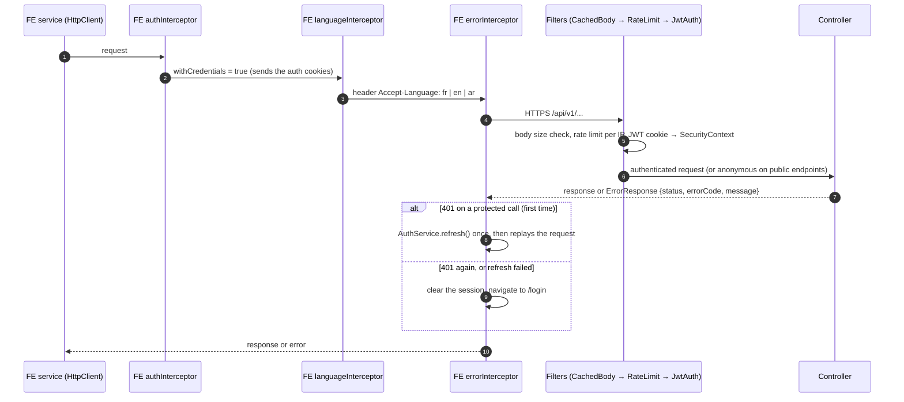

# Feature Flows

One page per feature, from the user's click to the response on screen. Each page has:

1. **The journey** in one sentence.
2. **A sequence diagram** through every class involved, frontend and backend, down to the database.
3. **A table of the classes** with a link to each file.
4. **The error cases**, with their HTTP status and what the user sees.

Start with [Architecture at a Glance](../c4-architecture.md) for the big picture; the business view of the same
journeys is in [End-to-End Flows](../end-to-end-flows.md).

| # | Feature | Who | Page |
|---|---|---|---|
| 1 | Login and session refresh | Everyone | [01-login.md](01-login.md) |
| 2 | Mortgage simulation (opens a dossier) | Public | [02-mortgage-simulation.md](02-mortgage-simulation.md) |

## Conventions used in the diagrams

- `FE` participants live in the [frontend repository](https://github.com/LouziAmine/---Bladi-Credit-Portal---),
  the others in this one.
- Every request goes through the same chain, drawn once here and abbreviated as **HTTP chain** in the pages:

- `alt` blocks are the error branches; `Note` boxes mark the audit entries and notifications.
