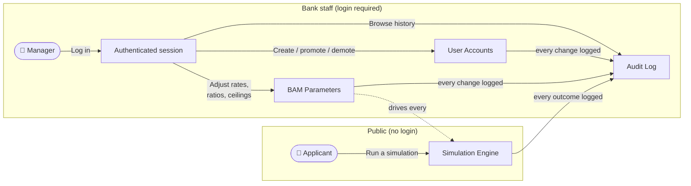

[Back to README](../README.md) · [Enterprise Credit Workflow →](enterprise-credit-workflow.md) · [Glossary](glossary.md)

# Mortgage Credit Simulation Workflow (Business Process)

This is the individual mortgage side of Credit Bladi's business, explained without technical
jargon, for Product Owners, Scrum Masters, and managers who need to understand *what the system
does*, not how it's coded. For business/investment credit aimed at companies (TPE,
Auto-Entrepreneur, PME, ETI, GE), see the
[Enterprise Credit Workflow](enterprise-credit-workflow.md) instead.

## What a "simulation" is

A simulation answers one question for a mortgage applicant: **"If I borrow this amount, under
these conditions, am I eligible, and what will it cost me every month?"**

It's a single request/response exchange. The applicant fills in their info once and immediately
gets either a full cost breakdown or a clear rejection reason. No account, no paperwork, nothing
to sign just to get that answer. An *eligible* simulation also opens a tracked dossier behind the
scenes (see [From simulation to tracked dossier](#from-simulation-to-tracked-dossier)); a *rejected*
one creates nothing.

## The two financing products

The applicant picks a product via the `productType` field (defaults to **Conventional** if left
out). Every other field on the request stays the same either way.

| | Conventional | Mourabaha |
|---|---|---|
| What it is | A standard interest-bearing mortgage | A participative financing without interest (*riba*): the bank finances the purchase and is repaid through a fixed markup. Its Sharia conformity is the bank's Sharia board's call, not the software's |
| What the applicant pays | Principal + **interest** | Principal + a fixed **profit margin (Marge HT)** + **VAT on that margin (TVA sur Marge)** |
| Rate depends on applicant profile? | Yes, each professional category (CSP) has its own rate, see [Applicant Profiles](#applicant-profiles-csp) | No, one bank-wide profit rate and VAT rate applies to every applicant, regardless of profile. The margin in force at simulation is **stored on the dossier**, and the VAT and takaful are frozen at the committee decision: later grid changes never move an existing client's installments |
| Duration limited by profile? | Yes, each profile has its own min/max duration | No, only the general BAM deposit and age-at-maturity rules apply (see checks 2 and 3 below) |
| Cost breakdown returned | Interest, monthly payment, TAEG | Margin HT, VAT on margin, Margin TTC, flat monthly installment (TTC), TAEG |

Both products go through the same BAM compliance checks and land in the same audit trail. What
differs is the pricing math, and the profile-specific duration limit that only applies to
Conventional.

## The 4 scenarios

Every simulation follows the same decision path: the first check that fails stops the process with
a specific reason; if all pass (three for Mourabaha, which has no per-profile duration limit), the
priced offer is finally compared with the legal rate ceiling (TMIC, on the nominal rate or the TEG depending on
`MAX_RATE_SIMULATION_BASIS`) and the applicant gets the full cost breakdown. Either way the outcome is recorded for compliance. The full
diagram, with every HTTP status, is in [End-to-End Flows → §2](end-to-end-flows.md#2-mortgage-simulation--dossier).

## Step by step

**1. The applicant provides their situation**
- Their full name, email and phone number, required so the bank can reach them about the dossier
  if the simulation is eligible (same fields enterprise credit has always collected)
- How much they want to borrow (loan amount)
- The value of the property they want to buy
- How long they want to repay (duration, in months)
- Which product they want: Conventional or Mourabaha (see [The two financing
  products](#the-two-financing-products) above; defaults to Conventional)
- Their professional category, see [Applicant Profiles](#applicant-profiles-csp) below
- Their age
- Their nationality and whether they live in Morocco
- Their monthly income (and, if applicable, a co-borrower's income)

**2. The system checks eligibility against Bank Al-Maghrib (BAM) regulation**

Four checks run automatically, in order. If any one fails, the simulation stops right there and
returns the specific reason: the applicant is never left guessing what went wrong:

| # | Check | Plain-language meaning |
|---|---|---|
| 1 | Duration limit | Does this applicant's profile allow a loan this long? (Different professions have different maximum durations, see below.) |
| 2 | Deposit / down payment | Is the applicant borrowing too large a share of the property's value? The bank requires a minimum personal contribution. |
| 3 | Age at maturity | Will the applicant still be under the bank's maximum age at maturity when the loan is fully repaid? This ceiling is a single bank-configured value (age 75 by default) applied identically to every profile, not just retirees: a borrower's income capacity isn't guaranteed past the same age regardless of current employment status. |
| 4 | Debt-to-income ratio | Would the monthly payment (including mandatory insurance, or the flat Mourabaha installment) take up too large a share of the applicant's income? Banks cap this to protect the borrower from over-indebtedness. |

> Check #1 only applies to **Conventional** financing, since only Conventional rates are tied to a
> profile-specific duration range. **Mourabaha** financing skips straight to checks #2–#4: its
> profit rate and VAT rate are the same for every profile, so there's no per-profile duration limit
> to check in the first place.

**3. If eligible, the system computes the offer**

For a **Conventional** loan:
- The **interest rate** that applies to this applicant's profile
- The **monthly payment** (principal + interest)
- The **ADI insurance premium** (death and disability cover, required by the bank on every mortgage,
  doubled with a co-borrower; see [Insurance](#insurance-adi-for-conventional-takaful-for-mourabaha) below)
- The **all-in monthly payment** (what actually leaves the applicant's account each month)
- The **total cost** of the loan over its full duration, and the **total interest** paid

For a **Mourabaha** financing:
- The **profit margin excluding VAT (Marge HT)**, the **VAT on that margin (TVA sur Marge)**, and
  the **margin including VAT (Marge TTC)**, which replaces interest entirely
- The **flat monthly installment including VAT** the applicant actually pays each month
- The **Takaful contribution** (mandatory, doubled with a co-borrower; see
  [Insurance](#insurance-adi-for-conventional-takaful-for-mourabaha) below)

Either way:
- The **effective annual rate (TAEG)**: the single number Moroccan regulation requires banks to
  disclose, bundling in all fees so different offers are comparable, whichever product was chosen
- The **one-time fees** due at signing: registration, land conservation, notary, and the bank's
  own processing fee
- A full **month-by-month amortization schedule** (tableau d'amortissement), showing, for every
  installment, how much goes to principal versus interest (Conventional) or margin/VAT
  (Mourabaha), and the remaining balance

### Insurance: ADI for Conventional, Takaful for Mourabaha

Both financing products protect the bank against a borrower who can no longer pay (job loss,
death, disability), but each one prices that protection through a mechanism that fits its own
nature. Enterprise credit's insurance step documents this same split between pricing and mechanism
(see [Enterprise Credit Workflow → Insurance: pricing vs. the workflow
step](enterprise-credit-workflow.md#insurance-pricing-and-the-workflow-step-are-two-different-things)):

| | Conventional | Mourabaha |
|---|---|---|
| Mechanism | **ADI** (Assurance Décès-Invalidité): a conventional insurer takes on the risk in exchange for a premium | **Takaful**: a Sharia-compliant cooperative/mutual scheme: every borrower's monthly contribution feeds a shared fund that pays out on behalf of a member who can no longer repay, instead of an insurer profiting from the risk |
| Why different | Conventional interest-bearing credit has no religious constraint on using a conventional insurer | Mourabaha exists specifically to avoid *riba* (interest) and excessive *gharar* (uncertainty): a conventional insurance contract raises the same concerns for a strict Sharia-compliant applicant, so Takaful is the accepted alternative for this product line |
| Priced from | `bam_parameters.adi_monthly_rate` (bank-wide, shared with enterprise credit's own conceptually-similar-but-separately-priced insurance ratio) | `mourabaha_parameters.takaful_monthly_rate` (bank-wide, admin-configurable on the same "Paramètres Mourabaha" screen as the profit/VAT rate: Mourabaha doesn't read `bam_parameters` for pricing, so this needed its own rate rather than sharing ADI's) |
| Doubled for co-borrower? | Yes | Yes: same rule, same rationale: two incomes being protected |
| Folded into TAEG / debt-ratio check? | Yes, `allInMonthlyPayment` (monthlyPayment + ADI) is what's checked against the 40% debt-ratio cap and folded into TAEG | Yes, `allInMonthlyPaymentTtc` (échéance TTC + Takaful contribution) is what's checked and folded into TAEG, the exact same way |

**4. Every simulation is recorded**

Whether it succeeds or gets rejected, the event gets logged with the reason. This isn't optional, 
it's the audit trail BAM inspectors and internal compliance review against. A rejected simulation
is just as important to have on record as a successful one: it's proof the bank's automated system
is actually enforcing the regulation, not just rubber-stamping everything.

## Applicant Profiles (CSP)

The interest rate and the maximum duration depend on the applicant's professional category: the
single biggest lever in the simulation: the same loan can be eligible for one profile and rejected
for another. This only applies to **Conventional** financing; Mourabaha prices every profile
identically.

| Profile | Code | Rate formula (seed range) | Duration allowed | What's different |
|---|---|---|---|---|
| Private-sector employee | `SALA` | `AVERAGE` of 5.00–5.50% | 12–240 months | Standard terms |
| Civil servant | `FONC` | `MIN` of 4.80–5.00% | 12–300 months | Preferential rate, longest duration (stable income) |
| Freelancer / self-employed | `INDE` | `MAX` of 6.00–6.50% | 12–180 months | Higher rate, shorter duration |
| Liberal profession | `PROF` | `MAX` of 5.50–6.00% | 12–180 months | Higher rate, shorter duration |
| Retired | `RETR` | `MIN` of 4.60–4.60% | 12–240 months | Fixed rate; same bank-wide maximum age at maturity as everyone |

Each CSP is one `credit_rate` row: `rateMin`/`rateMax`, a duration range and a `rateFormula`
(`MIN`, `MAX` or `AVERAGE`) that derives the applicable rate: the same generic mechanism
enterprise credit uses per enterprise type. Adding a profile that reuses one of these formulas is a
configuration change (a new `credit_rate` row via the admin API), not code. Only a genuinely new
formula shape needs code (a new `RateFormula` value), and a new financing product means a new
`FinancingCalculationStrategy` implementation.

## From simulation to tracked dossier

Mortgage credit runs on the **same Workflow/Process/Step engine** as enterprise credit. See [Enterprise Credit Workflow → The Workflow/Process/Step
pipeline](enterprise-credit-workflow.md#the-workflowprocessstep-pipeline) for how that engine
itself works (assignment, step history, notifications, documents, comments are all identical for
both products): this section only covers what's specific to mortgage.

The dossier opens at `CLASSIFICATION_STEP`; `POST /classify REAL` sends it into the pipeline,
`FAKE`/`SIMULATION_ONLY` reject it (diagram: [End-to-End Flows → §5](end-to-end-flows.md#5-classifying-a-dossier)).

### Why a dossier at all: an individual isn't a company

Enterprise credit's classification step attaches a demand to an `Enterprise` (a company record) so
future demands from the same client all link into one portfolio. An individual mortgage applicant
just doesn't have that kind of company-style record, so a mortgage demand's `POST /classify`
**skips the Enterprise step entirely**. `REAL` simply confirms the dossier is a genuine request
(not spam, not someone poking at the simulator) and opens the next step directly: no `enterpriseId`,
no RIB capture, no BAM SCIP/Centrale des Risques check panel. `FAKE`/`SIMULATION_ONLY` reject it
exactly like enterprise credit does.

Instead of a company portfolio, a mortgage dossier gets a **borrower**. At classification, the applicant's
e-mail either matches a single existing client account, which is linked to the dossier, or receives an
invitation e-mail; accepting it creates the account and the link in one step. The borrower then follows the
dossier under *Mes crédits immobiliers* in the portal (`GET /me/mortgage-demands`), answers document requests
and, once the credit is granted, sees the schedule and declares payments.

### The 6-step pipeline (workflow `MORTGAGE_RETAIL`)

This one's deliberately much shorter than enterprise credit's 16 steps, since a retail mortgage
applicant doesn't go through the PPIF/PAE committee process. The first step **reuses the exact
same `CLASSIFICATION_STEP`** enterprise credit uses (same code, same row in the `step` table), so
the "genuine vs. spam" gate behaves identically for both products. The remaining five steps are
mortgage-specific.

| Process | Step | Typical role |
|---|---|---|
| Vérification | Validation initiale du dossier avec le client (`CLASSIFICATION_STEP`, shared with enterprise credit) | Chargé d'affaires |
| Instruction | Étude du dossier et calcul définitif | Chargé de clientèle |
| Décision | Décision agence/direction | Directeur d'agence |
| Édition | Édition de l'offre de prêt | Support Administratif |
| Garanties | Garantie hypothécaire / notaire | Chargé de clientèle |
| Déblocage | Déblocage des fonds | Support Administratif |

No mortgage team or grade is seeded yet, so any manager can be proposed for these steps. Once a step is
assigned, only its assignee can act on it or hand it over. Restricting the steps to real teams and grades
later is a seed-data change, not a code change.

`Décision agence/direction` (`MORTGAGE_DECISION_STEP`) is a **four-eyes** step: whoever handled an
earlier step of the dossier cannot take the decision alone (`403 FOUR_EYES_VIOLATION`; enforced in
staging/prod, off in the `dev` profile). A `REJECTED` decision ends the dossier, a `DEFERRED` one can
only be sent back for completion: same rules as enterprise credit, see
[Enterprise Credit Workflow → Two decision modes](enterprise-credit-workflow.md#two-decision-modes).

It is also seeded with
`notify_contact_on_enter_type = DEMAND_IN_DECISION`, the same client "dossier en cours de décision"
notification enterprise credit's `DECISION_STEP` sends. Both steps reuse the exact same generic
mechanism (`step.notify_contact_on_enter_type`, see [Architecture → Design
Patterns](architecture.md#design-patterns), Data-Driven Step Behavior row), so a mortgage applicant
gets notified the moment their dossier hits this step, just like an enterprise applicant does.

### Changing the terms during instruction

A manager may change the amount, rate or duration on any `POST /advance` (`MANUAL` options). The new
terms are re-checked with **exactly the rules the simulation applied** for that product: so a
dossier can never be granted on terms a simulation would have refused:

| Product | Re-checked on changed terms |
|---|---|
| Conventional | Duration allowed for the applicant's CSP, deposit/LTV, age at maturity, debt ratio on the conventional monthly payment + ADI |
| Mourabaha | Deposit/LTV, age at maturity, debt ratio on the TTC installment + Takaful at the new margin |

The applied rate, kept or manual, must stay under the legal maximum (TMIC, `MAX_ANNUAL_RATE`, 14 % by
default), otherwise `422 RATE_ABOVE_LEGAL_MAXIMUM`.

Once the decision step (`MORTGAGE_DECISION_STEP`) is closed, the terms are fixed: a `MANUAL` change at the
offer, guarantee or disbursement step is refused (`409 TERMS_FROZEN_AFTER_DECISION`) until the dossier is
returned to the decision step. The pricing parameters in force at the decision (fees, ADI, Mourabaha VAT and
takaful) are frozen for the dossier at the same moment.

### The dossier reference

Same as enterprise credit: an eligible simulation's response includes a `demandReference`
(e.g. `DEM-3F2A9C1B`) identifying the tracked dossier a Manager can look up at
`GET /api/v1/demands/{id}`, alongside the usual cost breakdown. A rejected simulation still returns
no reference at all, since nothing was created.

### Recomputing the amortization schedule later

`GET /api/v1/demands/{id}/amortization` (documented for enterprise credit
[here](enterprise-credit-workflow.md#rate-amount-and-duration-a-decision-on-every-advance)) works
for a mortgage dossier too: it just dispatches automatically by product:

| Product | What gets recomputed |
|---|---|
| Conventional | Interest-based schedule at the dossier's current (or an explicit override) rate/amount/duration: identical mechanics to enterprise credit |
| Mourabaha | Margin-based schedule (Marge HT / TVA / Marge TTC / échéance TTC) plus the Takaful contribution, at the **margin agreed on the dossier** (set at simulation, or by a `MANUAL` decision before the committee), with the VAT and takaful frozen at the decision, or an explicit override. The credit file's installments are generated the same way, so a later change to the bank's grid never changes the price a client already agreed to |

## Who can do what

| Role | Can do |
|---|---|
| **Applicant / public visitor** | Run simulations. No login required: this is the product's front door, it must have zero friction. |
| **Borrower (client account linked to the dossier)** | Follow the dossier in the portal, answer document requests, see the schedule, declare payments. |
| **Manager (bank staff)** | Everything above, plus: adjust the regulatory parameters every simulation uses, manage staff accounts, read the audit log, and run the dossier: classify, assign, advance or return, comment, handle documents, read the step and assignment history. |

## Why the regulatory parameters are adjustable, not hardcoded

BAM's rules (maximum debt ratio, minimum deposit, fee ceilings, insurance rate, etc.) aren't fixed
in the code. They live in a single configuration a Manager can update straight through the app.
This matters for the business because:
- BAM can change these thresholds, and the bank needs to comply the same day, not wait around for
  a new software release
- Every change is tracked (who changed what, from what value to what value, and when): the same
  compliance audit trail mentioned above covers configuration changes too, not just simulations
- A dossier keeps the terms it was granted on: the rate or margin is stored on the dossier, and the fees,
  insurance, VAT and takaful are frozen at the committee decision, so editing a grid only affects new
  simulations and dossiers not yet decided
