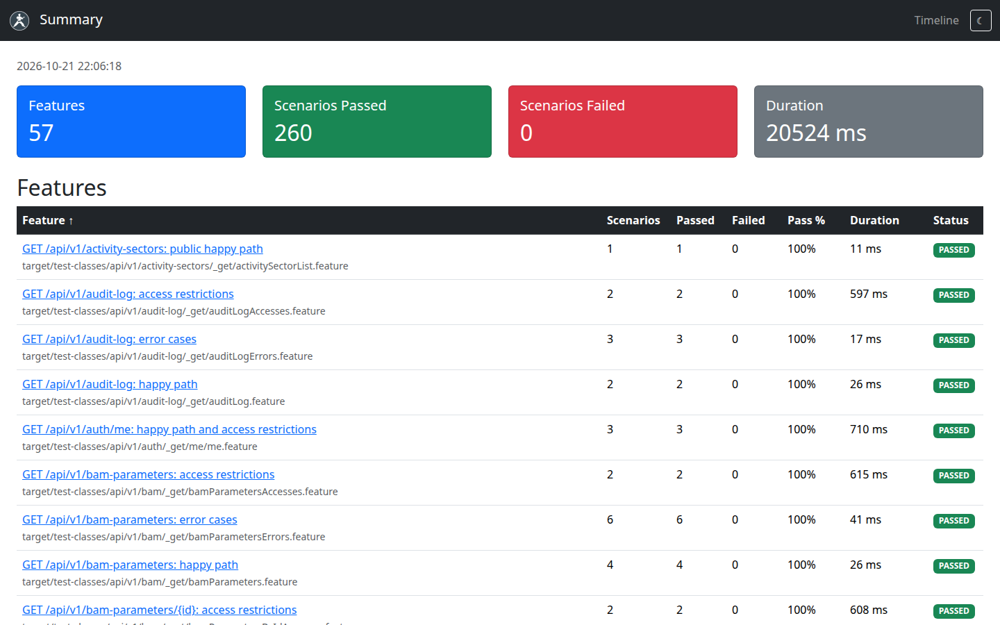
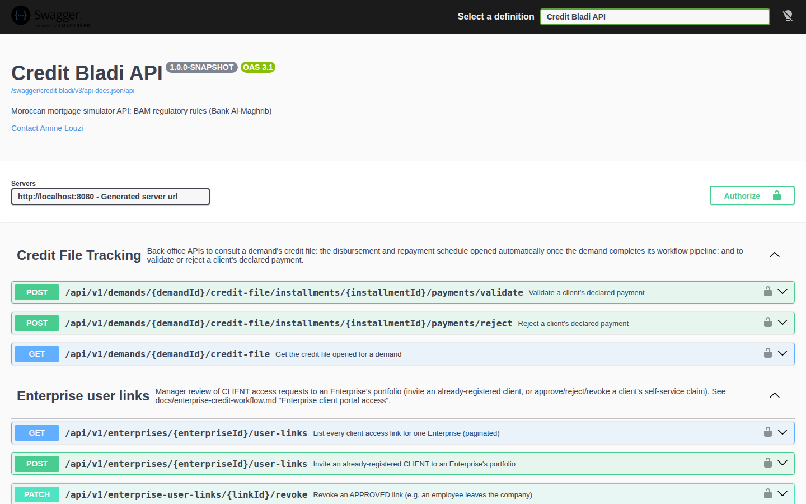
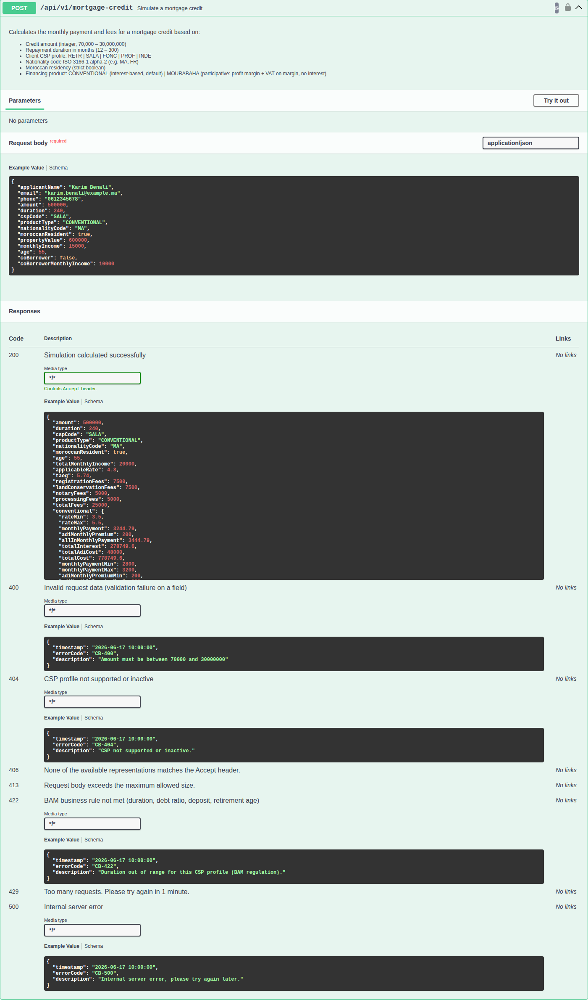

[Back to README](../README.md)

# Testing

## Commands

| Suite | Command | Needs |
|---|---|---|
| Unit tests (JUnit 5, Mockito, ArchUnit) | `./mvnw test -Dtest='com.credit.bladi.unittest.**'` | Nothing |
| Integration (Karate) | `./mvnw test -Dtest=IntegrationTest` | A free port 8080, or `-Dserver.port=8081` |
| Everything above, plus JaCoCo | `./mvnw test` (report in `target/site/jacoco/`) | Same |
| Live end-to-end scenarios | `python3 scripts/e2e/run_e2e.py` | The app running, see below |
| Code style | `./mvnw checkstyle:check` | Nothing |
| Load test (Gatling) | `./mvnw gatling:test` | The app running |
| Dependency vulnerabilities (OWASP Dependency-Check) | `./mvnw org.owasp:dependency-check-maven:check` | Network, ideally `NVD_API_KEY` |
| Dynamic security scan (OWASP ZAP) | `./security/run-zap-scan.sh` | Docker and the app running |

`./run-tests.sh` offers the same commands as a menu. The CI pipeline runs `./mvnw verify` and Checkstyle on
every push ([Deployment](deployment.md)).

## Current results (2026-10-21)

| Suite | Result |
|---|---|
| Unit tests | 1,378 tests, all passing, including the 7 ArchUnit layer rules |
| Karate | 57 features, 260 scenarios, all passing |
| Coverage (unit tests and Karate) | 79.3 % instructions, 66.3 % branches, 80.1 % lines |
| Live end-to-end scenarios | 60 scenarios, all passing |
| Front-end browser tests against this API | 130 Playwright tests, all passing (front-end repository) |
| Checkstyle | 0 violations in `src/main` and `src/test` |

Gatling, Dependency-Check and ZAP have no current run: their last reports targeted an older version. Run them
before a release; the commands are above.

## Unit tests

Unit tests start no Spring context. `unittest/architecture/ArchitectureTest` checks the layer rules described
in [Architecture at a Glance](c4-architecture.md#backend-layers).

**Test data.** Tests never hard-code business values. Usernames, names, e-mails, phones, RIBs, company names,
dossier references, codes, labels, dates, amounts and rates are defined once in
`src/test/java/com/credit/bladi/unittest/mock/data/` (`MockUsers`, `MockContacts`, `MockCodes`, `MockLabels`,
`MockDates`, `MockAmounts`, `MockFiles`, `MockTokens`) and imported statically. Builders for whole objects
(`MockDemand`, `MockAuth`, `MockMortgageCredit`) sit next to them in `unittest/mock/`. Add a new value to the
matching class rather than writing a literal in a test.

## Karate

`IntegrationTest` boots the application (`@SpringBootTest`, `dev` profile) on an in-memory H2 database:
`src/test/resources/application.properties` replaces the main one on the test classpath, so no Docker is
needed. Each endpoint has its own folder under `src/test/java/.../integration/api/v1/`, usually with a
success feature, an error feature and an access feature. Every placeholder a bean reads at startup must also
be declared in the test `application.properties`, or the context does not start.

Report (`target/karate-reports/karate-summary.html`); click a feature to see each request and response:



## Live end-to-end scenarios

`scripts/e2e/run_e2e.py` walks every journey of [End-to-End Journeys](end-to-end-flows.md) through the API of
a running application, with the real PostgreSQL, ClamAV, Mailpit (invitation e-mails are read back) and
encrypted storage. It creates staff for every grade and team (two each, for the four-eyes rule) and uses a
random suffix on every name, so it can be repeated on the same database.

```bash
docker compose up -d
./mvnw spring-boot:run -Dspring-boot.run.profiles=dev -Dspring-boot.run.arguments="\
--security.rate-limit.auth.max-requests=1000 --security.rate-limit.mortgage-credit.max-requests=1000 \
--workflow.four-eyes.enabled=true"
pip install requests
python3 scripts/e2e/run_e2e.py      # E2E_BASE_URL and E2E_MAILPIT_URL to override the defaults
```

The rate limits are raised because the run logs in and simulates many times from one IP. The four-eyes rule
is off by default in dev for single-user convenience; the run turns it on. A JSON report is written to
`scripts/e2e/e2e-report.json`.

## Swagger UI

`http://localhost:8080/swagger/credit-bladi/v3/swagger-ui.html` once the app runs. One group per controller,
each endpoint with its request schema, an example payload and every response it can return, generated from
the controllers' `@Operation` and `@ApiResponse` annotations. The API is cookie-based: log in through
`POST /api/v1/auth/login` first, then **Try it out** works on protected endpoints.



`POST /api/v1/mortgage-credit` expanded:



`springdoc.swagger-ui.version` is pinned to the same `swagger-ui.version` Maven property as the
`org.webjars:swagger-ui` override in `pom.xml`. Keep them equal: when they differ, the UI page returns 404.

## Load test (Gatling)

`src/test/java/com/credit/bladi/perf/` replays public mortgage simulations (one scenario per CSP, a unique
applicant per iteration) and a few authenticated admin calls. Run it against an instance sized like production (for
example the production connection pool of 10) and read `target/gatling/<simulation>/index.html`: response time
percentiles per request, errors, and how latency follows the load.

Latest result for 2.1.0, on the `dev` Docker stack with the backend limited to 2 CPUs: 5,800 requests at about
39 per second, 99.7 % successful, 95th percentile at 216 ms (99th at 455 ms). Both assertions pass (at least 99 %
of successful calls, 95th percentile under 2 s). The few failed calls are simulations refused by a BAM rule, as
expected for some random applicants.

## Security scans

- **Dependency-Check**: report in `target/dependency-check-report.html`. Reviewed false positives are listed,
  with a reason, in `security/dependency-check-suppressions.xml`; patched versions are pinned in `pom.xml`
  (`tomcat.version`, `netty.version`, `log4j2.version`, `swagger-ui.version`).
- **ZAP**: report in `security/zap-report.html`. It scans the endpoints listed in
  `security/zap-automation.yaml`, logged in as the demo manager.

## Postman

[`postman/`](../postman/) holds a collection and its environment, ready to import. It has two parts:

- **1. End-to-end journey**: 35 ordered requests with tests, on a fresh `dev` database. It creates its own staff
  accounts, simulates a mortgage and an investment loan, classifies both, checks the four-eyes rule, grants and
  disburses the mortgage, reads the credit file, then checks the client and anonymous access rules. A suffix per
  run makes it repeatable.
- **2. API reference**: every operation of the API, grouped like Swagger, with an example body.

Run the journey from the command line with Newman, Postman's runner:

```bash
npx newman run postman/Credit-Bladi.postman_collection.json \
  -e postman/Credit-Bladi.postman_environment.json --folder "1. End-to-end journey"
```

The collection is generated from the running API's OpenAPI document. After an API change, start the app on
the `dev` profile and regenerate it:

```bash
node scripts/postman/generate-collection.mjs
```
