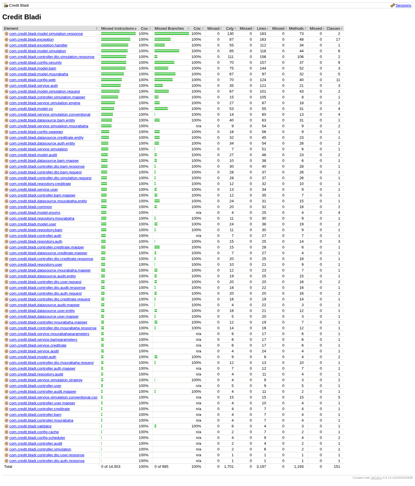
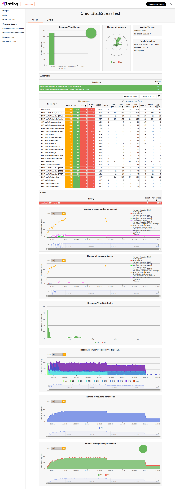
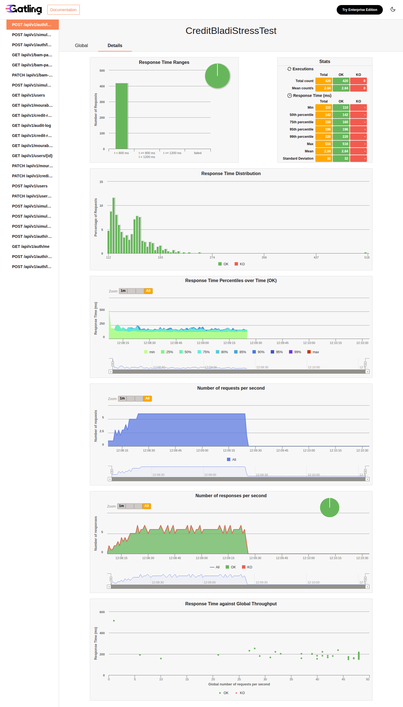
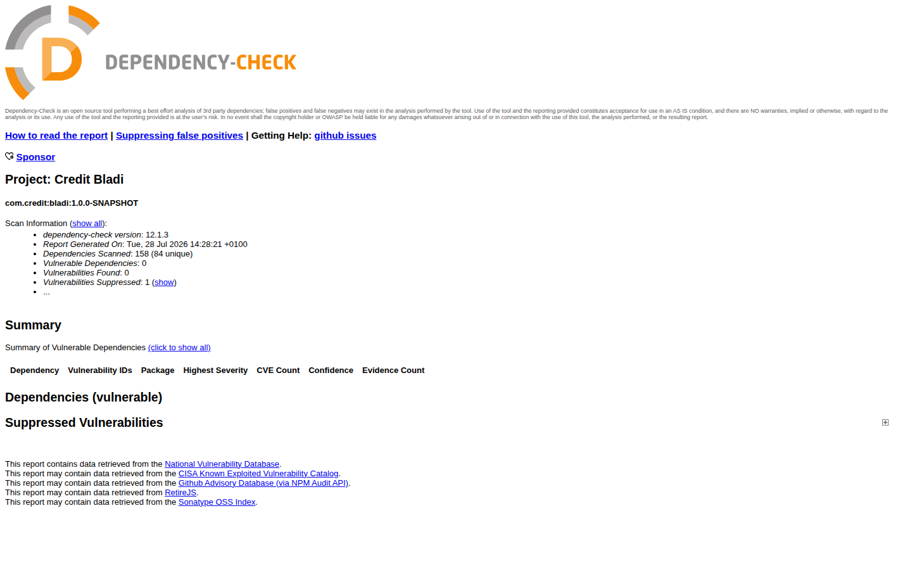
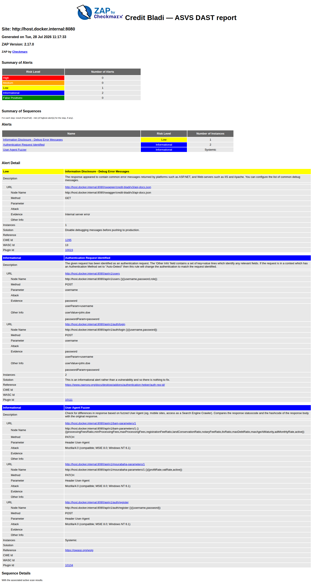

[← Back to README](../README.md)

# Running Tests

```bash
# Unit + integration tests
./mvnw test

# Performance tests (Gatling)
./mvnw gatling:test
```

Karate BDD integration tests require the application running on the `dev` profile.

## Reference Results

| Suite | Command | Result |
|---|---|---|
| Unit tests (JUnit 5 / Mockito) | `./mvnw test -Dtest="com.credit.bladi.unittest.**"` | **894 tests, 0 failures, 0 errors** (`BUILD SUCCESS`) |
| Karate (integration) | `./mvnw test` | **52 features / 250 scenarios, all passed** in ~14s |
| Checkstyle | `./mvnw checkstyle:check` | **0 violations** (`BUILD SUCCESS`) |
| JaCoCo coverage | generated by `./mvnw test` | **100% instructions, 100% branches** covered |
| Gatling (performance) | `./mvnw gatling:test` | **5,600 requests, 99.93% under 800ms**, 95th percentile 193ms, both assertions `OK` |
| Dependency-Check (SCA) | `./mvnw org.owasp:dependency-check-maven:check` | **0 vulnerable dependencies** (158 scanned, 84 unique) |
| ZAP (DAST) | `./security/run-zap-scan.sh` | **0 High, 0 Medium, 1 Low, 2 Informational** |

### Unit tests: JaCoCo coverage report

`target/site/jacoco/index.html`, opened after `./mvnw test`:



Reading this table:
- **Element**: one row per Java package (`com.credit.bladi.<layer>`).
- **Missed Instructions / Cov.**: bytecode instructions never executed by a test, and the resulting
  percentage covered. The green/red bar is a visual proportion of the same number.
- **Missed Branches / Cov.**: `if`/`switch` branches (e.g. both sides of a condition) that were
  never both exercised. Stricter than instruction coverage alone.
- **Cxty (Complexity)**: cyclomatic complexity summed for the package, i.e. how many independent
  paths exist through its code. Higher means more test cases are needed to fully cover it.
- **Lines / Methods / Classes**: raw counts, each with its own "Missed" column.

Every package sits at 100% instructions and 100% branches. Every line and every conditional path in
the codebase is exercised by the test suite.

### Karate: integration test summary

`target/karate-reports/karate-summary.html`, generated by `./mvnw test`:


Reading this report:
- **Features**: one `.feature` file per endpoint/scenario group. 52 in this project, mirroring the
  `_get`/`_post`/`_patch` folders under `src/test/java/.../integration/api/v1/`, split roughly into
  a happy-path feature, an error-cases feature, and an access-restrictions feature per endpoint.
- **Scenarios Passed / Failed**: individual `Scenario:` blocks inside those features, 250 in total.
  Each one exercises the real embedded Spring Boot app (via `@SpringBootTest`) against a real HTTP
  call, not a mock.
- **Duration**: wall-clock time for the whole suite, around 14s here. Fast because Karate reuses
  the single embedded server context across all 52 features.
- The **Feature table** underneath lists every feature with its own scenario count and per-feature
  duration. Clicking a feature name in the live report drills into the request/response of every
  step.

### Swagger UI: live API documentation

Available at `http://localhost:8080/swagger/credit-bladi/v3/swagger-ui.html` once the app is
started (`./run-tests.sh` → option 6):


Reading this page:
- **Header (title, version, OAS badge)**: pulled from `credit.bladi.swagger.config.*` in
  `application.properties`. The API name, version (`1.0.0-SNAPSHOT`), and the OpenAPI spec version
  it's rendered from (`OAS 3.1`).
- **Servers**: the base URL Swagger will call when you hit "Try it out", `http://localhost:8080`
  here since it's the dev instance.
- **Authorize**: opens the auth dialog. This API is cookie-based (see [Security
  Model](../README.md#security-model)), so authorizing here means logging in via
  `/api/v1/auth/login` first so the browser holds the `cb_access_token` HttpOnly cookie.
- **Tag groups** (`Audit Log`, `User Management`, `Authentication`, …): one per `@Tag` on a
  controller, matching the [API Endpoints](api.md#api-endpoints) table.
- **Each endpoint row**: HTTP verb badge (color-coded: blue `GET`, green `POST`/`PATCH`), path,
  and one-line summary. Expanding a row shows the full request schema, response schemas per status
  code, and a live "Try it out" form.

> **Note**: `springdoc.swagger-ui.version` in `application.properties` is pinned to the same
> `swagger-ui.version` Maven property as the CVE override on `org.webjars:swagger-ui` in `pom.xml`,
> so the two can never drift apart. Springdoc bakes this version into the static resource path it
> serves the UI from, and a mismatch 404s `swagger-ui/index.html` under the custom nested
> `swagger-ui.path` used here. (`/webjars/swagger-ui/**` is unaffected: Spring Boot resolves that
> mapping's version dynamically from the classpath instead of baking it in.)

### Swagger UI: endpoint detail

The list view above only shows one line per endpoint. Expanding one (click its row, or open it
directly via deep link, e.g. `...swagger-ui.html#/Credit_Simulation/simulate`) reveals the actual
contract. `POST /api/v1/simulation` expanded:


Reading this view:
- **Description**: the free-text block under the path, from the controller method's `@Operation`
  Javadoc. Here it's the five fields BAM eligibility depends on and their valid ranges, straight
  from the [Simulation Workflow](business-workflow.md#simulation-workflow-business-process) rules.
- **Parameters / Request body**: `Request body` is marked **required**. The **Example Value** tab
  shows a realistic pre-filled JSON payload (generated by springdoc from the DTO's validation
  annotations and `@Schema` examples); the **Schema** tab next to it switches to the type-level
  contract (field types, which are required, min/max) instead of a sample instance.
- **Responses table**: one row per HTTP status the endpoint can actually return, each with its own
  example payload: `200` (full cost breakdown), `400`/`404`/`422` (the specific `ApiException`
  subtypes from [Error Handling](api.md#error-handling), each with a real `errorCode` like
  `CB-422`), `429` (rate limiting), `500`. This is generated directly from the method's
  `@ApiResponse` annotations, so it can never drift from what the controller actually throws.
- **Try it out**: switches the whole block into an editable form that fires a real HTTP request
  from the browser to the `Servers` URL above and shows the live response, instead of just the
  static example.

### Gatling: performance test report (Global)

`target/gatling/<simulation>/index.html`, generated by `./mvnw gatling:test` (requires the app
running on `:8080`, simulation class `com.credit.bladi.perf.CreditBladiStressTest`):



Reading this report:
- **Response Time Ranges / Number of requests**: the two donut/bar charts at the top summarize
  every request across the whole run. How many landed under 800ms, between 800ms and 1200ms, at
  or above 1200ms, or failed outright.
- **Assertions**: the pass/fail thresholds defined for the run (95th percentile under 2000ms,
  success rate ≥ 99%), both `OK` here.
- **Requests table**: one row per simulated request type (e.g. `POST /api/v1/simulation [SALA]`,
  `POST /api/v1/auth/login [admin]`), each with its own execution count and response-time
  percentiles (min, 50th/75th/95th/99th, max, mean, std dev). This is where a slow endpoint would
  stand out from the rest.
- **Errors**: any assertion failures grouped by cause. The one here
  (`status.find.is(200), found 422`) is an intentionally out-of-range scenario correctly rejected
  by BAM validation, not a bug.
- **Time-series charts** (users started, concurrent users, response time percentiles, requests/sec,
  responses/sec): how load and latency evolved second-by-second over the run, useful for spotting
  degradation as concurrency ramps up rather than just the final aggregate numbers.

### Gatling: per-request drill-down (Details)

The **Global** tab aggregates every request together. The **Details** tab (left sidebar lists every
simulated request) breaks the same charts down for a single request type, here
`POST /api/v1/auth/login [admin]`:



Reading this view:
- **Sidebar**: every request type in the simulation. Clicking one reloads the whole page scoped to
  just that request, including the **Stats** table and every chart below it.
- **Stats table**: the same percentile breakdown as the Global table's row for this request, plus
  min/max/mean/std-dev. Useful when the aggregate numbers hide a single consistently-slow endpoint.
- **Response Time Distribution**: a histogram (not just a single percentile number) of exactly how
  this request's response times were spread out.
- **Response Time Percentiles over Time / requests per second / responses per second**: the same
  three time-series as the Global view, but isolated to this one request, e.g. to check whether
  *this specific* endpoint degraded as load ramped up, independent of the others.
- **Response Time against Global Throughput**: scatter plot correlating this request's latency
  against the *system-wide* requests/sec at that moment. This is where a request that only slows
  down under overall system load, not its own load, would show up.

### OWASP Dependency-Check: SCA scan report

`target/dependency-check-report.html`, generated by
`./mvnw org.owasp:dependency-check-maven:check` (no running app needed; downloads NVD/GitHub
Advisory/RetireJS data. Set `NVD_API_KEY` or the first run can take hours):



Reading this report:
- **Scan Information**: dependencies scanned (including transitive ones) vs. unique artifacts.
- **Summary of Vulnerable Dependencies**: one row per dependency with a matched CVE, its highest
  severity, and how many CVEs matched. Expand "click to show all" for the full CVE detail per
  dependency (description, affected version range, CVSS vector, fix version).
- **Suppressed Vulnerabilities**: reviewed false positives excluded from the count above, each with
  a `<notes>` justification in `security/dependency-check-suppressions.xml`.
- This run found **0 vulnerable dependencies** (1 suppressed: `CVE-2022-31691` on
  `spring-boot-devtools`, a dev-only dependency Spring Boot's plugin excludes from the production
  jar). A prior scan had flagged `tomcat-embed-core` (CRITICAL), `netty-transport` (HIGH), and
  `log4j-core` (MEDIUM) for CVEs that were real, not false positives: the pinned versions in
  `pom.xml` were behind the patched releases. Bumped `tomcat.version` to 11.0.24, `netty.version`
  to 4.2.16.Final, added `log4j2.version` 2.25.5, and `swagger-ui.version` to 5.32.11 to resolve
  them; the full test suite (unit + Karate) was re-run and still passes after the bump.

### OWASP ZAP: DAST scan report

`security/zap-report.html`, generated by `./security/run-zap-scan.sh` (requires Docker and the app
running on `:8080`; scans the endpoints listed in `security/zap-automation.yaml`, authenticated as
the `manager` user):



Reading this report:
- **Summary of Alerts**: findings bucketed by risk (`High`/`Medium`/`Low`/`Informational`), each a
  distinct vulnerability class, not a per-request count.
- **Alerts table**: one row per finding type with its number of instances (how many
  requests/parameters triggered it).
- **Alert Detail**: for each finding, its description, the exact URL/method/parameter that
  triggered it, the evidence ZAP matched on, a suggested solution, and its CWE/WASC reference IDs
  for cross-referencing against other scanners.
- This run found **0 High, 0 Medium, 1 Low, 2 Informational**. All three are expected, not
  vulnerabilities. The `Low` finding matched the literal string "Internal server error" on
  `/api-docs.json`, which is the documented `500` response *example* in the controllers'
  `@ApiResponse` annotations (e.g. `ISimulationController.java`), not a real debug leak. The two
  `Informational` entries are ZAP correctly recognizing the login/register endpoints as
  authentication requests and its own User-Agent fuzzer probing every endpoint.

## Postman

A ready-to-import collection covering all 21 endpoints listed in the [API
Reference](api.md#api-endpoints) (nominal, access-restriction, and error scenarios) lives in
[`postman/`](../postman/): `Credit-Bladi.postman_collection.json` +
`Credit-Bladi.postman_environment.json`.

A few things to know before running it:

- **Auth is cookie-based**, not Bearer. `login` / `register` / `refresh` set two HttpOnly cookies
  (`cb_access_token`, `cb_refresh_token`); the JWT is never in the response body. The collection
  captures each session's cookie value into a variable (`client_access_token` /
  `manager_access_token`) and replays it via an explicit `Cookie` header on protected requests.
- Run with the **`dev` profile** locally (`security.cookie.secure=false`) so the cookies persist
  over plain `http://localhost:8080`.
- Run `🔐 Auth / auth` first (register CLIENT, then login CLIENT + MANAGER); every other folder
  depends on the session variables it captures.
- `authAccountLockout` is intentionally isolated from the rest of `auth`. See its folder
  description before running it; it conflicts with the global rate limiter (`RateLimitFilter`, 5
  req/min on `/login`) if run back-to-back with the nominal login flow.
- The collection stays under every `RateLimitFilter` ceiling for a single top-to-bottom run.
  Re-running it immediately afterward (e.g. via Collection Runner) may need a short pause.